# 17. Tư liệu để viết báo cáo dự án FAB Seafood

Tài liệu này gom **mọi thông tin cần để viết một bản báo cáo đồ án** về dự án, sắp theo bố cục báo cáo hay dùng: Mở đầu → Chương 1 (tổng quan, cơ sở lý thuyết) → Chương 2 (phân tích, thiết kế) → Chương 3 (cài đặt, kết quả, kiểm thử) → Kết luận → Phụ lục.

- Mọi số liệu, quy tắc, sơ đồ đều lấy từ **code thật**, không lấy từ tài liệu cũ. Bản đầu viết theo commit `801bacc` (27/10/2026); **cập nhật 19/11/2026** thêm: lý do hủy đơn hàng, tài khoản nhân viên demo, Chủ nhà hàng ngang quyền Admin, trang **Vệ sinh** (tạp vụ), **Lễ tân chuyển / xếp bàn**, trang **Kỹ thuật** (thiết bị, sửa chữa, bảo trì); **cập nhật 22/11/2026** thêm: thực đơn hải sản mới 12 nhóm / 70 món, hải sản sống **bán theo kg** (web không đặt online được, tại quán hồ hải sản **cân** rồi mới tính tiền, trang **Cân hải sản**), khối **Best seller** ở trang chủ ([docs/24](24-thuc-don-ban-theo-kg.md)); **cập nhật 23/11/2026**: người nhập số kg món bán theo kg đổi từ hồ hải sản (web) sang **phục vụ nhập ngay tại hồ trên app** (màn S14), trang Cân hải sản thành trang theo dõi + cân lại của hồ hải sản / quản lý; thêm **Tồn hồ hải sản** ([docs/27](27-ton-ho-hai-san.md)): 6 loại hải sản sống trong hồ, nhập hàng / kiểm hồ / hao hụt, sổ nhập - xuất, tự trừ hồ khi phục vụ cân món; **cập nhật 24/11/2026**: app có thêm nhóm **Quản lý** ([docs/28](28-app-quan-ly.md)) - doanh thu hôm nay / tháng này, đơn đã hủy kèm lý do, bàn đang phục vụ, bia & nước, tồn hồ; và **kiểm bia nước cuối ngày** ([docs/29](29-kiem-bia-nuoc.md)) - xuất ra quầy theo thùng, lệch âm = thiếu hàng.
- **Cập nhật 22/11/2026 (lần 2):** thêm phần **ăn tại quán** và **app nhân viên phục vụ** ([docs/23](23-app-nhan-vien-phuc-vu.md), [docs/19](19-app-mobile.md)): tác nhân, use case UC13 đến UC16, quy tắc R48 đến R60, sơ đồ trạng thái đơn tại quán, sơ đồ tuần tự gửi bếp → thu tiền, 17 màn app, ca kiểm thử TC68 đến TC81; giao diện trang khách mới ([docs/25](25-giao-dien-trang-khach.md)); bảng đối chiếu với đề cương (mục 2.3). Từ 20/11 app mobile **chỉ dành cho nhân viên**, khách dùng website.
- Thêm tính năng mới thì cập nhật file này ở các mục: 1 (số liệu), 2.3 (phạm vi, đối chiếu đề cương), 2.5 (tiến độ), 4.1 + 4.4 (tác nhân, bảng tác nhân × use case), 4.2 (mã KH / QT / PV), 4.5, 4.6, 4.7, 4.10, 4.11, 4.12, 4.13, 5.4, 5.6, 7. Mã đang dùng tới: KH19, QT23, PV15, QL03, A23, UC16, R60, TC81, ảnh #68, kỹ thuật 5.3 số 25, bảo mật #26, TC87.
- Chỗ ghi **[Tự điền]** là thông tin chỉ bạn biết: lớp, khóa, giảng viên, ảnh chụp, kết quả chạy thử, lý do điều chỉnh so với đề cương... (tên đề tài, trường, khoa, tên sinh viên đã lấy từ đề cương).
- Các sơ đồ viết bằng Mermaid. Muốn chèn vào Word: dán code sơ đồ vào https://mermaid.live rồi tải PNG/SVG.

## Mục lục

0. [Cách dùng tài liệu này](#0-cách-dùng-tài-liệu-này)
1. [Thông tin chung và số liệu nhanh](#1-thông-tin-chung-và-số-liệu-nhanh)
2. [Mở đầu](#2-mở-đầu)
3. [Chương 1: Tổng quan và cơ sở lý thuyết](#3-chương-1-tổng-quan-và-cơ-sở-lý-thuyết)
4. [Chương 2: Phân tích và thiết kế hệ thống](#4-chương-2-phân-tích-và-thiết-kế-hệ-thống)
5. [Chương 3: Cài đặt, kết quả và kiểm thử](#5-chương-3-cài-đặt-kết-quả-và-kiểm-thử)
6. [Bảo mật](#6-bảo-mật)
7. [Kết luận và hướng phát triển](#7-kết-luận-và-hướng-phát-triển)
8. [Tài liệu tham khảo](#8-tài-liệu-tham-khảo)
9. [Phụ lục](#9-phụ-lục)

---

## 0. Cách dùng tài liệu này

| Phần trong tài liệu này | Đưa vào phần nào của báo cáo |
|---|---|
| 1. Thông tin chung | Trang bìa, tóm tắt, mở đầu |
| 2. Mở đầu | Lý do chọn đề tài, mục tiêu, phạm vi, phương pháp, tiến độ |
| 3. Chương 1 | Khảo sát bài toán, công nghệ sử dụng, cơ sở lý thuyết |
| 4. Chương 2 | Tác nhân, yêu cầu, use case, quy tắc nghiệp vụ, sơ đồ trạng thái / tuần tự, kiến trúc, CSDL, API, phân quyền, giao diện |
| 5. Chương 3 | Môi trường, cấu trúc code, kỹ thuật nổi bật, ảnh màn hình, kiểm thử, triển khai |
| 6. Bảo mật | Có thể để thành 1 mục riêng trong Chương 2 hoặc Chương 3 |
| 7. Kết luận | Kết quả đạt được, hạn chế, hướng phát triển |
| 8. Tài liệu tham khảo | Danh mục tài liệu tham khảo |
| 9. Phụ lục | Câu hỏi bảo vệ, kịch bản demo, thuật ngữ |

**Việc bạn phải tự làm:**
- Chụp ảnh màn hình theo danh sách ở [mục 5.4](#54-kết-quả-các-màn-hình-đã-làm-ảnh-cần-chụp) (ảnh app chụp trên máy ảo Android hoặc điện thoại, cách chạy ở [docs/19](19-app-mobile.md) mục 1).
- Chạy các ca kiểm thử ở [mục 5.6](#56-kiểm-thử) rồi ghi kết quả thật vào cột "Kết quả".
- Điền thông tin còn thiếu: lớp, khóa, giảng viên hướng dẫn, ngày bảo vệ; xác nhận lại cột "Lý do" ở bảng đối chiếu đề cương (mục 2.3).

---

## 1. Thông tin chung và số liệu nhanh

| Mục | Nội dung |
|---|---|
| Tên đề tài (theo đề cương) | XÂY DỰNG HỆ THỐNG FAB – NỀN TẢNG QUẢN LÝ NHÀ HÀNG ĐA KÊNH (WEBSITE, MOBILE APP, ADMIN/STAFF VÀ KDS) |
| Trường, khoa | Trường Đại học Kiến trúc Đà Nẵng, Khoa Công nghệ Thông tin |
| Tên sản phẩm | FAB Seafood (app nhân viên: "FAB Phục vụ") |
| Loại sản phẩm | Hệ thống 3 kênh dùng chung 1 REST API và 1 cơ sở dữ liệu: website khách hàng (SPA), web quản trị cho nhân viên theo vai trò (gồm **Phiếu bếp** đóng vai KDS, **Thanh toán tại bàn**, **Cân hải sản**, **Tồn hồ hải sản**), app mobile Flutter cho nhân viên: phục vụ gọi món tại bàn và **quản lý xem doanh thu / đơn hủy** ([docs/19](19-app-mobile.md), [docs/23](23-app-nhan-vien-phuc-vu.md), [docs/28](28-app-quan-ly.md)) |
| Sinh viên thực hiện | Võ Đình Ngưu (làm một mình); lớp, khóa: [Tự điền] |
| Giảng viên hướng dẫn | [Tự điền] (đề cương còn để trống) |
| Thời gian thực hiện | Đề cương: 15 tuần, 08/09/2026 đến 21/12/2026. Code: 01/10/2026 (commit đầu) đến 24/11/2026, 24 commit, commit cuối `47bba59`; phần giao diện trang khách mới ([docs/25](25-giao-dien-trang-khach.md)), nhóm Quản lý trên app, kiểm bia nước, tồn hồ hải sản chưa commit. Khi chốt báo cáo đếm lại bằng `git rev-list --count HEAD` |
| Mã nguồn | Repo GitHub công khai [Tự điền link] |
| Bối cảnh giả định | Nhà hàng hải sản ở Đà Nẵng (địa chỉ mẫu: 123 Võ Nguyên Giáp, Sơn Trà), mở cửa 10:00 đến 22:00, 3 khu vực ăn |

**Số liệu đo trên code (dùng cho phần tóm tắt / kết quả):**

| Hạng mục | Số lượng |
|---|---|
| Backend (`backend/src`) | 64 file JavaScript, khoảng 4.000 dòng |
| Schema + dữ liệu mẫu (`backend/prisma`) | khoảng 1.100 dòng (`schema.prisma`, `seed.js`, `seed-staff.js`, `menu.js`), 14 lần migration |
| Frontend (`frontend/src`) | 87 file, khoảng 8.600 dòng |
| App mobile (`mobile/`) | `lib/` 67 file Dart, khoảng 8.800 dòng; `test/` 14 file, khoảng 1.900 dòng |
| Tài liệu (`docs/`) | 24 file Markdown khác, khoảng 6.000 dòng (chưa tính file này) |
| Bảng dữ liệu | 17 bảng, 14 kiểu liệt kê (enum) |
| API | 94 endpoint: 15 module + 2 route chung (`/health`, `/info`); riêng ăn tại quán (`/dine-in`) 16 endpoint |
| Trang giao diện web | 37 trang: 12 trang khách, 3 trang tài khoản, 22 trang quản trị (9 trang chung + 4 trang Vệ sinh + 4 trang Kỹ thuật + 5 trang Tại quán: Tồn hồ hải sản, Cân hải sản, Phiếu bếp, Thanh toán tại bàn, In bill) |
| Màn app nhân viên | 17 màn (S01 đến S17): 13 màn hình + 4 bottom sheet (S07 Ghi chú món, S09 Gửi thanh toán, S12 Check món, S13 Hủy món); chuyển giữa 4 màn chính (Sơ đồ bàn, Đơn hôm nay, Tài khoản, **Quản lý**) bằng menu trái kiểu app MISA CukCuk. Nhóm Phục vụ: S01–S14 (ghi món, cân hải sản); nhóm Quản lý: S15–S17 (doanh thu, đơn hủy, kiểm bia nước) |
| Kiểm thử tự động | App: 83 test Flutter qua ngày 22/11 (server giả) + 2 test gọi backend thật; backend và web chưa có test tự động (kiểm bằng script API chạy một lần, lint + build) |
| Ăn tại quán | 5 trạng thái món (Chờ cân, Chờ bếp, Bếp đang làm, Đã ra bàn, Đã hủy), trạng thái đơn tự suy ra từ món; món bán theo kg: phục vụ nhập số kg tại hồ trên app (S14); app tự tải lại 15 giây, web Phiếu bếp / Thanh toán tại bàn / Cân hải sản 10 giây; nhóm Quản lý trên app tự tải lại 60 giây |
| Thực đơn | 12 nhóm, 70 món: 28 món hải sản sống **bán theo kg** (Tôm hùm, Tôm sú, Cua, Cá mú, Tôm tít), 42 món bán theo phần / lon / chai (Hàu, Sò điệp, Nghêu, Cháo, Cơm, Rau, Nước uống); 8 món Best seller |
| Phân quyền | 3 loại tài khoản, 12 vai trò nhân viên × 13 chức năng × 4 quyền (Xem / Thêm / Sửa / Xóa) |
| Sơ đồ bàn | 23 bàn ở 3 khu vực (Trong nhà 12, Ngoài trời view biển 8, Phòng VIP 3) |
| Vệ sinh | 10 khu vực mặc định (khu rửa chén bát, quầy rửa ly, 2 nhà vệ sinh, sảnh, sàn phòng ăn, sân ngoài trời, phòng VIP, sàn bếp, khu rác) |
| Thiết bị | 18 thiết bị mặc định, 6 nhóm (Điện lạnh, Hồ hải sản, Bếp, Điện nước, An toàn, Khác) |
| Dữ liệu mẫu | 12 nhóm, 70 món, 81 đơn hàng online, 3 mã giảm giá, 4 lịch đặt bàn, 15 tài khoản (1 admin, 3 khách, 11 nhân viên mỗi vai trò 1 người), việc vệ sinh 7 ngày, phiếu sửa chữa 30 ngày. Không có đơn ăn tại quán mẫu: tạo bằng app khi chạy thử / demo |

---

## 2. Mở đầu

### 2.1 Lý do chọn đề tài (ý để viết)

- Khách hàng ngày càng quen đặt đồ ăn và đặt bàn qua mạng thay vì gọi điện.
- Nhà hàng nhỏ khi bán qua các ứng dụng giao đồ ăn trung gian phải trả phí hoa hồng; có website riêng thì chủ động khách hàng, giá và khuyến mãi.
- Đặt bàn qua điện thoại dễ nhầm giờ, trùng bàn, khó biết bàn nào còn trống ở từng khung giờ.
- Hải sản tươi sống hết hàng theo ngày, cần bật / tắt món nhanh để khách không đặt món đã hết.
- Nhà hàng có nhiều bộ phận (lễ tân, thu ngân, bếp, phục vụ...), mỗi bộ phận chỉ nên thấy và làm đúng phần việc của mình.
- Khách ăn tại quán: phục vụ ghi món ra giấy rồi mang xuống bếp, dễ thất lạc phiếu, khó biết món nào đã ra bàn, món nào khách đổi ý; cuối bữa thu ngân phải cộng tay. Nhân viên cầm điện thoại ghi món, gửi thẳng xuống bếp và thu ngân thì bớt nhầm, bớt chạy đi chạy lại.
- Ngoài phục vụ khách còn việc hậu cần: vệ sinh (nhà vệ sinh hết giấy, sàn ướt), bảo trì thiết bị (tủ đông, máy sục khí hồ hải sản hỏng là mất hàng). Giao việc bằng lời nói và ghi sổ tay thì dễ quên, khó biết ai đã làm, tốn bao nhiêu tiền sửa.
- Thanh toán online (VNPay, QR ngân hàng) đã phổ biến ở Việt Nam.
- Về mặt học tập: đề tài đi qua đủ các phần của một ứng dụng thật: giao diện, API, cơ sở dữ liệu, xác thực, phân quyền, thanh toán, xử lý đồng thời.

### 2.2 Mục tiêu

1. Xây dựng website cho khách: xem thực đơn, đặt món (giao tận nơi hoặc đến lấy), áp mã giảm giá, thanh toán tiền mặt hoặc VNPay, theo dõi đơn, đặt bàn có chọn bàn trên sơ đồ, đánh giá món.
2. Xây dựng trang quản trị: thống kê doanh thu, xử lý đơn hàng và lịch đặt bàn (lễ tân xếp / chuyển bàn trên sơ đồ), quản lý món, danh mục, mã giảm giá, đánh giá, tài khoản nhân viên; trang công việc cho bộ phận hậu cần: **vệ sinh** (tạp vụ) và **kỹ thuật** (báo hỏng, sửa chữa, bảo trì định kỳ, chi phí).
3. Xây dựng luồng **ăn tại quán**: app mobile cho nhân viên phục vụ (chọn khu, chọn bàn, ghi món, gửi bếp, check món, hủy món, gửi thanh toán); trang **Phiếu bếp** (vai trò KDS trong đề cương) cho bếp nhận làm; trang **Thanh toán tại bàn** cho thu ngân in bill, thu tiền; trang **Cân hải sản** cho món bán theo kg.
4. Phân quyền chi tiết theo bộ phận (ma trận vai trò × chức năng) và chặn quyền ở cả backend lẫn giao diện (web và app).
5. Thiết kế API REST dùng chung cho website và app Flutter, một cơ sở dữ liệu tập trung.
6. Đảm bảo an toàn và đúng dữ liệu: tính tiền ở server, transaction, chống đặt trùng bàn, chống dùng lố lượt mã giảm giá, kiểm tra chữ ký thanh toán.

### 2.3 Đối tượng và phạm vi

**Đối tượng sử dụng:** khách vãng lai, khách hàng có tài khoản (dùng website), nhân viên nhà hàng theo vai trò (web quản trị, phục vụ dùng thêm app mobile), quản trị viên / chủ nhà hàng.

**Trong phạm vi (3 kênh, dùng chung 1 backend + 1 cơ sở dữ liệu):**

| Kênh | Ai dùng | Làm gì |
|---|---|---|
| Website khách hàng (`/`) | Khách vãng lai, khách hàng | Xem thực đơn, đặt món giao tận nơi / đến lấy (chỉ món bán theo phần), mã giảm giá, tiền mặt / VNPay, theo dõi đơn, đặt bàn trên sơ đồ, đánh giá món |
| Web quản trị (`/admin`) | Admin, chủ, quản lý, tổ trưởng, lễ tân, thu ngân, bếp, hồ hải sản, tạp vụ, kỹ thuật, tiếp thực | Mỗi vai trò thấy đúng mục được cấp quyền: thống kê, đơn hàng, đặt bàn, thực đơn, mã giảm giá, nhân sự; **Phiếu bếp** (bếp), **Thanh toán tại bàn** + **In bill** (thu ngân), **Cân hải sản** (hồ hải sản), Vệ sinh (tạp vụ), Kỹ thuật |
| App mobile "FAB Phục vụ" (Flutter, Android) | Nhân viên phục vụ, tổ trưởng, tiếp thực (và vai trò có quyền Xem đơn hàng); **quản lý, chủ, thu ngân** vào thẳng nhóm Quản lý | **Nhóm Phục vụ**: Chọn khu → chọn bàn → ghi món → Gửi bếp / Cất order / Hủy order; Check món, Hủy món, Order (gọi thêm), Nhập số kg (cân tại hồ), Gửi thanh toán. **Nhóm Quản lý**: doanh thu hôm nay / tháng, đơn đã hủy kèm lý do, bàn đang phục vụ, bia & nước, tồn hồ, **Kiểm bia nước** cuối ngày ([docs/28](28-app-quan-ly.md), [docs/29](29-kiem-bia-nuoc.md)). Giao diện tham khảo app MISA CukCuk |

- Giao diện web co giãn được trên điện thoại (responsive); app thử ở khổ 360 × 800.
- Một nhà hàng (một chi nhánh).
- Thanh toán VNPay ở môi trường thử nghiệm (sandbox), chỉ cho đơn online.

**Ngoài phạm vi (chưa làm):**
- App mobile cho khách (đã đổi hướng ngày 20/11, xem bảng đối chiếu bên dưới); khách tự gọi món bằng mã QR tại bàn.
- Quản lý kho nguyên liệu khô / gia vị (hồ hải sản có **Tồn hồ**: nhập hàng, kiểm hồ, hao hụt, tự trừ khi cân — [docs/27](27-ton-ho-hai-san.md)), chấm công.
- Cập nhật thời gian thực bằng WebSocket / thông báo đẩy (đang dùng tự tải lại theo chu kỳ).
- Gửi lệnh tới máy in nhiệt qua mạng LAN (ESC/POS); in phiếu bếp. Bill in qua hộp thoại in của trình duyệt.
- Tách / gộp bàn, chuyển đơn tại quán sang bàn khác; mã giảm giá, VNPay cho đơn tại bàn.
- Nhiều chi nhánh, giao hàng có theo dõi vị trí shipper.
- Nhận tiền thật qua VNPay (cần ký hợp đồng với VNPay).

**Đối chiếu với đề cương** (đề cương: "Xây dựng hệ thống FAB – nền tảng quản lý nhà hàng đa kênh (Website, Mobile App, Admin/Staff và KDS)"). Ba kênh và mô hình dữ liệu tập trung giữ nguyên; các điểm làm khác ghi ở bảng dưới. Cột "Lý do" là gợi ý dựa trên tài liệu dự án: bạn sửa theo lý do thật và nên báo GVHD đã đồng ý điều chỉnh. [Tự điền / xác nhận]

| Đề cương | Thực hiện | Lý do (gợi ý) |
|---|---|---|
| Frontend Next.js + TypeScript (Website, Admin/Staff, KDS) | React 19 + Vite + JavaScript (SPA), Tailwind CSS ([mục 3.2](#32-công-nghệ-sử-dụng)) | Dùng một ngôn ngữ JavaScript cho cả frontend lẫn backend, dễ học khi làm một mình; trang không cần dựng HTML phía server |
| Backend Spring Boot + Java | Node.js + Express 5 + Prisma (JavaScript) | Dùng chung ngôn ngữ với frontend; Prisma có migration và chống SQL injection sẵn |
| PostgreSQL, dữ liệu tập trung | Giữ nguyên: PostgreSQL, 17 bảng, website và app gọi chung 1 API | |
| Mobile App Flutter **cho khách hàng** | App Flutter **cho nhân viên phục vụ** (từ 20/11/2026). Bản app khách cũ cất trong nhãn git `refs/du-phong/truoc-app-nhan-vien-20-11` | Khách đã làm đủ việc trên website (co giãn trên điện thoại); khâu còn thiếu là gọi món tại bàn giữa phục vụ, bếp, thu ngân. Nguyên tắc chọn: nhân viên trực tiếp phục vụ khách dùng app; bếp (cần màn hình lớn), thu ngân (cần máy in ở quầy), tạp vụ, kỹ thuật, quản lý dùng web |
| KDS (Kitchen Display System) | Trang web **Phiếu bếp** `/admin/kitchen`: phiếu theo bàn, chờ lâu nhất lên đầu, "Nhận làm", chuông + số đỏ trên menu | Bếp dùng màn hình máy tính / máy tính bảng có trình duyệt, không cần cài thêm |
| KDS cập nhật trạng thái PREPARING, READY | Món: Chờ bếp → **Bếp đang làm** (bếp bấm Nhận làm) → **Đã ra bàn** (phục vụ bấm Check món). Chưa có bước bếp báo "Món xong" (READY) | Phục vụ là người mang món ra nên phục vụ xác nhận; "Món xong" để hướng phát triển (cho tiếp thực) |
| Realtime WebSocket + STOMP | Tự tải lại theo chu kỳ (polling): web 10 đến 30 giây, app 15 giây; chuông khi có việc mới | Không cần server giữ kết nối, đủ nhanh cho 1 quán; WebSocket để hướng phát triển ([mục 7.3](#73-hướng-phát-triển)) |
| Khách quét QR tại bàn để gọi món | Phục vụ ghi món trên app | Hải sản sống bán theo kg phải chọn con tại hồ và cân ([docs/24](24-thuc-don-ban-theo-kg.md)), khách khó tự gọi qua QR; QR để hướng phát triển |
| Voucher nhiều loại (%, số tiền, khách mới, thành viên, tặng món, mua X tặng Y, Happy Hour, Referral) | 2 loại: giảm % (có giảm tối đa) và giảm số tiền; đơn tối thiểu, số lượt, thời hạn; áp cho đơn online | [Tự điền: thời gian / ưu tiên]; các loại còn lại để hướng phát triển |
| In phiếu bếp / hóa đơn qua PrinterService, máy in nhiệt LAN / Wi-Fi | **In bill** khổ 80mm bằng hộp thoại in của trình duyệt (`/admin/bill/:id/print`); phiếu bếp hiện trên màn hình, không in | Máy in nhiệt cắm vào máy thu ngân in được ngay, không cần dịch vụ in riêng; đề cương cũng ghi in thật không phải trọng tâm |
| Dashboard: số đơn, doanh thu, món bán chạy, tình trạng bàn, hiệu quả voucher | Tổng quan: doanh thu (tách theo kênh online / ăn tại quán), số đơn, đơn theo trạng thái, top 5 món bán chạy, đặt bàn hôm nay (QT01); tình trạng bàn ở app (đầu menu trái) và sơ đồ bàn; voucher chỉ có số lượt đã dùng | Chưa có thống kê hiệu quả voucher |
| Vai trò: quản lý, admin, tổ trưởng, nhân viên, tạp vụ, **bảo vệ**, nhà bếp, bảo trì, lễ tân, thu ngân | 12 vai trò mặc định, thêm **tiếp thực**, **hồ hải sản**, chủ nhà hàng; "bảo trì" = nhân viên kỹ thuật; không có bảo vệ (admin tự thêm được vai trò mới, nhưng chưa có trang việc riêng) | Bảo vệ không thao tác với đơn, bàn hay món |
| Ngoài đề cương | Thêm: VNPay sandbox, sơ đồ bàn chống đặt trùng, lý do hủy, chuyển bàn, vệ sinh, kỹ thuật + bảo trì, hải sản bán theo kg + cân tại hồ, Best seller, Cất order | Theo nghiệp vụ nhà hàng hải sản |
| Kế hoạch 15 tuần (Dashboard ở tuần 12, KDS tuần 10) | Làm tăng dần theo tính năng (mục 2.5): Dashboard có từ 01/10, Phiếu bếp + thu ngân 21/11 | |

### 2.4 Phương pháp thực hiện

- **Khảo sát:** tìm hiểu quy trình đặt món, đặt bàn, gọi món tại bàn, các bộ phận trong nhà hàng hải sản; tham khảo website các nhà hàng; lấy app order của **MISA CukCuk** làm mẫu giao diện cho app phục vụ (menu trái, 3 nút Hủy order / Cất order / Gửi bếp). [Tự điền thêm nếu có khảo sát thật]
- **Phát triển tăng dần (incremental):** làm bản lõi trước (thực đơn, giỏ hàng, đặt món, đặt bàn, admin), sau đó mỗi đợt thêm một tính năng lớn (VNPay, phân quyền, sơ đồ bàn, lý do hủy, ghi chú món, vệ sinh, chuyển bàn, kỹ thuật, app phục vụ + ăn tại quán, thực đơn bán theo kg).
- **Quản lý mã nguồn:** Git + GitHub, mỗi tính năng một commit, có migration cho mỗi lần đổi cấu trúc dữ liệu.
- **Kiểm thử:** kiểm thử thủ công theo kịch bản; lint + build frontend trước mỗi lần hoàn thành; app có test Flutter tự động (`flutter analyze`, `flutter test`); luồng ăn tại quán kiểm bằng script gọi API thật (mục 5.6).
- **Tài liệu hóa:** mỗi tính năng lớn có một file tài liệu riêng trong `docs/`.

### 2.5 Tiến độ thực hiện (lấy từ lịch sử Git)

| Ngày | Công việc |
|---|---|
| 01/10/2026 | Khởi tạo dự án: backend Express + Prisma, frontend React, các chức năng lõi (thực đơn, giỏ hàng, đặt món, mã giảm giá, đặt bàn, đánh giá, trang quản trị) |
| 07/10/2026 | Backend: thêm giới hạn số lần gọi (rate limit), sửa múi giờ thống kê, chặn hủy lịch đã qua. Frontend: trang chi tiết đặt bàn, tra cứu 2 tab (đơn hàng / đặt bàn), tiêu đề tab trình duyệt. Viết bản đồ mã nguồn, sổ tay |
| 09/10/2026 | Thêm thanh toán VNPay; tự tạo `.env`, thêm `docker-compose.yml` để clone về chạy ngay |
| 13/10/2026 | Ma trận phân quyền 12 vai trò × 11 chức năng; quản lý tài khoản nhân viên; sơ đồ bàn |
| 22/10/2026 | Lý do hủy đặt bàn; ghi chú khẩu vị cho từng món; tài liệu đi kèm |
| 27/10/2026 | Đặc tả app mobile cho khách (25 màn hình, [docs/16](16-dac-ta-app-mobile-stitch.md)) để chuẩn bị làm Flutter (bản này bỏ ngày 20/11) |
| 12/11/2026 | Tài khoản nhân viên demo cho mọi vai trò; Chủ nhà hàng ngang quyền Admin; lý do hủy đơn hàng (khách xem được); tư liệu viết báo cáo |
| 15/11/2026 | App mobile Flutter bước 0 và 1 (bản app khách): khung app, theme, 25 màn giữ chỗ, gọi API, đăng nhập, giỏ hàng, test |
| 19/11/2026 | Trang Vệ sinh cho tạp vụ; lễ tân: tab Hôm nay, chuyển / xếp bàn có lịch sử; trang Kỹ thuật: thiết bị, phiếu sửa chữa, bảo trì định kỳ, nút Báo hỏng cho mọi bộ phận (phần Kỹ thuật commit ngày 22/11) |
| 20/11/2026 | **Đổi app mobile thành app nhân viên phục vụ**: backend đơn ăn tại quán `DINE_IN` (bàn, nhân viên mở đơn); bỏ 16 màn của khách, bản đầu S01 đến S11 |
| 21/11/2026 | Luồng phục vụ: S03 chọn khu, S04 Check món / Hủy món / Order / Gửi thanh toán, sheet S09, S12, S13; backend trạng thái từng món; web **Phiếu bếp**, **Thanh toán tại bàn**, **In bill** 80mm. Kiểm tra: 63 test app, script API cả quy trình 28/28 bước, build APK |
| 22/11/2026 | App: menu trái kiểu CukCuk; phục vụ ghi số kg; 3 nút **Hủy order / Cất order / Gửi bếp** (83 test). Thực đơn hải sản mới 12 nhóm / 70 món (`prisma/menu.js`, lệnh `db:seed-menu` đổi thực đơn không xóa đơn cũ); hải sản sống bán theo kg: web không cho đặt online (nút "Đặt bàn để thưởng thức"), tại quán món vào "Chờ cân", trang **Cân hải sản** cho hồ hải sản nhập số kg rồi mới tính tiền; khối Best seller ở trang chủ, chip lọc Best seller ở Thực đơn. Commit `47bba59` gồm Kỹ thuật, app phục vụ, ăn tại quán, thực đơn kg, cân tại hồ, Best seller |
| 22/11/2026 | Giao diện trang khách nổi bật hơn ([docs/25](25-giao-dien-trang-khach.md)): thanh thông tin trên cùng, nút Gọi / Đặt bàn luôn thấy, ảnh bìa có thẻ món đinh, khu "Chọn con nào, cân con đó", hiệu ứng hiện dần (chưa commit) |
| 23/11/2026 | Phục vụ nhập số kg **ngay tại hồ trên app** (S14, trước đó nhập trên web); trang Cân hải sản đổi thành theo dõi + cân lại. **Tồn hồ hải sản** ([docs/27](27-ton-ho-hai-san.md)): 6 loại hải sản sống, nhập hàng / kiểm hồ / hao hụt, sổ nhập - xuất, tự trừ hồ khi cân; lệnh `db:seed-tank` |
| 24/11/2026 | App thêm nhóm **Quản lý** (S15–S17, [docs/28](28-app-quan-ly.md)): doanh thu hôm nay / tháng tách tại quán - online, đơn đã hủy kèm lý do, bàn đang phục vụ, bia & nước, tồn hồ, món bán chạy. **Kiểm bia nước** cuối ngày (S17, [docs/29](29-kiem-bia-nuoc.md)): xuất ra quầy theo thùng, lệch âm = thiếu hàng; lệnh `db:seed-drinks`. API `GET /stats/manager`, `GET /stats/cancellations`, `/drinks/*` |

### 2.6 Bố cục báo cáo gợi ý

- Mở đầu
- Chương 1: Tổng quan đề tài và cơ sở lý thuyết
- Chương 2: Phân tích và thiết kế hệ thống
- Chương 3: Cài đặt, kết quả và kiểm thử
- Kết luận và hướng phát triển
- Tài liệu tham khảo, Phụ lục

**Nếu viết theo đúng mục lục của đề cương**, lấy nội dung từ các mục sau của tài liệu này:

| Mục trong đề cương | Lấy từ |
|---|---|
| 1.1 Lý do chọn đề tài | 2.1 |
| 1.2 Đối tượng và phạm vi nghiên cứu | 2.3 (kèm bảng đối chiếu đề cương) |
| 1.3 Công cụ và môi trường (1.3.1 đến 1.3.6) | 3.2, 3.3, 5.1. Đổi tên tiểu mục theo công nghệ thật: React + Vite (thay Next.js + TypeScript), Flutter + Dart, Node.js + Express + Prisma (thay Spring Boot + Java), PostgreSQL, polling (thay WebSocket + STOMP), in bill qua trình duyệt (thay Print Service) |
| 2.1 Khảo sát và lấy yêu cầu | 3.1 |
| 2.2 Đặc tả yêu cầu hệ thống | 4.2, 4.3 |
| 2.3 Phân tích tác nhân và chức năng | 4.1, bảng tác nhân × use case ở 4.4 |
| 2.4 Sơ đồ use case | 4.4 |
| 2.5 Sơ đồ hoạt động | 4.8 (sơ đồ hoạt động ăn tại quán, các sơ đồ tuần tự); 4.7 (sơ đồ trạng thái) |
| 2.6 Thiết kế cơ sở dữ liệu | 4.10 |
| 2.7 Kịch bản cho từng use case | 4.5 (UC01 đến UC16), 4.6 (quy tắc) |
| 3.1 Giới thiệu tổng quan hệ thống | 1, 4.9, 5.2 |
| 3.2.1 Đăng ký, đăng nhập | KH16, PV01; ảnh #12, #45 |
| 3.2.2 Xem và tìm kiếm menu | KH02, KH03, PV05; ảnh #2, #3, #48 |
| 3.2.3 Đặt bàn | KH12 đến KH15, QT03, QT10, UC03, UC08 |
| 3.2.4 Đặt món | Online: KH04 đến KH07, UC01. Tại bàn: PV06 đến PV08, UC13 |
| 3.2.5 Theo dõi đơn "realtime" | KH09, PV04, QT21, QT22 (tự tải lại 10 đến 15 giây, nói rõ chưa phải WebSocket) |
| 3.2.6 Voucher và quảng bá | KH07, QT06, khối Best seller (KH01) |
| 3.2.7 Quản lý KDS | QT21 Phiếu bếp, UC14 |
| 3.2.8 Thanh toán và hóa đơn | Online: KH08, UC02 (VNPay). Tại bàn: QT22, QT23, UC16 |
| 3.2.9 In phiếu | QT23 (bill 80mm), kỹ thuật 5.3.24 |
| 3.2.10 Quản trị hệ thống | QT04 đến QT09, 4.12 |
| 3.2.11 Dashboard và báo cáo | QT01 |
| (thêm ngoài đề cương) | Vệ sinh QT11 đến QT14, Kỹ thuật QT15 đến QT19, Cân hải sản QT20 |

---

## 3. Chương 1: Tổng quan và cơ sở lý thuyết

### 3.1 Khảo sát bài toán

**Quy trình nghiệp vụ mà hệ thống phục vụ** (chỉnh lại theo khảo sát của bạn):

1. **Bán mang đi / giao tận nơi:** khách chọn món → nhà hàng xác nhận đơn → bếp chế biến → giao hàng (hoặc khách đến lấy) → hoàn thành, thu tiền.
2. **Đặt bàn:** khách chọn ngày giờ, số khách, khu vực, có thể chọn bàn → lễ tân gọi xác nhận, xếp bàn nếu khách chưa chọn, chuyển bàn khi khách muốn đổi chỗ → khách đến (đánh dấu "đã đến") hoặc nhà hàng hủy kèm lý do.
3. **Quản lý thực đơn:** món có giá gốc, giá khuyến mãi, đơn vị (phần, kg, lon, chai...), bật / tắt khi hết hàng, đánh dấu món Best seller để giới thiệu ở trang chủ.
4. **Khuyến mãi:** mã giảm theo % hoặc số tiền, có đơn tối thiểu, giảm tối đa, số lượt, thời gian hiệu lực.
5. **Nhân sự:** mỗi bộ phận có quyền riêng.
6. **Vệ sinh:** quản lý / tổ trưởng giao việc, phục vụ / lễ tân / bếp báo chỗ cần dọn → tạp vụ nhận việc, làm xong bấm hoàn thành → lưu lịch sử ai dọn khu nào lúc nào (thay tờ giấy ký tên dán ở cửa nhà vệ sinh). Dọn bàn sau khi khách về là việc của phục vụ.
7. **Kỹ thuật:** nhân viên bất kỳ báo thiết bị hỏng → kỹ thuật nhận sửa, có thể chờ linh kiện → sửa xong ghi cách xử lý và chi phí. Thiết bị quan trọng có lịch bảo trì định kỳ (máy sục khí hồ 30 ngày, máy lạnh 90 ngày...).
8. **Bán hải sản sống theo kg:** tôm hùm, tôm sú, cua, cá mú, tôm tít bơi trong hồ, niêm yết giá 1 kg. Khách chọn con tại hồ → phục vụ gọi món (chọn cách chế biến) → nhân viên hồ hải sản bắt con, cân → tiền = giá 1 kg × số kg thực tế → bếp chế biến → thu ngân in bill ghi rõ số kg. Vì phải chọn con và cân tại chỗ nên món theo kg **không bán giao hàng online**; các món theo phần (hàu, sò điệp, nghêu, cháo, cơm, rau, nước) vẫn đặt online được.
9b. **Quản lý hàng trong hồ:** sáng xe hàng về → hồ hải sản ghi **Nhập hàng** (số kg, giá nhập, nhà cung cấp) → trong ngày phục vụ cân món cho khách thì hệ thống **tự trừ hồ** đúng số kg đã bán (hủy món khi bếp chưa làm thì tự trả lại) → hải sản chết thì ghi **Hao hụt** kèm lý do → cuối ngày **Kiểm hồ**: cân / đếm thực tế, hệ thống ghi phần lệch → quản lý xem sổ nhập - xuất đối chiếu nhập / bán / hao hụt và tiền hàng.

9. **Ăn tại quán (gọi món tại bàn):** khách ngồi vào bàn → phục vụ cầm điện thoại ghi món cùng khách (ghi chú khẩu vị, số kg ước chừng) → **Gửi bếp** (chưa chắc thì **Cất order**, gửi sau) → món bán theo kg: phục vụ dẫn khách ra hồ, khách chỉ con, cân tại hồ rồi **Nhập số kg** ngay trên app (hồ hải sản cân lại trên web nếu nhập nhầm) → bếp thấy phiếu, bấm **Nhận làm** → phục vụ mang món ra, bấm **Check món** → khách gọi thêm thì cộng vào cùng đơn của bàn; đổi ý thì **Hủy món** (bếp đã làm phải ghi lý do) → ăn xong phục vụ **Gửi thanh toán** → thu ngân nhận thông báo, **In bill** 80mm, thu tiền, bấm **Đã thu tiền** → bàn trống lại.

**Các bộ phận trong nhà hàng** (12 vai trò tạo sẵn, `backend/src/config/permissions.js`). Cột "Làm việc ở đâu" theo quyền mặc định:

| Vai trò | Công việc chính | Làm việc ở đâu |
|---|---|---|
| Chủ nhà hàng | Toàn quyền, xem mọi báo cáo và quyết định cuối cùng | Web quản trị (mọi mục), app |
| Admin | Quản trị hệ thống, tài khoản và cấu hình website | Web quản trị (mọi mục), app |
| Quản lý | Điều hành ca, xử lý khiếu nại, duyệt thực đơn và khuyến mãi | Web quản trị, app (ghi món như phục vụ) |
| Tổ trưởng | Phân công nhân viên trong ca, giám sát phục vụ tại khu vực | App (ghi món), web quản trị |
| Nhân viên phục vụ | Đón khách tại bàn, ghi món, tư vấn hải sản trong hồ, dọn bàn sau khi khách về | **App FAB Phục vụ**; web: Khu vực cần dọn, nút Báo hỏng |
| Lễ tân | Nghe điện thoại, nhận đặt bàn, đón và xếp chỗ cho khách | Web: Đặt bàn (app chỉ xem) |
| Thu ngân | Tính tiền, áp mã giảm giá, in hóa đơn, chốt tiền cuối ca, **kiểm bia nước** | Web: **Thanh toán tại bàn**, In bill; app: nhóm **Quản lý** + **Kiểm bia nước** ([docs/29](29-kiem-bia-nuoc.md)), check / hủy món (không ghi món) |
| Nhân viên kỹ thuật | Bảo trì điện nước, máy lạnh, hệ thống lọc và sục khí hồ | Web: nhóm Kỹ thuật (không dùng app) |
| Tạp vụ | Vệ sinh quanh nhà hàng: rửa chén bát, rửa ly, quét lau sàn, dọn nhà vệ sinh, đổ rác (không dọn bàn) | Web: nhóm Vệ sinh (không dùng app) |
| Bếp | Sơ chế và chế biến món, báo món hết nguyên liệu | Web: **Phiếu bếp**, Cân hải sản (cân lại), Món ăn (app chỉ xem) |
| Nhân viên tiếp thực | Nhận món từ bếp, mang ra đúng bàn | App: check / hủy món, gửi thanh toán (không ghi món); web: Phiếu bếp |
| Nhân viên hồ hải sản | Chăm sóc hồ, nhập hàng, kiểm số lượng hải sản trong hồ, vớt con khách chọn và cân cùng phục vụ | Web: **Tồn hồ hải sản** (nhập hàng, kiểm hồ, hao hụt - việc chính), **Cân hải sản** để theo dõi và cân lại (app chỉ xem). Số kg bán do phục vụ nhập trên app ngay tại hồ |

**Phần mềm tham khảo:** đề cương nêu Toast POS, Square for Restaurants, Grubhub (thế giới) và iPOS, KiotViet, POS365 (Việt Nam). App phục vụ lấy **MISA CukCuk** làm mẫu giao diện: menu trái (nút ☰) thay cho thanh tab, đầu menu có số liệu của ca; dưới phiếu gọi món có 3 nút Hủy order · Cất order · Gửi bếp. [Tự điền: nhận xét khảo sát thật các phần mềm này, ảnh chụp, ngày xem]

### 3.2 Công nghệ sử dụng

Phiên bản lấy theo `package.json` (dấu `^` nghĩa là bản này hoặc mới hơn trong cùng phiên bản chính).

**Frontend (`frontend/package.json`):**

| Công nghệ | Phiên bản | Dùng để | Lý do chọn |
|---|---|---|---|
| React | 19.2 | Xây dựng giao diện theo component | Phổ biến nhất, cộng đồng lớn |
| Vite | 8.3 | Dev server và đóng gói (build) | Khởi động nhanh, thay Create React App đã ngừng phát triển |
| Tailwind CSS | 4.3 | Viết style bằng class ngay trong JSX | Giao diện đồng bộ, cấu hình màu / font bằng CSS (`@theme`) |
| React Router | 7.18 | Điều hướng giữa các trang (SPA) | Chuẩn phổ biến cho React |
| TanStack Query (React Query) | 5.104 | Gọi API, cache, loading, tự tải lại | Không phải tự viết `useEffect` + `useState` cho mỗi API |
| Zustand | 5.0 | Lưu giỏ hàng, thông tin đăng nhập | Gọn hơn Redux, có sẵn `persist` lưu vào localStorage |
| React Hook Form | 7.89 | Form và kiểm tra dữ liệu nhập | Ít render lại, khai báo luật kiểm tra ngắn |
| Axios | 1.20 | Gửi request HTTP | Có interceptor để tự gắn token và chuẩn hóa lỗi |
| Recharts | 3.10 | Biểu đồ doanh thu, món bán chạy | Viết biểu đồ bằng component React |
| Day.js | 1.11 | Định dạng ngày giờ tiếng Việt | Nhẹ |
| lucide-react, sonner, clsx, tailwind-merge | | Icon, thông báo nổi (toast), gộp class | |
| Oxlint | 1.81 | Kiểm tra lỗi code (lint) | Rất nhanh |

**Backend (`backend/package.json`):**

| Công nghệ | Phiên bản | Dùng để | Lý do chọn |
|---|---|---|---|
| Node.js | 20 trở lên | Môi trường chạy JavaScript phía server | Dùng chung ngôn ngữ với frontend |
| Express | 5.2 | Web framework, định tuyến API | Đơn giản; bản 5 tự bắt lỗi của hàm async |
| Prisma | 6.19 | ORM: truy vấn DB bằng JavaScript, migration | Gợi ý code tốt, chống SQL injection, quản lý thay đổi cấu trúc DB |
| PostgreSQL | 16 (Docker) | Cơ sở dữ liệu quan hệ | Mạnh, miễn phí, hỗ trợ transaction và mức cô lập Serializable |
| Zod | 4.6 | Kiểm tra dữ liệu đầu vào | Khai báo schema ngắn, thông báo lỗi tiếng Việt |
| jsonwebtoken | 9.0 | Tạo và kiểm tra JWT | Xác thực không cần session, hợp cả web lẫn mobile |
| bcryptjs | 3.0 | Băm mật khẩu | Chuẩn phổ biến để lưu mật khẩu |
| helmet | 8.3 | Thêm header bảo mật HTTP | |
| cors | 2.8 | Chỉ cho phép frontend được khai báo gọi API | |
| multer | 2.4 | Nhận file ảnh upload | |
| morgan, dotenv, nodemon | | Ghi log request, đọc `.env`, tự khởi động lại khi sửa code | |

**App mobile nhân viên (`mobile/pubspec.yaml`):**

| Công nghệ | Phiên bản | Dùng để | Lý do chọn |
|---|---|---|---|
| Flutter (Dart) | 3.41 (Dart SDK ^3.11) | Viết app Android (iOS cần máy Mac) từ một mã nguồn | Đề cương chọn Flutter; giao diện vẽ bằng widget, chạy giống nhau trên nhiều máy |
| go_router | 17.5 | Chuyển màn bằng đường đi (`/tables/5/menu`) | Nút quay lại đi ngược từng bước, giống URL của web |
| flutter_riverpod | 2.6 (viết tay, không sinh code) | Dữ liệu dùng chung nhiều màn: người đăng nhập, phiếu gọi món, sơ đồ bàn | Màn tự vẽ lại khi dữ liệu đổi; không phải chạy `build_runner` mỗi lần sửa |
| dio | 5.11 | Gọi API | Có interceptor gắn token, đổi lỗi sang tiếng Việt (giống Axios ở web) |
| flutter_secure_storage | 11.2 | Lưu token đăng nhập | Lưu mã hóa trên máy (Android Keystore) |
| shared_preferences | 2.5 | Lưu phiếu gọi món, order đã cất | Tắt app mở lại vẫn còn |
| intl, google_fonts | 0.20, 8.2 | Định dạng tiền / giờ Việt Nam; font Be Vietnam Pro, Playfair Display (cùng font với web) | |
| flutter_test, flutter_lints | | Test tự động (server giả), kiểm tra lỗi code (`flutter analyze`) | |

**Công cụ khác:** Git / GitHub, Docker Compose (chạy PostgreSQL), VS Code + REST Client (`docs/api.http`), Prisma Studio (xem dữ liệu), cổng thanh toán VNPay sandbox, Android SDK + máy ảo Android (chạy app).

### 3.3 Cơ sở lý thuyết cần trình bày

Mỗi mục dưới đây là một tiểu mục lý thuyết, kèm chỗ áp dụng trong dự án để bạn liên hệ.

| Lý thuyết | Nói ngắn gọn | Áp dụng trong dự án |
|---|---|---|
| Mô hình client - server | Client (trình duyệt, app) gửi request, server xử lý và trả kết quả | Website React và app Flutter cùng gọi API Express qua HTTP + JSON |
| REST API | Tài nguyên được định danh bằng URL, thao tác bằng phương thức HTTP (GET, POST, PUT, PATCH, DELETE), trả mã trạng thái (200, 201, 400, 401, 403, 404, 409, 429, 500) | 94 endpoint dưới `/api/v1`, một định dạng phản hồi chung |
| SPA (Single Page Application) | Tải trang một lần, chuyển trang bằng JavaScript, không tải lại toàn trang | React Router, tải trễ (lazy load) từng trang |
| JWT (JSON Web Token) | Chuỗi gồm header.payload.chữ ký, server ký bằng khóa bí mật; client gửi kèm mỗi request trong header `Authorization: Bearer` | Payload `{ sub: id, role }`, hết hạn sau 7 ngày |
| Băm mật khẩu bcrypt | Hàm băm một chiều có muối (salt) và hệ số chi phí; không thể giải ngược | Lưu `passwordHash`, cost = 10 |
| ORM và migration | Ánh xạ bảng thành đối tượng; migration là lịch sử các lần đổi cấu trúc DB, chạy lại được trên máy khác | Prisma, 14 migration trong `backend/prisma/migrations/` (có migration kèm dữ liệu: cấp quyền cho vai trò có sẵn) |
| Transaction, ACID | Nhiều thao tác hoặc thành công hết, hoặc hoàn tác hết | Tạo đơn (lấy giá, trừ lượt mã, tạo đơn, tăng số đã bán), hủy đơn, ghi nhận thanh toán |
| Mức cô lập Serializable | Các transaction chạy đồng thời cho kết quả như chạy lần lượt; nếu xung đột thì một bên bị hủy | Đặt bàn có chọn bàn và lễ tân chuyển bàn: 2 người không giữ được cùng 1 bàn |
| Máy trạng thái (state machine) | Đối tượng chỉ được chuyển giữa các trạng thái theo những bước cho phép | Trạng thái đơn hàng, lịch đặt bàn, giao dịch thanh toán, việc vệ sinh, phiếu sửa chữa, từng món của đơn tại quán (Chờ cân → Chờ bếp → Bếp đang làm → Đã ra bàn) |
| Chữ ký HMAC-SHA512 | Mã xác thực tạo từ dữ liệu + khóa bí mật chung; ai không có khóa thì không tạo được chữ ký đúng | Tạo link VNPay và kiểm tra kết quả VNPay gửi về |
| Phân quyền theo vai trò (RBAC) | Quyền gán cho vai trò, người dùng nhận quyền qua vai trò | Ma trận 12 vai trò × 13 chức năng × 4 quyền; menu hiện theo từng quyền (vd trang Nhiệm vụ vệ sinh cần quyền Sửa) |
| Giới hạn tần suất (rate limiting) | Giới hạn số request của một IP trong một khoảng thời gian | Chống dò mật khẩu, dò SĐT, spam đơn ảo (lỗi 429) |
| CORS | Trình duyệt chỉ cho trang web gọi API khác tên miền nếu server cho phép | Chỉ cho phép `CORS_ORIGIN` |
| Kiểm tra dữ liệu hai lớp | Frontend kiểm tra để báo lỗi nhanh; backend kiểm tra để bảo mật | React Hook Form + Zod |
| Cache phía client | Lưu tạm dữ liệu đã tải, tránh gọi API trùng | React Query: dữ liệu "mới" trong 30 giây |
| Polling | Client hỏi lại server theo chu kỳ để cập nhật | Chi tiết đơn của khách 15 giây / lần; danh sách đơn admin, trang vệ sinh, kỹ thuật, tab Hôm nay của lễ tân 30 giây / lần; Phiếu bếp, Thanh toán tại bàn, Cân hải sản 10 giây / lần (chuông + thông báo khi có việc mới); app phục vụ: sơ đồ bàn và đơn của bàn 15 giây / lần |
| Trạng thái suy ra (derived state) | Không lưu trạng thái tổng mà tính lại từ dữ liệu chi tiết mỗi khi chi tiết đổi, nên không bao giờ lệch | Trạng thái đơn ăn tại quán suy từ trạng thái các món (`syncOrderStatus`); khu "cần dọn", máy "có sự cố" suy từ việc / phiếu chưa xong |
| Quản lý trạng thái trên app (Riverpod) | "Provider" giữ dữ liệu dùng chung; màn nào "theo dõi" provider thì tự vẽ lại khi dữ liệu đổi | Người đăng nhập, phiếu gọi món, order đã cất, sơ đồ bàn |
| Lưu trữ cục bộ trên thiết bị | Dữ liệu nhỏ lưu trên máy để tắt app không mất; dữ liệu nhạy cảm lưu mã hóa | Phiếu chưa gửi bếp, order đã cất (`shared_preferences`); token (`flutter_secure_storage`) |
| Phi chuẩn hóa (denormalization) | Lưu sẵn giá trị tổng hợp để đọc nhanh | `Dish.soldCount`, `ratingAvg`, `ratingCount`; `Order.subtotal`, `total` của đơn tại quán cộng / trừ dần mỗi lần gửi bếp, hủy món, cân |

---

## 4. Chương 2: Phân tích và thiết kế hệ thống

### 4.1 Tác nhân (actor)

Hệ thống có 12 vai trò nhân viên (mục 3.1). Để sơ đồ dễ đọc, báo cáo **gộp các vai trò có use case giống nhau thành 8 tác nhân nội bộ**, đều kế thừa tác nhân chung "Nhân viên". Phạm vi từng tác nhân lấy theo **quyền mặc định** (`DEFAULT_ROLES`); admin sửa ma trận phân quyền thì phạm vi thực tế có thể khác. Cột "Kênh" cho biết tác nhân làm việc trên web quản trị hay app.

| Tác nhân | Loại | Gồm vai trò | Kênh | Mô tả |
|---|---|---|---|---|
| Khách vãng lai | Người | | Website | Không đăng nhập. Xem thực đơn, đặt món, đặt bàn, thanh toán, tra cứu và hủy bằng mã + số điện thoại |
| Khách hàng (CUSTOMER) | Người, kế thừa Khách vãng lai | | Website | Có tài khoản. Thêm: lịch sử đơn và đặt bàn, hồ sơ, đổi mật khẩu, đánh giá món đã nhận. Không đăng nhập được app (app chỉ cho nhân viên) |
| Nhân viên (STAFF) | Người, tác nhân cha của 8 tác nhân dưới | Mọi vai trò | Web, app | Đăng nhập trang quản trị, chỉ thấy mục vai trò được cấp quyền; vai trò có quyền Xem "Đơn hàng & gọi món" đăng nhập được app |
| Quản lý | Kế thừa Nhân viên | Quản lý, Tổ trưởng | Web, app | Điều hành ca: xem thống kê, xử lý đơn hàng và đặt bàn, thực đơn, mã giảm giá, kiểm duyệt đánh giá; giao và hủy việc vệ sinh, quản lý khu vực vệ sinh; giao phiếu sửa chữa, ghi bảo trì; xem nhân sự. Tại quán: ghi món trên app như phục vụ; Quản lý còn nhận làm, nhập hàng và kiểm tồn hồ hải sản, thu tiền. **Trên app**: đăng nhập là vào thẳng nhóm **Quản lý** (doanh thu hôm nay / tháng này tách tại quán - online, đơn đã hủy kèm lý do, bàn đang phục vụ, bia & nước, tồn hồ) - [docs/28](28-app-quan-ly.md). Tổ trưởng hẹp hơn (vd chỉ xem thực đơn, phiếu bếp; in bill được nhưng không thu tiền) |
| Lễ tân | Kế thừa Nhân viên | Lễ tân | Web | Xác nhận / hủy lịch đặt bàn, **xếp / chuyển bàn**; xem đơn, món, mã giảm giá, đánh giá; báo cần dọn, báo hỏng. Mở app chỉ xem được sơ đồ bàn, đơn của bàn |
| Thu ngân | Kế thừa Nhân viên | Thu ngân | Web (app phụ) | Trang **Thanh toán tại bàn**: thấy bàn gửi thanh toán (chuông), **In bill** 80mm, **Đã thu tiền**; xem thống kê, chuyển trạng thái đơn online; xem đặt bàn, món, mã giảm giá. **Trên app**: nhóm **Quản lý** (doanh thu, đơn hủy, bàn, bia nước, tồn hồ) + **Kiểm bia nước** cuối ngày (S17); check / hủy món, gửi thanh toán, không ghi món |
| Phục vụ | Kế thừa Nhân viên | Phục vụ, Tiếp thực | **App** (web phụ) | App FAB Phục vụ: xem sơ đồ bàn theo khu, **ghi món tại bàn, gửi bếp, gọi thêm, cất / hủy order, nhập số kg món bán theo kg (cân tại hồ cùng khách), check món, hủy món, hủy cả đơn, gửi / rút thanh toán**, xem đơn hôm nay. Web: báo cần dọn, báo hỏng. Tiếp thực không ghi món (chỉ check / hủy món, gửi thanh toán; thấy Phiếu bếp và nhận làm được), không báo cần dọn / báo hỏng |
| Bếp | Kế thừa Nhân viên | Bếp | Web | Trang **Phiếu bếp**: thấy món phục vụ gửi xuống (chuông), **Nhận làm** từng món / cả bàn; sửa món, bật / tắt món hết hàng; cân lại hải sản khi hồ hải sản vắng; xem thiết bị, báo hỏng, báo cần dọn |
| Hồ hải sản | Kế thừa Nhân viên | Hồ hải sản | Web | Trang **Tồn hồ hải sản** (việc chính): nhập hàng (kèm giá nhập, nhà cung cấp), kiểm hồ, ghi hao hụt, xem sổ nhập - xuất; thêm / tắt loại hải sản. Trang **Cân hải sản**: theo dõi món bán theo kg còn chờ cân, đối chiếu "Đã cân hôm nay", **cân lại** khi phục vụ nhập nhầm (số kg do phục vụ nhập tại hồ trên app); xem phiếu bếp (không nhận làm); sửa món, bật / tắt món; xem thiết bị, báo hỏng |
| Tạp vụ | Kế thừa Nhân viên | Tạp vụ | Web | Làm việc vệ sinh (nhận, hoàn thành, báo đã dọn cả khu), báo hỏng. Không dọn bàn |
| Nhân viên kỹ thuật | Kế thừa Nhân viên | Kỹ thuật | Web | Nhận và sửa phiếu sửa chữa, bảo trì định kỳ, quản lý danh sách thiết bị |
| Quản trị viên (ADMIN) | Người | Admin | Web, app | Toàn quyền: mọi use case nội bộ, sửa ma trận phân quyền, tạo / sửa tài khoản kể cả ADMIN |
| Chủ nhà hàng | Người, ngang Quản trị viên | Chủ nhà hàng | Web, app | Tài khoản STAFF giữ vai trò Chủ nhà hàng, quyền như Quản trị viên (`isFullAdmin`) |
| Cổng VNPay | Hệ thống bên ngoài | | | Nhận khách sang thanh toán, gọi IPN báo kết quả về backend |

**Không coi là tác nhân:**
- Google Maps chỉ được nhúng để hiện bản đồ, không trao đổi dữ liệu với hệ thống.
- Ảnh Unsplash là nguồn ảnh mẫu, không trao đổi dữ liệu.
- App mobile "FAB Phục vụ" là **kênh làm việc** của tác nhân Phục vụ (và các nhân viên có quyền Xem đơn hàng), không phải tác nhân riêng.
- Khách ăn tại quán không thao tác trực tiếp với hệ thống: phục vụ ghi món thay khách, nên khách không phải tác nhân của luồng ăn tại quán.
- Máy in bill chỉ nhận lệnh in từ hộp thoại in của trình duyệt, không trao đổi dữ liệu với backend.
- **"Thời gian"**: hệ thống chưa có việc tự chạy theo lịch. Hạn bảo trì và "khu lâu chưa dọn" chỉ được tính lúc mở trang; việc tự tải lại 10 đến 30 giây là của client, không phải việc chạy ở server. Sau này nếu làm việc tự động (tự tạo việc vệ sinh mỗi 2 tiếng, tự nhắc bảo trì) thì thêm tác nhân này.

### 4.2 Yêu cầu chức năng

**Phía khách hàng:**

| Mã | Chức năng | Mô tả |
|---|---|---|
| KH01 | Xem trang chủ | Ảnh bìa (nút chính **Đặt bàn ngay**, nút phụ Xem thực đơn, dải số liệu thật: số món, số nhóm, giờ mở cửa) kèm **thẻ món đinh** bên phải (món Best seller bán theo kg đắt nhất, bấm mở chi tiết); khối **Best seller** ngay dưới ảnh bìa (8 món, bán chạy trước, nút "Xem tất cả"); khu **"Chọn con nào, cân con đó"** 3 bước (chọn con tại hồ, cân trước mặt bạn, chế biến theo ý); danh mục, mã giảm giá đang có, giới thiệu, cảm nhận khách, bản đồ. Các khối hiện dần khi cuộn tới ([docs/25](25-giao-dien-trang-khach.md)) |
| KH02 | Xem thực đơn | Lọc theo danh mục (danh mục không còn món đang bán thì ẩn), chip lọc **Best seller**, tìm theo tên (chờ ngừng gõ 400ms mới tìm), sắp xếp (bán chạy, mới nhất, đánh giá cao, giá tăng / giảm), phân trang 12 món; bộ lọc lưu trên URL |
| KH03 | Xem chi tiết món | Ảnh, giá gốc / giá khuyến mãi, đơn vị, mô tả, điểm đánh giá, số đã bán, 20 đánh giá mới nhất, 4 món cùng danh mục. Món bán theo kg: giá / kg, khung "Hải sản sống, bán theo kg" và nút **Đặt bàn để thưởng thức** thay cho "Thêm vào giỏ" |
| KH04 | Quản lý giỏ hàng | Thêm, đổi số lượng (tối đa 50 / món), xóa; giỏ dạng ngăn kéo trượt, lưu ở trình duyệt nên tải lại trang không mất. Món bán theo kg không thêm vào giỏ được (thẻ món ghi "Cân tại hồ" thay cho nút "+") |
| KH05 | Ghi chú khẩu vị từng món | Bấm vào món trong giỏ / trang thanh toán để ghi chú (tối đa 200 ký tự), có nút gợi ý theo loại món (Tôm: ít cay, bóc vỏ sẵn...; Đồ uống: ít đá...) |
| KH06 | Đặt món | Chọn giao tận nơi / đến lấy, nhập người nhận, ghi chú đơn, mã giảm giá, chọn tiền mặt / VNPay. Không cần tài khoản |
| KH07 | Áp mã giảm giá | Nhập mã hoặc bấm mã gợi ý; kiểm tra điều kiện và báo số tiền giảm trước khi đặt |
| KH08 | Thanh toán VNPay | Chuyển sang trang VNPay, quay về trang kết quả; thanh toán lại được nếu lần trước thất bại |
| KH09 | Theo dõi đơn | Dòng thời gian trạng thái, tự cập nhật 15 giây / lần, chi tiết món kèm ghi chú |
| KH10 | Hủy đơn | Khách tự hủy khi đơn còn "Chờ xác nhận" và chưa trả tiền online |
| KH11 | Tra cứu | Tra cứu đơn hàng hoặc lịch đặt bàn bằng mã + số điện thoại |
| KH12 | Đặt bàn | Chọn ngày, khung giờ 30 phút / lần, số khách (1 đến 50), khu vực; có thể chọn bàn trên sơ đồ |
| KH13 | Xem sơ đồ bàn | Màu bàn theo trạng thái tại đúng giờ đã chọn: trống, chờ xác nhận, có khách, không đủ ghế, tạm ngưng; tự tải lại 30 giây / lần |
| KH14 | Hủy đặt bàn | Hủy khi lịch còn "Chờ xác nhận" / "Đã xác nhận" và chưa tới giờ |
| KH15 | Xem lý do hủy và đặt lại | Lịch bị nhà hàng hủy hiện lý do + nút "Đặt lại ngày/giờ khác", form điền sẵn thông tin cũ |
| KH16 | Đăng ký, đăng nhập, đăng xuất | |
| KH17 | Quản lý tài khoản | Sửa họ tên, SĐT, địa chỉ mặc định; đổi mật khẩu; xem lịch sử đơn (phân trang), lịch đặt bàn |
| KH18 | Đánh giá món | 1 đến 5 sao + bình luận; chỉ khi đã nhận món (đơn hoàn thành); mỗi người 1 đánh giá / món, đánh giá lại thì cập nhật |
| KH19 | Liên hệ nhanh | Mọi trang khách: thanh thông tin trên cùng ("Hải sản sống tại hồ mỗi ngày · chọn con, cân tại chỗ", giờ mở cửa, hotline bấm là gọi); máy tính có nút nổi góc dưới phải "Đặt bàn" + nút tròn gọi hotline, điện thoại có thanh cố định ở đáy "Gọi ngay \| Đặt bàn"; đang ở trang Đặt bàn thì ẩn nút Đặt bàn |

**Phía quản trị** (mỗi chức năng cần quyền tương ứng, xem [mục 4.12](#412-thiết-kế-phân-quyền)):

| Mã | Chức năng | Mô tả |
|---|---|---|
| QT01 | Tổng quan | Doanh thu (chỉ đơn hoàn thành), tổng đơn, đơn chờ xác nhận, đặt bàn hôm nay, số khách hàng; biểu đồ doanh thu theo ngày; top 5 món bán chạy; **doanh thu theo kênh** (giao tận nơi / đến lấy / ăn tại quán, kèm tỉ lệ phần trăm và số đơn); đơn theo trạng thái; 6 đơn mới nhất; chọn 7 / 30 / 90 ngày |
| QT02 | Quản lý đơn hàng | Tab theo trạng thái kèm số lượng, tìm theo mã / tên / SĐT, phân trang, xem chi tiết (món, ghi chú món, lịch sử thanh toán VNPay), chuyển trạng thái đúng quy trình, hủy bắt buộc chọn / ghi lý do (khách xem được), tự làm mới 30 giây / lần |
| QT03 | Quản lý đặt bàn | Ba chế độ: **Hôm nay** (mặc định: lịch hôm nay theo giờ, tô vàng khách sắp đến trong 60 phút, tô đỏ khách trễ, đếm lịch chưa xếp bàn), danh sách (lọc theo ngày, trạng thái, tìm kiếm) và sơ đồ bàn theo ngày giờ (bấm bàn xem khách); xác nhận, đánh dấu khách đã đến, hủy bắt buộc kèm lý do |
| QT04 | Quản lý món ăn | Thêm / sửa / xóa, upload ảnh hoặc dán link, bật / tắt "đang bán" bằng công tắc, đánh dấu **Best seller**; ghi đơn vị `kg` thì món thành bán theo kg (giá là giá 1 kg), không cần sửa code |
| QT05 | Quản lý danh mục | Thêm / sửa / xóa, ảnh, thứ tự hiển thị |
| QT06 | Quản lý mã giảm giá | Thêm / sửa / xóa, xem đã dùng bao nhiêu lượt, trạng thái (hoạt động, tắt, hết hạn, hết lượt) |
| QT07 | Kiểm duyệt đánh giá | Xem, xóa đánh giá (điểm trung bình của món tự tính lại) |
| QT08 | Quản lý người dùng | Tìm, lọc theo loại tài khoản và bộ phận; tạo tài khoản nhân viên (mật khẩu ngẫu nhiên, hiện một lần để sao chép); đổi loại tài khoản, gán vai trò, khóa / mở khóa, đặt lại mật khẩu |
| QT09 | Ma trận phân quyền | Xem theo từng vai trò hoặc toàn bộ ma trận; ADMIN / Chủ nhà hàng thêm / sửa / xóa vai trò và tích quyền theo ô, theo hàng, theo cột |
| QT10 | Chuyển bàn / xếp bàn (lễ tân) | Nút ở cả 3 chế độ xem. Sơ đồ mở đúng giờ khách đến: bàn hiện tại tô tím, chỉ chọn được bàn trống đủ ghế; lý do nhanh hoặc tự ghi; lưu lịch sử (bàn cũ → bàn mới, ai chuyển, lúc nào, lý do). Chuyển được cả khi khách đã đến |
| QT11 | Tổng quan vệ sinh | Việc của tôi, việc đang chờ (gấp / chưa ai nhận / đang làm), khu vực cần dọn, khu quá 4 tiếng chưa dọn, hôm nay ai làm được bao nhiêu việc |
| QT12 | Nhiệm vụ vệ sinh | Danh sách việc chưa xong (việc gấp trên cùng), tab Tất cả / Của tôi / Chờ làm / Đang làm, lọc khu vực; Bắt đầu (nhận việc), Hoàn thành (ghi chú), sửa / giao việc, hủy kèm lý do |
| QT13 | Khu vực cần dọn | Mỗi khu 1 ô: đỏ cần dọn, vàng lâu chưa dọn, xanh sạch. Phục vụ / lễ tân / bếp bấm **Báo cần dọn**; tạp vụ bấm **Đã dọn xong** cả khu; quản lý thêm / sửa / ẩn khu vực |
| QT14 | Lịch sử công việc vệ sinh | Việc đã xong / đã hủy gom theo ngày, lọc ngày, người làm, khu vực, số việc từng người |
| QT15 | Tổng quan kỹ thuật | Phiếu của tôi, phiếu đang mở, thiết bị có sự cố, thiết bị quá hạn / sắp đến hạn bảo trì (bấm Đã bảo trì ngay), chi phí tháng này |
| QT16 | Phiếu sửa chữa | Phiếu chưa xong, tab Tất cả / Của tôi / Mới báo / Đang sửa / Chờ linh kiện, lọc nhóm thiết bị; Nhận sửa, Chờ linh kiện (ghi đang chờ gì), Hoàn thành (ghi cách xử lý + chi phí), hủy kèm lý do |
| QT17 | Thiết bị & bảo trì định kỳ | Thiết bị gom theo nhóm, tình trạng (có sự cố / quá hạn / sắp đến hạn / tốt), chu kỳ và hạn bảo trì; nút **Hoàn thành** ngay cạnh từng phiếu đang mở; bấm Đã bảo trì (mỗi máy 1 lần / ngày, có thể đóng luôn phiếu sửa chữa); kỹ thuật thêm / sửa / ngưng dùng thiết bị |
| QT18 | Lịch sử sửa chữa | Phiếu đã xong và lần bảo trì, lọc ngày / loại / người sửa / thiết bị, tổng chi phí, thời gian xử lý từ lúc báo tới lúc xong |
| QT19 | Báo hỏng thiết bị | Nút "Báo hỏng" trên thanh tiêu đề trang quản trị cho mọi bộ phận có quyền: chọn thiết bị, sự cố (gợi ý tự ghép tên máy + tình trạng), mức độ; xem lại các phiếu mình đã báo và tiến độ |
| QT20 | Cân hải sản (hồ hải sản) | Trang `/admin/weighing`, nhóm menu "Tại quán" — **trang theo dõi và cân lại**, vì người nhập số kg là phục vụ ngay tại hồ trên app (xem PV14). Thẻ món bán theo kg đang "Chờ cân" (bàn, khu, người gọi, giờ gọi, ghi chú, giá / kg); ô nhập số kg (gõ "1,25" hay "1.25" đều được) xem trước thành tiền, Enter để cân; bảng "Đã cân hôm nay" có nút **Cân lại** khi bếp chưa nhận làm (dùng khi phục vụ nhập nhầm hoặc khách thắc mắc số cân). Chuông + thông báo + số đỏ trên menu khi có món mới chờ cân (hồ hải sản biết có khách sắp ra hồ), tự tải lại 10 giây |
| QT24 | Tồn hồ hải sản (hồ hải sản) | Trang `/admin/tank`, nhóm menu "Tại quán" ([docs/27](27-ton-ho-hai-san.md)). Hồ nuôi **6 loại hải sản sống** (Tôm hùm, Tôm sú, Cua gạch, Cua thịt, Cá mú, Tôm tít) - tính tồn theo **loại hàng trong hồ** chứ không theo món, vì 28 món bán theo kg đều bắt từ 6 loại này. Mỗi thẻ: tồn còn bao nhiêu kg, **hôm nay nhập / bán / hao hụt**, nhãn Còn hàng / Gần hết / Hết hàng, số món trên thực đơn; đầu trang nhắc "Cần nhập hàng" khi có loại dưới ngưỡng. Ba loại phiếu ghi tay: **Nhập hàng** (kèm giá nhập, nhà cung cấp), **Kiểm hồ** (nhập số cân thực tế, hệ thống ghi phần lệch), **Hao hụt** (bắt buộc lý do). Hai loại phiếu tự động: **Bán** (phục vụ nhập số kg ở app), **Trả lại hồ** (hủy món đã cân khi bếp chưa nhận làm). Bảng **Sổ nhập - xuất** lọc theo loại phiếu / ngày, ghi rõ người làm và bàn / mã đơn. Tự tải lại 30 giây |
| QT21 | Phiếu bếp (bếp, vai trò KDS) | Trang `/admin/kitchen`: mỗi bàn còn món phải làm là 1 phiếu (bàn, khu, tên phục vụ, đã chờ bao lâu, chữ đỏ khi chờ từ 15 phút; ghi chú cả bàn), **phiếu chờ lâu nhất lên đầu**; đầu trang đếm số phần chờ làm / đang làm; từng món có số lượng, ghi chú khẩu vị, giờ gửi, nhãn Chờ bếp / Bếp đang làm; nút **Nhận làm** từng món hoặc "Nhận làm cả bàn". Món theo kg chỉ hiện sau khi cân, kèm "Đã cân 1,3 kg". Chuông + thông báo + số đỏ trên menu khi bàn gửi món mới, tự tải lại 10 giây |
| QT22 | Thanh toán tại bàn (thu ngân) | Trang `/admin/cashier`: bàn đã **gửi thanh toán** xếp trên cùng (gửi sớm trước), viền cam, ghi "Gửi thanh toán ... phút trước"; bàn đang ăn bên dưới (giờ mở bàn, đã ngồi bao lâu). Mỗi bàn: tổng tiền, 5 món đầu, nhãn "Còn N món chờ cân", "Còn N phần chưa lên", "Đã in HH:mm"; nút **In bill** và **Đã thu tiền** (hỏi lại kèm số tiền). Còn món chờ cân thì không thu được. Chuông + thông báo "Bàn ... gửi thanh toán" (bấm Xem mở trang), tự tải lại 10 giây |
| QT23 | In bill | Trang `/admin/bill/:id/print` mở ở cửa sổ mới, tự bật hộp thoại in, khổ giấy **80mm** (máy in nhiệt): tên, địa chỉ, SĐT quán; bàn, mã đơn, giờ vào, giờ in, phục vụ; món (gộp cùng món cùng giá; món theo kg "1,25 kg x 1.890.000/kg"), tạm tính, tổng cộng; tiêu đề "PHIẾU THANH TOÁN", in lại sau khi thu tiền thì "HÓA ĐƠN (ĐÃ THANH TOÁN)"; nút In lại |

**Phía nhân viên phục vụ (app mobile "FAB Phục vụ")**, mã PV. Cần quyền "Đơn hàng & gọi món" (`ORDERS`): Xem = dùng app, Thêm = ghi món / gửi bếp, Sửa = check, hủy món, gửi thanh toán. Màn hình ở [mục 4.13](#413-thiết-kế-giao-diện):

| Mã | Chức năng | Mô tả |
|---|---|---|
| PV01 | Đăng nhập nhân viên | S01 kiểm tra phiên đăng nhập (mất mạng thì "Thử lại"); S02 đăng nhập, nút điền nhanh tài khoản demo. Tài khoản khách, tạp vụ, kỹ thuật bị chặn: "Tài khoản này không dùng được app phục vụ..." |
| PV02 | Menu trái kiểu CukCuk | Nút ☰ hoặc vuốt từ mép trái: tên, vai trò, 3 số của ca (bàn có khách, bàn trống, tiền đang phục vụ); Sơ đồ bàn · Đơn hôm nay · Tài khoản · Đăng xuất. Nút quay lại của điện thoại ở Đơn hôm nay / Tài khoản thì về Sơ đồ bàn |
| PV03 | Sơ đồ bàn theo khu | S03: 3 ô khu (Trong nhà, Ngoài trời - view biển, Phòng VIP) kèm số bàn có khách, chờ thanh toán; bàn vẽ theo vị trí thật: trắng = trống, xanh = có khách (tiền, số món, "2 chưa ra", "1 chờ cân"), cam = chờ thu tiền; tự tải lại 15 giây |
| PV04 | Xem đơn của bàn | S04: món gom theo từng lần gửi bếp, nhãn trạng thái từng món, món hủy gạch ngang kèm lý do, tạm tính; món theo kg "Chờ cân" (tiền tạm) / "Đã cân 1,25 kg × 1.890.000đ/kg"; tự tải lại 15 giây |
| PV05 | Chọn món | S05: tìm, lọc danh mục, sắp xếp, nút "+" thêm vào phiếu, thanh phiếu nổi "Bàn B05 · 3 món"; S06 chi tiết món (ảnh, mô tả, đánh giá để tư vấn khách); S07 ghi chú khẩu vị (chip gợi ý theo loại món, tối đa 200 ký tự) |
| PV06 | Phiếu gọi món | S08: đổi số lượng (−/+ hoặc bấm vào số để gõ), ghi chú, xóa món (Hoàn tác); món theo kg mặc định 1 kg, sửa được 0,05 đến 30 kg, tiền tạm = giá 1 kg × số kg; tắt app mở lại phiếu vẫn còn |
| PV07 | Gửi bếp / gọi thêm | S08 nút **Gửi bếp** (hỏi lại): bàn trống thì tạo đơn mới, bàn đang có đơn thì cộng vào đơn đó; xong về S04. Ở S04 nút **Order** để gọi thêm |
| PV08 | Cất order / Hủy order | S08: **Cất order** lưu phiếu chưa gửi theo từng bàn trên điện thoại (S03 khung "Order đã cất", S04 nút "Mở order"); **Hủy order** xóa phiếu chưa gửi, món đã gửi bếp giữ nguyên |
| PV09 | Check món | S12: tick món đã mang ra bàn, bỏ tick nếu bấm nhầm, "Chọn hết", "Lưu (2 món)" |
| PV10 | Hủy món / hủy cả đơn | S13: chọn món, số phần muốn hủy, lý do (chip điền nhanh), bắt buộc lý do khi bếp đã làm; món theo kg hủy cả dòng. Menu ⋮ ở S04: **Hủy cả đơn** (bắt buộc lý do) |
| PV11 | Gửi thanh toán | S09: xem lại bill (món còn tính tiền, tổng), nhắc nếu còn món chưa ra bàn; còn món chưa cân thì nút bị khóa. Đã gửi thì S04 có nút **Rút yêu cầu thanh toán** |
| QL01 | Xem doanh thu trên app (quản lý) | S15 (vào thẳng sau khi đăng nhập nếu có quyền Xem "Tổng quan"): doanh thu **hôm nay** và **tháng này** (từ ngày 1) kèm số đơn, trung bình 1 đơn, tách **Ăn tại quán / Khách đặt online** có thanh tỉ lệ; bàn có khách / trống / chờ thu tiền + tiền đang phục vụ; **bia & nước** bán hôm nay từng loại; **tồn hồ hải sản** (loại gần hết tô vàng, hết tô đỏ, nhắc "Cần nhập hàng"); món bán chạy. Tự tải lại 60 giây. Doanh thu chỉ tính đơn đã thu tiền ([docs/28](28-app-quan-ly.md)) |
| QL03 | Kiểm bia nước cuối ngày (thu ngân, quản lý) | S17 (mở từ thẻ "Bia & nước hôm nay" ở S15), [docs/29](29-kiem-bia-nuoc.md). Bia / nước đóng lon chai xuất từ kho ra quầy **theo thùng** (thùng 24 lon, két bia chai 20), cuối **ngày** kiểm số mang về kho. Mỗi loại 1 thẻ: **xuất ra quầy · bán theo đơn (hệ thống tự tính) · trả lại**, nhãn lệch ở góc. **Lệch = (bán + trả lại) − xuất**: 0 khớp, **ÂM = thiếu hàng** (xuất ra mà không bán, không trả lại), **DƯƠNG = thừa** (lấy thêm từ kho chưa ghi phiếu). Bấm thẻ mở sheet nhập số thùng / lon lẻ / trả lại, khung giữa tính lại lệch ngay kèm phép tính. Chọn ngày xem lại 90 ngày. Chặn: trả lại nhiều hơn xuất, ngày chưa tới. Chức năng quyền riêng `DRINKS` |
| QL02 | Xem đơn đã hủy trên app (quản lý) | S16 (mở từ thẻ "Đơn đã hủy" ở S15): chip **Hôm nay / 7 ngày / Tháng này**; tóm tắt số đơn + tổng tiền; phần **Hủy cả đơn** (mã đơn, tại quán kèm bàn / online, số món, giờ, nhân viên mở bàn, **lý do**; lý do trống = khách tự hủy) và phần **Món hủy lẻ** (đơn vẫn còn, bỏ vài món; hủy khi bếp đã làm là hàng mất thật) |
| PV15 | Xem hàng trong hồ khi tư vấn khách | S05 thẻ món bán theo kg có dòng "Hồ còn 3,2 kg" (xanh) / "Hồ gần hết · 1,5 kg" (vàng) / "Hồ hết hàng" (đỏ); S06 chi tiết món có khung kèm gợi ý ("Dẫn khách ra hồ chọn con rồi cân", "Hỏi hồ hải sản trước khi hứa với khách"). Chỉ để tư vấn, **không chặn** ghi món vì số trong máy có thể lệch so với hồ thật ([docs/27](27-ton-ho-hai-san.md)) |
| PV14 | Nhập số kg món bán theo kg | S04 khung xanh "N món bán theo kg chờ cân" → **Nhập số kg** mở S14: mỗi món một bộ `[ − ] 1 kg [ + ]` (bấm số để gõ, vd 0,98; từ 0,05 đến 30 kg), tiền xem trước = giá 1 kg × số kg, nhiều món có dòng "Tiền hải sản tạm tính"; **Lưu số kg (N món)** → món sang "Chờ bếp", bếp mới thấy, tiền tính theo số kg thật. Phục vụ dẫn khách ra hồ chọn con và cân nên nhập ngay tại hồ, không phải chạy vào máy tính; nhập nhầm thì sửa lại được khi bếp chưa "Nhận làm" (hoặc hồ hải sản / quản lý **Cân lại** trên web, QT20) |
| PV12 | Đơn hôm nay | S10: tổng đã thu hôm nay, đang phục vụ; lọc Đang phục vụ / Đã thu tiền / Đã hủy; xem lại đơn + lý do hủy; bấm đơn đang mở thì sang S04 |
| PV13 | Tài khoản, nút theo quyền | S11: vai trò, việc làm được theo quyền, đăng xuất (xóa phiếu chưa gửi và order đã cất). Nút ẩn theo quyền: không có quyền Thêm thì không có "Ghi món" / "Order"; không có quyền Sửa thì không có Check món / Hủy món / Nhập số kg / Gửi thanh toán |

### 4.3 Yêu cầu phi chức năng

| Nhóm | Yêu cầu | Cách đáp ứng |
|---|---|---|
| Bảo mật | Mật khẩu không lưu dạng gốc; chặn truy cập trái phép; chống sửa giá | bcrypt, JWT, phân quyền ở backend, giá lấy từ DB (xem [mục 6](#6-bảo-mật)) |
| Toàn vẹn dữ liệu | Không đặt trùng bàn, không dùng lố lượt mã, không ghi nhận thanh toán 2 lần | Transaction, mức Serializable, câu UPDATE có điều kiện |
| Tương thích thiết bị | Web dùng được trên điện thoại và máy tính; app chạy trên điện thoại Android màn nhỏ | Tailwind responsive, menu thu gọn trên mobile, thanh đáy "Gọi ngay \| Đặt bàn" trên điện thoại; app kiểm bố cục ở khổ 360 × 800, chữ dài tự xuống dòng |
| Hiệu năng | Trang chủ tải nhanh, không gọi API trùng | Tải trễ từng trang, cache React Query, index DB (vd `Order(tableId, status)` cho tìm đơn mở của bàn), ảnh `loading="lazy"` |
| Dễ dùng | Đặt món không cần tài khoản, giỏ không mất khi tải lại, thông báo lỗi tiếng Việt; phục vụ ghi món nhanh tại bàn | Đơn có `userId` tùy chọn, Zustand persist, thông báo lỗi từ backend; app: bấm vào số để gõ số lượng / số kg, 3 nút như CukCuk, phiếu chưa gửi không mất khi tắt app |
| Kịp thời | Bếp, thu ngân, hồ hải sản thấy việc mới trong vài giây | Tự tải lại 10 giây + chuông + số đỏ trên menu; app 15 giây |
| Mở rộng | Dùng chung API cho website và app mobile | REST, một định dạng phản hồi, JWT Bearer |
| Bảo trì | Dễ tìm code, dễ thêm chức năng | Backend chia theo module, tài liệu `docs/08`, `docs/09` |
| Múi giờ | Ngày giờ đúng giờ Việt Nam kể cả khi server chạy giờ UTC | Tính theo `Asia/Ho_Chi_Minh` / UTC+7 ở mọi chỗ liên quan ngày |

### 4.4 Sơ đồ use case tổng quát

Chia 4 sơ đồ cho dễ đọc khi chèn vào Word: quan hệ giữa các tác nhân, use case phía khách, use case quản trị / hậu cần của nhà hàng, use case ăn tại quán.

**a) Quan hệ kế thừa giữa các tác nhân:**

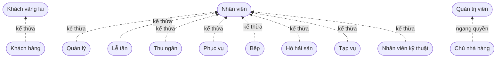

**b) Use case phía khách:**

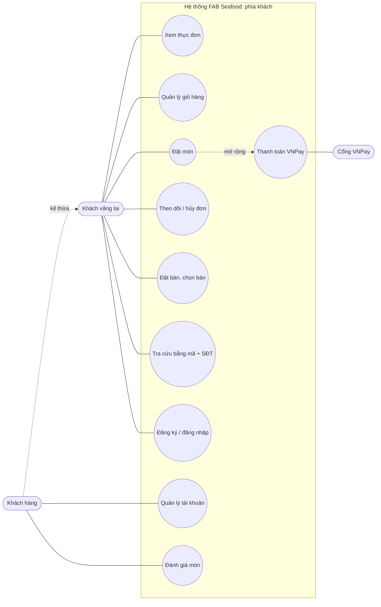

**c) Use case phía nhà hàng: quản trị và hậu cần** (chỉ nối các việc tác nhân **làm được**; việc chỉ được xem thì ghi ở bảng bên dưới):

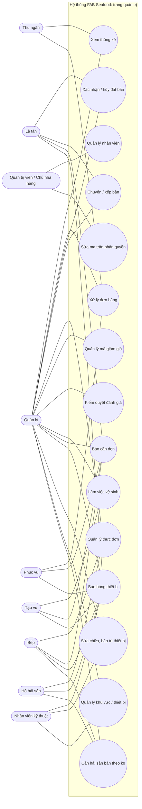

Quản trị viên / Chủ nhà hàng làm được **mọi** use case nội bộ; sơ đồ chỉ nối 2 use case riêng của họ để đỡ rối.

**d) Use case ăn tại quán** (phục vụ dùng app, bếp / hồ hải sản / thu ngân dùng web; Quản lý và QTV / Chủ làm được tất cả, không vẽ để đỡ rối):

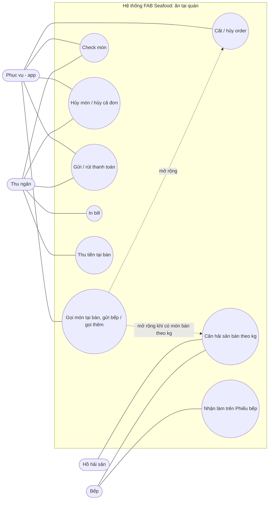

Ghi chú (mũi tên "mở rộng" vẽ cùng chiều với sơ đồ b, từ use case gốc sang phần mở rộng): "Cất order" là bước tùy chọn trong lúc ghi món, chưa gửi bếp. Gửi bếp món bán theo kg thì phát sinh việc cân (A15) trước khi bếp thấy món. Thu ngân thường in bill rồi mới thu tiền, nhưng hệ thống không bắt buộc in trước. Thu ngân có quyền Sửa đơn hàng nên trên app cũng check / hủy món, gửi thanh toán được.

**Bảng tác nhân × use case** (theo quyền mặc định; ✔ = làm được, 👁 = chỉ xem, - = không thấy):

| Use case | Quản lý | Lễ tân | Thu ngân | Phục vụ | Bếp | Hồ hải sản | Tạp vụ | Kỹ thuật | QTV / Chủ |
|---|---|---|---|---|---|---|---|---|---|
| A1 Xem thống kê | ✔ | - | ✔ | - | - | - | - | - | ✔ |
| A2 Xử lý đơn hàng | ✔ | 👁 | ✔ | ✔ | 👁 | 👁 | - | - | ✔ |
| A3 Xác nhận / hủy đặt bàn | ✔ | ✔ | 👁 | 👁 | - | - | - | - | ✔ |
| A4 Chuyển / xếp bàn | ✔ | ✔ | - | - | - | - | - | - | ✔ |
| A5 Quản lý thực đơn | ✔ (Tổ trưởng 👁) | 👁 | 👁 | 👁 | ✔ (sửa, bật / tắt) | ✔ (sửa, bật / tắt) | - | - | ✔ |
| A6 Quản lý mã giảm giá | ✔ (Tổ trưởng -) | 👁 | 👁 | - | - | - | - | - | ✔ |
| A7 Kiểm duyệt đánh giá | ✔ (Tổ trưởng 👁) | 👁 | - | - | - | - | - | - | ✔ |
| A8 Quản lý nhân viên | 👁 | - | - | - | - | - | - | - | ✔ |
| A9 Sửa ma trận phân quyền | 👁 | - | - | - | - | - | - | - | ✔ |
| A10 Làm việc vệ sinh | ✔ | - | - | - | - | - | ✔ | - | ✔ |
| A11 Báo cần dọn | ✔ | ✔ | - | ✔ (Tiếp thực -) | ✔ | - | ✔ | - | ✔ |
| A12 Báo hỏng thiết bị | ✔ | ✔ | - | ✔ (Tiếp thực -) | ✔ | ✔ | ✔ | ✔ | ✔ |
| A13 Sửa chữa, bảo trì thiết bị | ✔ (Tổ trưởng 👁) | - | - | - | 👁 | 👁 | - | ✔ | ✔ |
| A14 Quản lý khu vực / thiết bị | ✔ khu vực vệ sinh | - | - | - | - | - | - | ✔ thiết bị | ✔ |
| A15 Cân hải sản bán theo kg | ✔ (Tổ trưởng 👁) | - | - | 👁 (Tiếp thực -) | ✔ | ✔ | - | 👁 | ✔ |
| A16 Gọi món tại bàn, gửi bếp / gọi thêm (app) | ✔ | 👁 | 👁 | ✔ (Tiếp thực 👁) | 👁 | 👁 | - | - | ✔ |
| A17 Cất / hủy order (app) | ✔ | - | - | ✔ (Tiếp thực -) | - | - | - | - | ✔ |
| A18 Check món (app) | ✔ | 👁 | ✔ | ✔ | 👁 | 👁 | - | - | ✔ |
| A19 Hủy món / hủy cả đơn (app) | ✔ | 👁 | ✔ | ✔ | 👁 | 👁 | - | - | ✔ |
| A20 Gửi / rút thanh toán (app) | ✔ | 👁 | ✔ | ✔ | 👁 | 👁 | - | - | ✔ |
| A21 Nhận làm trên Phiếu bếp | ✔ (Tổ trưởng 👁) | - | - | 👁 (Tiếp thực ✔) | ✔ | 👁 | - | 👁 | ✔ |
| A22 In bill | ✔ (cả Tổ trưởng) | - | ✔ | - | - | - | - | - | ✔ |
| A23 Thu tiền tại bàn | ✔ (Tổ trưởng 👁) | - | ✔ | - | - | - | - | - | ✔ |
| QL01 Xem doanh thu trên app | ✔ | - | ✔ | - | - | - | - | - | ✔ |
| QL02 Xem đơn đã hủy trên app | ✔ | - | ✔ | - | - | - | - | - | ✔ |
| QL03 Kiểm bia nước cuối ngày | ✔ | - | ✔ | - | - | - | - | - | ✔ |

Bảng lấy từ ma trận ở [mục 4.12](#412-thiết-kế-phân-quyền): ✔ = có quyền Thêm / Sửa / Xóa ở chức năng tương ứng, 👁 = chỉ có quyền Xem. A15 dùng chức năng "Hồ hải sản & nhập hàng" (`SEAFOOD_TANK`): mục menu Cân hải sản chỉ hiện cho người có quyền Sửa, nên người chỉ có quyền Xem không thấy mục này. A16, A17 cần quyền Thêm "Đơn hàng & gọi món" (`ORDERS`); A18 đến A20 cần quyền Sửa; 👁 ở các dòng này nghĩa là đăng nhập app chỉ xem được sơ đồ bàn, đơn của bàn. A17 chỉ nằm trên điện thoại, không gọi API, nên chỉ ai ghi món được mới dùng. A21 cần quyền Sửa "Phiếu bếp" (`KITCHEN`). A22 chỉ cần quyền Xem "Thu ngân & thanh toán" (`PAYMENTS`), A23 cần quyền Sửa. QL01, QL02 cần quyền Xem "Tổng quan" (`DASHBOARD`); QL03 cần thêm quyền "Kiểm bia nước" (`DRINKS`).

### 4.5 Đặc tả các use case chính

#### UC01: Đặt món

| Mục | Nội dung |
|---|---|
| Tác nhân | Khách vãng lai, khách hàng |
| Điều kiện trước | Giỏ hàng có ít nhất 1 món |
| Luồng chính | 1. Khách mở trang Thanh toán. 2. Chọn hình thức nhận (giao tận nơi / đến lấy). 3. Nhập họ tên, SĐT, địa chỉ (nếu giao), ghi chú. Đã đăng nhập thì điền sẵn từ hồ sơ. 4. (Tùy chọn) nhập mã giảm giá, bấm Áp dụng. 5. Chọn tiền mặt hoặc VNPay. 6. Bấm Đặt hàng. 7. Hệ thống tính lại tiền từ giá trong DB, tạo đơn mã `FAB...`, xóa giỏ, chuyển sang trang chi tiết đơn |
| Luồng rẽ nhánh | 4a. Mã không hợp lệ / hết hạn / chưa đủ đơn tối thiểu / hết lượt: báo lỗi, không áp dụng. 5a. Nhà hàng chưa cấu hình VNPay: ô VNPay bị mờ. 6a. Thiếu địa chỉ khi giao tận nơi: báo "Vui lòng nhập địa chỉ giao hàng". 7a. Có món vừa hết: báo "Món ... hiện đã hết". 7b. Chọn VNPay: chuyển sang UC02. 7c. Có món bán theo kg (giỏ không cho thêm, nhưng gọi thẳng API vẫn gửi được): báo 400 "Món ... bán theo kg, cần chọn và cân tại hồ. Vui lòng đặt bàn để thưởng thức tại quán" |
| Điều kiện sau | Đơn ở trạng thái Chờ xác nhận, số đã bán của món tăng, lượt dùng mã tăng 1 |

#### UC02: Thanh toán qua VNPay

| Mục | Nội dung |
|---|---|
| Tác nhân | Khách vãng lai, khách hàng, cổng VNPay |
| Điều kiện trước | Đơn chọn ONLINE, chưa thanh toán, chưa hủy, tổng tiền từ 5.000đ |
| Luồng chính | 1. Frontend xin link thanh toán. 2. Backend tạo 1 dòng `Payment` (PENDING) với mã giao dịch mới, ký link bằng HMAC-SHA512, link hết hạn sau 15 phút. 3. Khách sang trang VNPay, nhập thẻ / quét QR. 4. VNPay gọi IPN về backend; backend kiểm tra chữ ký, số tiền, ghi nhận SUCCESS và đổi đơn sang Đã thanh toán. 5. VNPay đưa khách về `/payment/vnpay-return`; trang này gửi nguyên dữ liệu lên backend kiểm tra chữ ký rồi hiện kết quả |
| Luồng rẽ nhánh | 3a. Khách hủy / thẻ lỗi: Payment FAILED, hiện lý do theo mã lỗi, nút "Xem đơn & thanh toán lại" (lần sau là giao dịch mới). 4a. Sai chữ ký: từ chối (mã 97). 4b. Số tiền không khớp: từ chối (mã 04). 4c. IPN và trang trả về đến cùng lúc: chỉ một bên ghi nhận, bên kia thấy "đã xử lý" |
| Điều kiện sau | `Payment.status = SUCCESS`, `Order.paymentStatus = PAID` |

#### UC03: Đặt bàn có chọn bàn

| Mục | Nội dung |
|---|---|
| Tác nhân | Khách vãng lai, khách hàng |
| Luồng chính | 1. Khách nhập tên, SĐT, email (không bắt buộc), ngày, giờ, số khách. 2. Chọn khu vực, hệ thống hiện sơ đồ bàn của khu vực tại đúng thời điểm đó. 3. Khách bấm một bàn trống đủ ghế (không bắt buộc). 4. Bấm Xác nhận đặt bàn. 5. Hệ thống kiểm tra trong 1 transaction Serializable: bàn đang phục vụ, đủ ghế, không có lịch khác trong vòng ±120 phút; tạo lịch mã `RSV...`. 6. Hiện mã đặt bàn để tra cứu |
| Luồng rẽ nhánh | 1a. Giờ ngoài 10:00 đến 21:00, hoặc đặt trước chưa tới 30 phút: báo lỗi. 3a. Đổi giờ / số khách làm bàn đã chọn không còn hợp: tự bỏ chọn. 5a. Có người vừa đặt bàn đó: báo "Bàn vừa có người khác đặt", tự tải lại sơ đồ. 3b. Không chọn bàn: nhà hàng tự xếp |
| Điều kiện sau | Lịch ở trạng thái Chờ xác nhận, bàn hiện màu vàng trên sơ đồ |

#### UC04: Xử lý đơn hàng (nhân viên)

| Mục | Nội dung |
|---|---|
| Tác nhân | Phục vụ, Thu ngân, Quản lý (chuyển trạng thái); Lễ tân, Bếp (chỉ xem) |
| Luồng chính | 1. Mở trang Đơn hàng, chọn tab trạng thái. 2. Bấm Xem một đơn. 3. Bấm nút bước kế tiếp: Xác nhận đơn → Bắt đầu chế biến → Giao hàng → Hoàn thành |
| Luồng rẽ nhánh | 3a. Đơn đến lấy: không có nút Giao hàng. 3b. Hủy đơn: bắt buộc chọn lý do có sẵn hoặc tự ghi (khách xem được lý do ở trang chi tiết đơn), hoàn lại số đã bán và lượt dùng mã; nếu khách đã trả online thì đổi sang Đã hoàn tiền và nhắc hoàn tiền trên trang VNPay. 3c. Chuyển sai quy trình (vd Chờ xác nhận → Hoàn thành): backend từ chối |
| Điều kiện sau | Đơn tiền mặt chuyển Hoàn thành thì tự đổi sang Đã thanh toán |

#### UC05: Hủy lịch đặt bàn kèm lý do (nhân viên)

| Mục | Nội dung |
|---|---|
| Tác nhân | Lễ tân, Quản lý |
| Luồng chính | 1. Bấm Hủy ở danh sách hoặc trên sơ đồ bàn. 2. Chọn lý do có sẵn (Hết bàn vào khung giờ này / Nhà hàng có sự kiện, đóng cửa / Không liên lạc được với khách) hoặc "Lý do khác" và tự gõ (tối đa 300 ký tự). 3. Bấm Hủy lịch |
| Luồng rẽ nhánh | 2a. Chưa có lý do: nút Hủy lịch bị mờ; gọi API không có lý do thì backend trả lỗi 400. 3a. Người khác vừa cập nhật lịch này: báo "vừa được người khác cập nhật, vui lòng tải lại trang" (409) |
| Điều kiện sau | Khách thấy khung đỏ "Nhà hàng đã hủy lịch này · Lý do: ..." và nút đặt lại với thông tin cũ |

#### UC06: Quản lý nhân viên và phân quyền

| Mục | Nội dung |
|---|---|
| Tác nhân | Quản trị viên, Chủ nhà hàng (thêm / sửa tài khoản, sửa ma trận); Quản lý chỉ xem |
| Luồng chính | 1. Thêm nhân viên: nhập họ tên, email, chọn vai trò; hệ thống tạo sẵn mật khẩu ngẫu nhiên 8 ký tự (bỏ ký tự dễ nhầm 0/O, 1/l). 2. Hiện thông tin đăng nhập một lần để sao chép gửi nhân viên. 3. ADMIN mở Ma trận phân quyền, chọn vai trò, tích Xem / Thêm / Sửa / Xóa cho từng chức năng, lưu |
| Luồng rẽ nhánh | Không ai tự sửa / khóa tài khoản của chính mình ở trang này. Người không phải ADMIN không đụng được tài khoản ADMIN hay người giữ vai trò Chủ nhà hàng, không cấp được quyền ADMIN hay vai trò Chủ. Vai trò Chủ nhà hàng luôn toàn quyền. Vai trò mặc định không xóa được; vai trò còn người giữ không xóa được |
| Điều kiện sau | Quyền mới có hiệu lực ngay ở request kế tiếp (backend đọc quyền từ DB mỗi request) |

#### UC07: Đánh giá món

| Mục | Nội dung |
|---|---|
| Tác nhân | Khách hàng đã đăng nhập |
| Điều kiện trước | Có ít nhất một đơn Hoàn thành chứa món đó |
| Luồng chính | Chọn số sao, viết bình luận, gửi. Hệ thống tạo hoặc cập nhật đánh giá, tính lại điểm trung bình (làm tròn 1 chữ số) và số lượt đánh giá của món |
| Luồng rẽ nhánh | Chưa nhận món: "Bạn cần đặt và nhận món này trước khi đánh giá" (403) |

#### UC08: Chuyển bàn / xếp bàn (lễ tân)

| Mục | Nội dung |
|---|---|
| Tác nhân | Lễ tân, Quản lý |
| Điều kiện trước | Lịch ở trạng thái Chờ xác nhận, Đã xác nhận hoặc Khách đã đến |
| Luồng chính | 1. Ở tab Hôm nay / Danh sách / Sơ đồ bàn, bấm **Chuyển bàn** (lịch chưa có bàn thì là **Xếp bàn**). 2. Hệ thống hiện sơ đồ 3 khu đúng giờ khách đến, bàn hiện tại tô tím. 3. Lễ tân bấm một bàn trống đủ ghế, chọn lý do nhanh hoặc tự ghi (không bắt buộc). 4. Bấm "Chuyển bàn sang ...". 5. Trong 1 transaction Serializable: kiểm tra bàn mới (đang phục vụ, đủ ghế, không trùng giờ), đổi bàn và khu vực của lịch, ghi 1 dòng lịch sử chuyển bàn |
| Luồng rẽ nhánh | 3a. Bàn đỏ / vàng / không đủ ghế: không bấm được. 5a. Lễ tân khác vừa xếp lịch khác vào bàn đó: báo "Bàn vừa được xếp cho khách khác" (409), sơ đồ tự tải lại. 5b. Chọn đúng bàn đang ngồi: "Khách đang ở bàn ... rồi" (400). 5c. Lịch đã hủy: không chuyển được |
| Điều kiện sau | Khách xem chi tiết lịch thấy số bàn mới; lý do và tên nhân viên chỉ nhân viên thấy |

#### UC09: Làm việc vệ sinh (tạp vụ)

| Mục | Nội dung |
|---|---|
| Tác nhân | Tạp vụ (làm việc); Phục vụ, Lễ tân, Bếp (báo cần dọn); Quản lý (giao, hủy việc) |
| Luồng chính | 1. Phục vụ thấy nhà vệ sinh nữ hết giấy, mở **Khu vực cần dọn**, bấm Báo cần dọn ở khu đó, chọn mức Gấp. 2. Khu chuyển màu đỏ, việc hiện đầu danh sách của tạp vụ (trang tự tải lại 30 giây). 3. Tạp vụ bấm **Bắt đầu** (nhận việc). 4. Làm xong bấm **Hoàn thành**, ghi chú nếu cần (vd "đã báo kho hết giấy"). 5. Khu xanh lại, việc vào Lịch sử công việc |
| Luồng rẽ nhánh | 3a. Việc đang giao cho người khác: hỏi "nhận làm thay?". 4a. Tạp vụ dọn cả khu: bấm **Đã dọn xong** ở trang khu vực, mọi việc đang chờ ở khu đó (mình được phép) xong một lượt; khu không có việc thì ghi 1 lần "Dọn định kỳ". 4b. Phiếu người khác đang làm: tạp vụ khác không bấm Hoàn thành được (403). Quản lý hủy việc phải ghi lý do |
| Điều kiện sau | `CleaningTask.status = DONE`, `CleaningArea.lastCleanedAt` = lúc xong |

#### UC10: Báo hỏng và sửa chữa thiết bị

| Mục | Nội dung |
|---|---|
| Tác nhân | Nhân viên kỹ thuật (sửa chữa); Phục vụ, Lễ tân, Bếp, Tạp vụ, Quản lý (báo hỏng) |
| Luồng chính | 1. Bếp bấm **Báo hỏng** trên thanh tiêu đề, chọn "Tủ đông hải sản", bấm gợi ý "Không lạnh" (tên sự cố tự ghép), chọn Gấp, gửi. 2. Phiếu "Mới báo" hiện ở Tổng quan / Phiếu sửa chữa của kỹ thuật. 3. Kỹ thuật bấm **Nhận sửa**. 4. Thiếu linh kiện: bấm **Chờ linh kiện**, ghi "Chờ thợ hãng đến sửa"; bếp mở lại nút Báo hỏng thấy dòng này. 5. Linh kiện về, bấm Tiếp tục sửa. 6. Sửa xong bấm **Hoàn thành**, ghi cách xử lý (bắt buộc) và chi phí |
| Luồng rẽ nhánh | 1a. Không biết là máy nào: chọn "Khác / chưa rõ thiết bị", ghi rõ ở mô tả. 1b. Thiết bị đã ngưng sử dụng: không báo được. 6a. Không ghi cách xử lý: nút xác nhận bị mờ, gọi API báo lỗi 400. 6b. Báo nhầm: kỹ thuật hủy phiếu kèm lý do |
| Điều kiện sau | Phiếu vào Lịch sử sửa chữa, cộng vào chi phí tháng |

#### UC11: Bảo trì định kỳ

| Mục | Nội dung |
|---|---|
| Tác nhân | Nhân viên kỹ thuật, Quản lý |
| Luồng chính | 1. Tổng quan kỹ thuật hiện thiết bị quá hạn (đỏ) / còn ≤ 7 ngày (vàng), hạn = lần bảo trì gần nhất + chu kỳ. 2. Kỹ thuật bảo trì xong bấm **Đã bảo trì**, ghi chú và chi phí (không bắt buộc). 3. Hệ thống ghi 1 phiếu loại "Bảo trì định kỳ" đã xong vào lịch sử và tính lại hạn từ hôm nay |
| Luồng rẽ nhánh | 2a. Máy đang có phiếu sửa chữa chưa xong: hộp thoại liệt kê các phiếu, nhắc "bảo trì không tự đóng phiếu"; tích "Máy đã sửa xong, đóng luôn các phiếu này" và ghi cách xử lý thì các phiếu chuyển Đã sửa xong. 2b. Hôm nay đã ghi bảo trì máy này: nút đổi thành "Đã bảo trì hôm nay" (mờ), gọi API thì báo lỗi 400 |
| Điều kiện sau | `Equipment.lastMaintainedAt` = hôm nay; máy không còn phiếu mở thì trở về "Hoạt động tốt" |

#### UC12: Cân hải sản bán theo kg (hồ hải sản)

| Mục | Nội dung |
|---|---|
| Tác nhân | Hồ hải sản (người cân chính), Bếp, Quản lý; Phục vụ (gọi món trên app, xem kết quả) |
| Điều kiện trước | Món có đơn vị `kg` (tôm hùm, tôm sú, cua, cá mú, tôm tít); phục vụ đã gửi bếp đơn tại bàn kèm số kg ghi trên app (mặc định 1 kg), món đang "Chờ cân" |
| Luồng chính | 1. Khách muốn con tôm hùm khoảng 1,2 kg; phục vụ gọi "Tôm hùm nướng phô mai" trên app, số kg mặc định **1 kg**, bấm vào số gõ `1,2` (tiền tạm 2.268.000đ), bấm Gửi bếp. 2. Món vào trạng thái **Chờ cân** với số kg tạm 1,2, tiền tạm được cộng vào đơn, phiếu bếp chưa có món này; trang Cân hải sản kêu chuông, menu có số đỏ (tự tải lại 10 giây). 3. Nhân viên hồ hải sản bắt con khách chọn, cân; ô số kg **điền sẵn `1,2`** (số phục vụ ghi), cân ra 1,25 kg thì sửa thành `1,25`, ô bên cạnh hiện trước thành tiền. 4. Bấm **Xác nhận cân** (hoặc Enter). 5. Trong 1 transaction, hệ thống làm tròn số kg tới gam, tính tiền dòng = 1.890.000 × 1,25 = 2.362.500đ, cộng **phần chênh lệch** với tiền tạm (+94.500đ) vào tổng đơn, chuyển món sang **Chờ bếp**. 6. Bếp thấy món kèm "Đã cân 1,25 kg"; app của phục vụ hiện "Đã cân 1,25 kg × 1.890.000đ/kg" |
| Luồng rẽ nhánh | 3a. Số kg dưới 0,05 hoặc trên 30: báo lỗi 400 ("Ít nhất 0,05 kg" / "Nhiều nhất 30 kg, kiểm tra lại số cân"). 4a. Nhập nhầm: bấm **Cân lại** ở bảng "Đã cân hôm nay" khi bếp chưa "Nhận làm"; tiền đơn đổi theo chênh lệch, yêu cầu thanh toán đã gửi (nếu có) bị rút. Bếp đã nhận làm: 400 "Bếp đã nhận làm món này, không cân lại được". 1a. Phục vụ gõ số kg dưới 0,05 hoặc trên 30 (hay gõ chữ): app báo ngay trong ô nhập, không đổi số. Cân ra đúng số phục vụ ghi: hồ hải sản chỉ bấm Xác nhận cân, tiền không đổi. 4b. Khách đổi ý trước khi cân: phục vụ hủy cả dòng món, không cần lý do, tiền tạm bị trừ khỏi đơn. 6a. Phục vụ bấm Gửi thanh toán khi còn món chờ cân: nút bị khóa trên app; gọi API thì báo 400 "Còn món chưa cân: ...". Thu ngân bấm Đã thu tiền cũng bị chặn như vậy |
| Điều kiện sau | `OrderItem.weight` = số kg, `weighedAt` = lúc cân, `status = PENDING`; `Order.subtotal`, `total` bằng đúng tiền theo số kg thật; bill in dòng "1,25 kg x 1.890.000/kg" |

#### UC13: Gọi món tại bàn và gửi bếp (phục vụ, app)

| Mục | Nội dung |
|---|---|
| Tác nhân | Phục vụ, Tổ trưởng, Quản lý (quyền Thêm "Đơn hàng & gọi món"); Bếp nhận kết quả |
| Điều kiện trước | Đã đăng nhập app FAB Phục vụ; bàn đang hoạt động |
| Luồng chính | 1. Ở **S03 Sơ đồ bàn**, chọn khu "Trong nhà", bấm bàn T05 (ô trắng = trống). 2. S04 báo bàn trống, bấm **Ghi món**. 3. S05: tìm / lọc món, bấm "+" (hoặc mở S06 xem chi tiết để tư vấn), thanh phiếu nổi hiện "Bàn T05 · 3 món". 4. Mở **S08 Phiếu gọi món**: đổi số lượng (−/+ hoặc bấm vào số để gõ), bấm món để ghi chú khẩu vị (S07, chip gợi ý). 5. Bấm **Gửi bếp**, hộp hỏi "Gửi 3 món cho bàn T05 xuống bếp?", bấm Gửi bếp. 6. App gọi `POST /dine-in/orders { tableId, items[] }`; trong 1 transaction backend lấy giá từ DB (giá khuyến mãi nếu có), gộp món trùng, bàn chưa có đơn mở thì tạo đơn `DINE_IN` mã `FAB...` ở trạng thái **Đã gửi bếp** (`CONFIRMED`), món theo phần ở **Chờ bếp**, tăng số đã bán. 7. App báo "Đã gửi bếp 3 món cho bàn T05", về S04; S03 ô T05 chuyển xanh. 8. Trong tối đa 10 giây, trang Phiếu bếp của bếp kêu chuông, có phiếu bàn T05 |
| Luồng rẽ nhánh | 3a. Món theo kg: phiếu ghi mặc định 1 kg, phục vụ sửa số kg ước chừng (xem UC12). 4a. Khách chưa chọn xong / phục vụ phải chạy sang bàn khác: bấm **Cất order**, phiếu được cất theo bàn trên điện thoại, về S03 có khung "Order đã cất, chưa gửi bếp"; mở lại bàn bấm **Mở order** thì món hiện lại. Đang ghi dở bàn T02 mà sang bàn T05 bấm Ghi món thì phiếu T02 tự cất. 4b. Khách không gọi nữa: **Hủy order** (hỏi lại "Hủy order?"), chỉ xóa phiếu chưa gửi, không gọi API. 5a. Bấm "Xem lại": không gửi. 6a. Bàn đã có đơn mở (gọi thêm, nút **Order** ở S04): món thêm thành dòng mới cùng đơn, S04 gom theo giờ gửi, tổng tiền cộng thêm; nếu bàn đã gửi thanh toán thì yêu cầu thanh toán tự rút. 6b. Có món vừa hết: 400 "Món "..." hiện đã hết", phiếu giữ nguyên để bỏ món đó rồi gửi lại. 6c. Bàn tạm ngưng phục vụ: 400 "Bàn này hiện không phục vụ, vui lòng chọn bàn khác". 6d. Tài khoản không có quyền Thêm (tiếp thực, thu ngân, bếp): app không có nút Ghi món / Order; gọi API thì 403 |
| Điều kiện sau | Bàn có đúng 1 đơn mở; `OrderItem.status = PENDING` (món theo kg `WEIGHING`); `Order.total` cộng tiền các món vừa gửi |

#### UC14: Bếp nhận làm (Phiếu bếp)

| Mục | Nội dung |
|---|---|
| Tác nhân | Bếp, Quản lý, Tiếp thực (quyền Sửa "Phiếu bếp"); Hồ hải sản, Tổ trưởng, Phục vụ, Kỹ thuật chỉ xem |
| Điều kiện trước | Có đơn tại bàn đang mở còn món "Chờ bếp" |
| Luồng chính | 1. Trang **Phiếu bếp** (`/admin/kitchen`) tự tải lại 10 giây; có món mới thì kêu chuông, hiện thông báo, số đỏ trên menu. 2. Phiếu theo bàn, chờ lâu nhất lên đầu, ghi rõ khu, phục vụ, đã chờ bao lâu (đỏ khi từ 15 phút), ghi chú khẩu vị từng món. 3. Bếp bấm **Nhận làm** ở từng món hoặc "Nhận làm cả bàn". 4. `POST /dine-in/kitchen/start { itemIds }`: món Chờ bếp chuyển **Bếp đang làm**; nếu đơn không còn món chờ thì đơn chuyển "Đang chế biến" (`PREPARING`). 5. App của phục vụ (tải lại 15 giây) hiện nhãn "Bếp đang làm" |
| Luồng rẽ nhánh | 1a. Món bán theo kg chưa cân: chưa hiện trên phiếu bếp, cân xong mới hiện kèm "Đã cân 1,3 kg". 3a. Phục vụ vừa hủy món trước khi bếp bấm: món không còn Chờ bếp nên không đổi (backend chỉ nhận món đang Chờ bếp của đơn còn mở). 3b. Người chỉ có quyền Xem: không có nút Nhận làm, thấy nhãn trạng thái |
| Điều kiện sau | `OrderItem.status = COOKING`; từ lúc này phục vụ hủy món này phải ghi lý do; món theo kg không cân lại được nữa |

#### UC15: Check món và hủy món (phục vụ, app)

| Mục | Nội dung |
|---|---|
| Tác nhân | Phục vụ, Tiếp thực, Tổ trưởng, Thu ngân, Quản lý (quyền Sửa "Đơn hàng & gọi món") |
| Điều kiện trước | Bàn có đơn đang mở |
| Luồng chính | **Check món:** 1. Mang món ra bàn, ở S04 bấm **Check món**. 2. Sheet S12 liệt kê món, tick món đã mang ra (hoặc "Chọn hết"), bấm "Lưu (2 món)". 3. `POST /dine-in/items/serve`: món chuyển **Đã ra bàn**, app báo "Đã cập nhật món ra bàn"; khi mọi món còn lại đã ra thì đơn chuyển "Đã lên đủ món" (`DELIVERING`). **Hủy món:** 1. Khách đổi ý, ở S04 bấm **Hủy món**. 2. Sheet S13: chọn món, số phần muốn hủy, lý do (chip điền nhanh). 3. `POST /dine-in/items/:id/cancel`: món Đã hủy (S04 gạch ngang kèm lý do), tiền đơn và số đã bán trừ ngay |
| Luồng rẽ nhánh | Check: 2a. Bấm nhầm: bỏ tick, món về "Bếp đang làm". 2b. Món đã hủy: 400 "Có món đã hủy, không check được"; món chờ cân bỏ qua (chưa nấu). 2c. Chọn món của 2 bàn: 400 "Chỉ check món của cùng 1 bàn". Hủy: 2a. Món còn Chờ bếp / Chờ cân: hủy không cần lý do. 2b. Món Bếp đang làm / Đã ra bàn mà không ghi lý do: 400 "Bếp đã làm món này, vui lòng ghi lý do hủy" / "Món đã mang ra bàn, vui lòng ghi lý do hủy". 2c. Hủy bớt 1 trong 3 phần: dòng cũ còn 2 phần, phần hủy tách thành dòng riêng. 2d. Món theo kg: chỉ hủy cả dòng. 3a. Hủy hết món: đơn tự "Đã hủy" (lý do "Đã hủy hết món"), bàn trống. 3b. Hủy cả đơn: menu ⋮ ở S04, bắt buộc lý do (`PATCH /orders/:id/status`) |
| Điều kiện sau | Trạng thái đơn tự suy lại từ các món (R51) |

#### UC16: Gửi thanh toán, in bill, thu tiền tại bàn

| Mục | Nội dung |
|---|---|
| Tác nhân | Phục vụ (gửi thanh toán, app); Thu ngân, Quản lý (in bill, thu tiền, web) |
| Điều kiện trước | Bàn có đơn đang mở còn ít nhất 1 món chưa hủy |
| Luồng chính | 1. Khách ăn xong, phục vụ bấm **Gửi thanh toán** ở S04. 2. Sheet S09 hiện lại bill (món còn tính tiền, tổng), nhắc nếu còn món chưa ra bàn; bấm Gửi thanh toán. 3. `POST /dine-in/orders/:id/bill-request`: ghi `billRequestedAt`; app báo "Đã gửi thanh toán bàn T05 cho thu ngân", về S03, ô bàn màu cam "Chờ thu tiền". 4. Trong tối đa 10 giây, trang **Thanh toán tại bàn** của thu ngân kêu chuông, thông báo "Bàn T05 gửi thanh toán"; bàn lên đầu danh sách, viền cam. 5. Thu ngân bấm **In bill**: cửa sổ in bill khổ 80mm tự bật hộp thoại in, hệ thống ghi `billPrintedAt` (thẻ bàn có nhãn "Đã in HH:mm"). 6. Khách trả tiền, thu ngân bấm **Đã thu tiền**, xác nhận "Đã thu 850.000đ". 7. `POST /dine-in/bills/:id/pay`: đơn **Hoàn thành** + **Đã thanh toán**; báo "Đã thu tiền bàn T05". 8. App tải lại: bàn T05 trắng (trống), đơn vào "Đã thu tiền" ở S10 Đơn hôm nay |
| Luồng rẽ nhánh | 2a. Còn món bán theo kg chưa cân: S09 báo và khóa nút; gọi API thì 400 "Còn món chưa cân: ... Nhờ hồ hải sản cân trước khi gửi thanh toán". 2b. Bàn đã hủy hết món: 400 "Bàn chưa có món nào". 3a. Khách gọi thêm sau khi đã gửi: gửi bếp món mới thì yêu cầu thanh toán **tự rút** (bill cũ không còn đúng), phục vụ gửi lại khi khách ăn xong; hoặc tự bấm **Rút yêu cầu thanh toán**. 3b. Cân lại món theo kg làm đổi tiền: yêu cầu cũng tự rút. 6a. Còn món chờ cân: 400 "Còn món chưa cân: ... Nhờ hồ hải sản cân trước khi thu tiền". 6b. Phục vụ gọi API thu tiền: 403 (cần quyền Sửa "Thu ngân & thanh toán"). 6c. Khách trả tiền trước khi món cuối ra: vẫn thu được (đơn mở ở bước nào cũng thu được) |
| Điều kiện sau | `Order.status = COMPLETED`, `paymentStatus = PAID`; bàn không còn đơn mở, lần gọi món sau là đơn mới; doanh thu ở Tổng quan tính cả đơn này |

### 4.6 Quy tắc nghiệp vụ

| Mã | Quy tắc | Giá trị | Code |
|---|---|---|---|
| R01 | Phí giao hàng | 20.000đ, miễn phí khi tạm tính từ 500.000đ; đến lấy luôn miễn phí. Đổi trong `.env` (`SHIPPING_FEE`, `FREE_SHIPPING_MIN`) | `orders.service.js` |
| R02 | Tổng tiền | Tổng = Tạm tính - Giảm giá + Phí giao. Tạm tính dùng giá khuyến mãi nếu có | `orders.service.js` |
| R03 | Số lượng mỗi món | 1 đến 50; các dòng trùng món được gộp, ghi chú nối bằng "; " | `orders.validation.js` |
| R04 | Ghi chú | Ghi chú món tối đa 200 ký tự, ghi chú đơn tối đa 500 | `orders.validation.js` |
| R05 | Món hết hàng | Không đặt được món đang tắt; mặc định khách chỉ thấy món đang bán | `orders.service.js`, `dishes.controller.js` |
| R06 | Mã giảm giá | Phải đang bật, trong thời gian hiệu lực, còn lượt, tạm tính ≥ đơn tối thiểu. % thì làm tròn xuống, không vượt "giảm tối đa", không vượt tạm tính | `coupons.service.js` |
| R07 | Lượt dùng mã | Cộng lượt khi đặt đơn; trả lại lượt khi đơn bị hủy | `orders.service.js` |
| R08 | Quy trình đơn hàng | Xem [mục 4.7](#47-sơ-đồ-trạng-thái) | `STATUS_FLOW` |
| R09 | Khách tự hủy đơn | Chỉ khi Chờ xác nhận và chưa trả tiền online | `orders.controller.js > cancel` |
| R10 | Thanh toán tự động | Đơn tiền mặt Hoàn thành → Đã thanh toán; đơn đã trả bị hủy → Đã hoàn tiền | `changeStatus` |
| R11 | VNPay | Tối thiểu 5.000đ; link hết hạn 15 phút; mỗi lần bấm là một giao dịch mới; thành công khi cả `vnp_ResponseCode` và `vnp_TransactionStatus` là "00" | `payments.service.js`, `vnpay.js` |
| R12 | Giờ đặt bàn | Từ giờ mở cửa (10:00) đến trước giờ đóng cửa 1 tiếng (21:00), khung 30 phút / lần, đặt trước ít nhất 30 phút | `reservations.validation.js`, `lib/reservation.js` |
| R13 | Số khách | 1 đến 50 (đoàn trên 20 người nên gọi hotline) | `reservations.validation.js` |
| R14 | Giữ bàn | Một lượt đặt giữ bàn 120 phút: bàn đặt 19:00 thì bận từ 17:01 đến 20:59. Lịch Chờ xác nhận, Đã xác nhận, Đã đến đều giữ bàn; lịch hủy thì trả bàn | `tables.service.js` |
| R15 | Chọn bàn | Bàn phải đang phục vụ và đủ ghế | `assertTableAvailable` |
| R16 | Khách hủy đặt bàn | Chỉ khi Chờ xác nhận / Đã xác nhận và chưa tới giờ | `reservations.controller.js > cancel` |
| R17 | Nhà hàng hủy đặt bàn | Bắt buộc lý do, tối đa 300 ký tự | `updateReservationStatusSchema` |
| R18 | Đánh giá | Chỉ người có đơn Hoàn thành chứa món; mỗi người 1 đánh giá / món | `reviews.controller.js` |
| R19 | Xóa món | Món đã có trong đơn thì không xóa hẳn, chỉ chuyển sang ngừng bán (giữ lịch sử) | `dishes.controller.js > remove` |
| R20 | Xóa danh mục | Không xóa được danh mục còn món | `categories.controller.js` |
| R21 | Mã đơn / mã đặt bàn | `FAB` / `RSV` + ngày yyMMdd (giờ VN) + 6 số ngẫu nhiên, vd `FAB261022482913`; trùng thì sinh lại (tối đa 5 lần) | `utils/helpers.js` |
| R22 | Xem đơn / lịch của người khác | Chỉ chủ đơn, nhân viên có quyền, hoặc người biết đúng SĐT; sai thì trả "không tìm thấy" (404) để không lộ đơn có tồn tại | `findAccessibleOrder`, `findAccessible` |
| R23 | Doanh thu | Chỉ tính đơn Hoàn thành, theo ngày giờ Việt Nam | `stats.controller.js` |
| R24 | Tài khoản | Mật khẩu ≥ 6 ký tự, tên 2 đến 100 ký tự, SĐT dạng `0` hoặc `+84` + 9 đến 10 số; email không trùng | `auth.validation.js` |
| R25 | Ảnh upload | Chỉ JPG, PNG, WEBP, GIF, tối đa 5MB | `middlewares/upload.js` |
| R26 | Nhân viên hủy đơn | Bắt buộc lý do, tối đa 300 ký tự; khách xem được. Khách tự hủy thì không có lý do | `orders.validation.js > updateStatusSchema` |
| R27 | Chuyển / xếp bàn | Lịch Chờ xác nhận / Đã xác nhận / Đã đến; bàn mới đang phục vụ, đủ ghế, không trùng ±120 phút; khu vực đổi theo bàn; lý do ≤ 200 ký tự, chỉ nhân viên thấy; mỗi lần chuyển lưu 1 dòng lịch sử | `reservations.controller.js > moveTable` |
| R28 | Quy trình việc vệ sinh | Chờ làm → Đang làm → Đã xong (Chờ làm → Đã xong được); Hủy cần quyền Xóa và lý do | `CLEANING_FLOW` |
| R29 | Ai hoàn thành việc / phiếu | Việc chưa ai nhận, việc của mình, hoặc người có quyền Xóa (quản lý / kỹ thuật) xác nhận thay. Bấm Bắt đầu / Nhận sửa thì người bấm thành người làm | `assertCanFinish` (vệ sinh, kỹ thuật) |
| R30 | Khu vực cần dọn | Khu có việc chưa xong = cần dọn; khu sạch mà quá 4 tiếng chưa có việc nào xong = "lâu chưa dọn" | `config/cleaning.js > STALE_HOURS` |
| R31 | Đã dọn xong cả khu | Đóng mọi việc đang chờ ở khu mà người bấm được phép hoàn thành; khu không có việc thì ghi 1 lần "Dọn định kỳ" | `cleaning.controller.js > cleanArea` |
| R32 | Giao việc / giao phiếu | Chỉ người có quyền Sửa mới giao cho ai đó; người chỉ có quyền Thêm (phục vụ, lễ tân...) báo thì để trống | `createTask`, `createTicket` |
| R33 | Quy trình phiếu sửa chữa | Mới báo → Đang sửa ⇄ Chờ linh kiện → Đã sửa xong; Chờ linh kiện bắt buộc ghi đang chờ gì; Hoàn thành bắt buộc ghi cách xử lý, chi phí ≥ 0 không bắt buộc; Hủy cần quyền Xóa và lý do | `REPAIR_FLOW`, `ticketStatusSchema` |
| R34 | Hạn bảo trì | Hạn = lần bảo trì gần nhất (chưa có thì ngày thêm thiết bị) + chu kỳ; còn ≤ 7 ngày = sắp đến hạn; thiết bị không có chu kỳ thì không tính | `maintenanceInfo`, `DUE_SOON_DAYS` |
| R36 | Bảo trì và sửa chữa là 2 việc khác nhau | Bấm "Đã bảo trì" **không tự đóng** phiếu sửa chữa (máy vẫn "Có sự cố"). Muốn đóng thì tích "Máy đã sửa xong, đóng luôn các phiếu này", khi đó bắt buộc ghi cách xử lý; phiếu người khác đang sửa thì giữ nguyên. Mỗi máy chỉ ghi bảo trì 1 lần / ngày (giờ VN) | `maintenance.controller.js > maintain` |
| R35 | Báo hỏng | Chỉ chọn được thiết bị đang sử dụng; nhóm thiết bị phải thuộc danh sách cố định | `assertActiveEquipment`, `equipmentSchema` |
| R37 | Món bán theo kg | Món có đơn vị `kg`; giá của món là giá 1 kg. Không đặt online được: giỏ hàng bỏ qua, backend báo 400 nếu đơn online có món này | `isSoldByWeight`, `createOrder`, `stores/cart.js` |
| R38 | Gọi món theo kg tại quán | App mặc định **1 phần / 1 kg**, phục vụ sửa được (kg: 0,05 đến 30, gõ số lẻ vd 0,98). Gửi bếp kèm số kg; món theo kg luôn 1 dòng, ở **Chờ cân** (`WEIGHING`), **cộng tiền tạm** theo số kg ghi, phiếu bếp chưa có món này | `addItemsSchema`, `dine-in.service.js > addItems`, `CartNotifier.setWeight` |
| R39 | Cân | Ô cân điền sẵn số kg phục vụ ghi; số kg từ 0,05 đến 30, làm tròn tới gam. Tiền dòng = `Math.round(giá 1 kg × số kg)`, tiền đơn đổi theo chênh lệch với tiền tạm; cân xong món sang Chờ bếp | `weighItemSchema`, `lineTotal`, `weighItem` |
| R40 | Cân lại | Chỉ khi bếp chưa "Nhận làm" (món còn Chờ bếp). Tiền đơn đổi theo chênh lệch; số tiền đổi thì yêu cầu thanh toán đã gửi bị rút | `weighItem` |
| R41 | Còn món chờ cân | Không gửi thanh toán, không thu tiền được; câu báo kể tên món chưa cân | `requestBill`, `pay` |
| R42 | Hủy / check món theo kg | Chỉ hủy cả dòng (số kg cân chung cho cả dòng); món chờ cân hủy không cần lý do; món chưa cân không "Check món" được (chưa nấu) | `cancelItem`, `serveItems` |
| R43 | Quyền cân | Xem danh sách món chờ cân = quyền Xem "Hồ hải sản & nhập hàng"; cân / cân lại = quyền Sửa. Mặc định cân được: Chủ, Admin, Quản lý, Bếp, Hồ hải sản | `dine-in.routes.js`, `adminMenu.js` |
| R44 | Best seller | Món bật ô Best seller (`isFeatured`); trang chủ hiện 8 món, bán chạy trước; `/menu?best=1` chỉ hiện các món này | `Home.jsx`, `Menu.jsx` |
| R45 | Danh mục hiện cho khách | Chỉ đếm món đang bán (`_count.dishes`); danh mục 0 món bị ẩn ở web và app | `categories.controller.js > list` |
| R46 | Đổi thực đơn (`db:seed-menu`) | Món trùng slug trong `menu.js`: cập nhật và bật bán lại; chưa có: tạo mới. Món cũ chưa bán, chưa có đánh giá: xóa; đã nằm trong đơn / có đánh giá: ẩn, gom vào nhóm "Ngừng bán (thực đơn cũ)". Danh mục cũ hết món: xóa. Không xóa đơn hàng, đánh giá | `prisma/menu.js > applyMenu` |
| R47 | Cất order / Hủy order (app, S08) | **Cất order**: phiếu chưa gửi bếp được lưu theo từng bàn trên điện thoại (nhiều bàn cùng lúc, giữ ghi chú và số kg), mở lại bàn thì món hiện lại; đang ghi dở bàn khác mà bấm "Order" thì phiếu cũ tự cất. Chưa gửi bếp nên bếp, thu ngân, máy khác không thấy. **Hủy order**: chỉ xóa phiếu chưa gửi, món đã gửi bếp giữ nguyên | `state/cart_state.dart > SavedTicketsNotifier`, `s08_cart_screen.dart` |
| R48 | Một bàn một đơn mở | Đơn tại quán chưa thu tiền, chưa hủy (Đã gửi bếp / Đang chế biến / Đã lên đủ món) là **đơn mở** của bàn; gửi bếp khi bàn đã có đơn mở thì cộng món vào đơn đó. Thu tiền hoặc hủy xong thì bàn trống, lần sau là đơn mới | `findOpenOrder`, `OPEN_ORDER`, `addItems` |
| R49 | Đơn tại quán | Loại `DINE_IN`, tạo ra là **Đã xác nhận** (`CONFIRMED`) luôn (nhân viên ghi trực tiếp, không chờ xác nhận); lưu bàn (`tableId`), người mở đơn (`staffId`); tên khách "Khách bàn B05", SĐT để trống. Không phí giao, không mã giảm giá; giá lấy từ DB lúc gửi bếp (giá khuyến mãi nếu có), không tin app gửi | `addItems` |
| R50 | Gửi bếp | Món trùng trong 1 lần gửi gộp số lượng, nối ghi chú bằng "; ", giữ thứ tự phục vụ bấm (bếp đọc theo thứ tự này). Lần gửi sau là dòng mới (app gom theo giờ gửi). Số lượng 1 đến 50 / món, ghi chú món ≤ 200 ký tự, ghi chú đơn ≤ 500. Số đã bán của món tăng ngay lúc gửi | `addItemsSchema`, `addItems` |
| R51 | Trạng thái đơn suy ra từ món | Không tính món đã hủy: còn món Chờ cân / Chờ bếp → **Đã gửi bếp** (`CONFIRMED`); không còn món chờ, còn món Bếp đang làm → **Đang chế biến** (`PREPARING`); mọi món còn lại đã ra bàn → **Đã lên đủ món** (`DELIVERING`); hủy hết món → **Đã hủy** (lý do "Đã hủy hết món"). Tính lại sau mỗi lần đổi món; app không tự đổi trạng thái đơn | `syncOrderStatus` |
| R52 | Hủy món | Món Chờ cân / Chờ bếp hủy luôn, không cần lý do; Bếp đang làm / Đã ra bàn **bắt buộc lý do** (≤ 200 ký tự). Hủy bớt phần: dòng cũ giảm số phần, phần hủy tách thành dòng riêng (giữ giờ gửi). Tiền đơn và số đã bán trừ ngay. Món đã hủy không hủy lại được | `cancelItem`, `cancelItemSchema` |
| R53 | Check món | Chỉ món của cùng 1 bàn (cùng đơn mở); có món đã hủy thì báo lỗi; món chờ cân bị bỏ qua (chưa nấu). Bỏ tick (bấm nhầm): Đã ra bàn → Bếp đang làm | `serveItems` |
| R54 | Nhận làm | Chỉ món **Chờ bếp** của đơn còn mở; món theo kg chỉ có trên phiếu bếp sau khi cân. Phiếu bếp xếp bàn có món chờ lâu nhất lên đầu | `startCooking`, `kitchen` |
| R55 | Gửi thanh toán | Bàn phải còn món chưa hủy và không còn món chờ cân; không bắt buộc mọi món đã ra bàn (S09 chỉ nhắc). Đã gửi mà **gọi thêm** thì yêu cầu **tự rút** (`billRequestedAt = null`), cân lại làm đổi tiền cũng rút; phục vụ rút tay được | `requestBill`, `addItems`, `weighItem` |
| R56 | Thu tiền tại bàn | Cần quyền Sửa "Thu ngân & thanh toán" (phục vụ gọi API: 403). Đơn mở ở bước nào cũng thu được (khách có thể trả trước khi món cuối ra), trừ khi còn món chờ cân. Thu xong: Hoàn thành + Đã thanh toán, phương thức ghi tiền mặt (`COD`); bàn trống | `pay`, `DINE_IN_FLOW` |
| R57 | Hủy cả đơn | Nhân viên có quyền Sửa đơn hàng, **bắt buộc lý do** (≤ 300 ký tự); các món Chờ cân / Chờ bếp / Bếp đang làm / Đã ra bàn chuyển Đã hủy kèm lý do, trả lại số đã bán | `changeStatus`, `syncDineInItems` |
| R58 | Ai dùng được app | Tài khoản STAFF / ADMIN có quyền **Xem** "Đơn hàng & gọi món"; Thêm = ghi món, gửi bếp, cất order; Sửa = check, hủy món, hủy cả đơn, gửi / rút thanh toán. Khách, tạp vụ, kỹ thuật bị chặn ở màn đăng nhập. App ẩn nút theo quyền, backend vẫn kiểm tra lại | `models/user.dart > canUseApp, canTakeOrder, canUpdateOrder`, `dine-in.routes.js` |
| R59 | Tự tải lại và chuông | App: sơ đồ bàn, đơn của bàn 15 giây. Web: Phiếu bếp, Thanh toán tại bàn, Cân hải sản 10 giây, chạy trên mọi trang admin để hiện số đỏ trên menu. Chỉ người có quyền Sửa việc đó mới nghe chuông; lần tải đầu chỉ ghi nhớ, không báo; bàn rút rồi gửi lại thanh toán thì báo lại | `refreshEvery`, `useDineInAlerts.js`, `DINE_IN_REFRESH_MS` |
| R60 | Phiếu gọi món trên điện thoại | Phiếu gắn với 1 bàn; mỗi món tối đa 50 phần, ghi chú ≤ 200 ký tự; tắt app vẫn còn. Đăng xuất thì xóa phiếu đang ghi và mọi order đã cất (máy có thể đưa người khác dùng) | `state/cart_state.dart` |

### 4.7 Sơ đồ trạng thái

**Đơn hàng (`Order.status`)** — `backend/src/modules/orders/orders.service.js` (`STATUS_FLOW`):

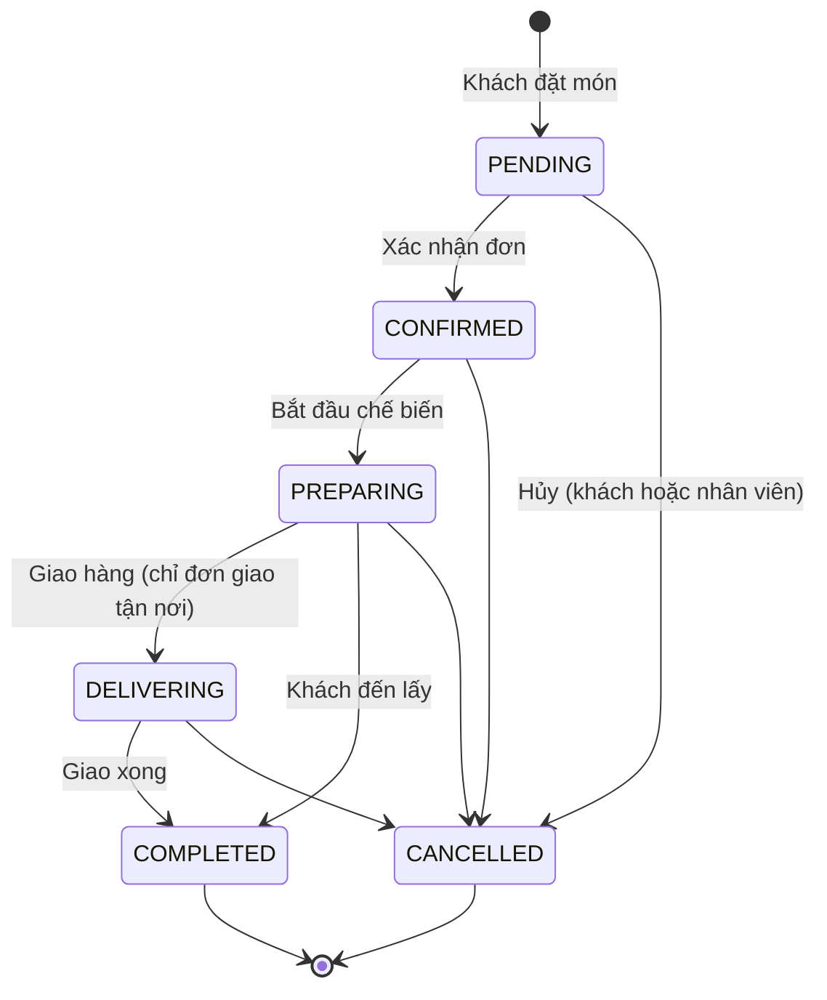

| Trạng thái | Nhãn hiển thị |
|---|---|
| PENDING | Chờ xác nhận |
| CONFIRMED | Đã xác nhận |
| PREPARING | Đang chế biến |
| DELIVERING | Đang giao |
| COMPLETED | Hoàn thành |
| CANCELLED | Đã hủy |

**Thanh toán của đơn (`Order.paymentStatus`):** UNPAID (Chưa thanh toán) → PAID (khi VNPay báo thành công, hoặc đơn tiền mặt Hoàn thành) → REFUNDED (khi đơn đã trả bị hủy).

**Lịch đặt bàn (`Reservation.status`)** — `RESERVATION_FLOW` trong `reservations.controller.js`:

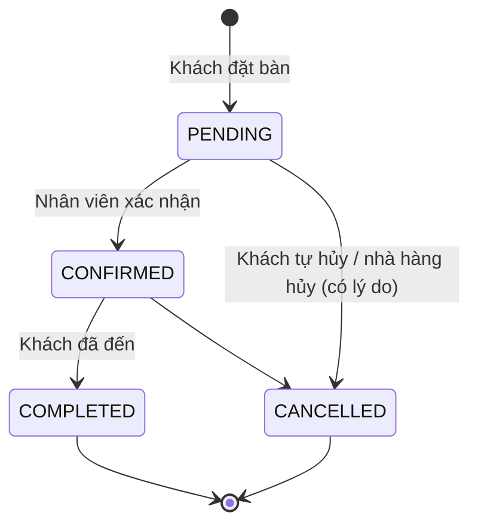

**Một lần thanh toán VNPay (`Payment.status`):**

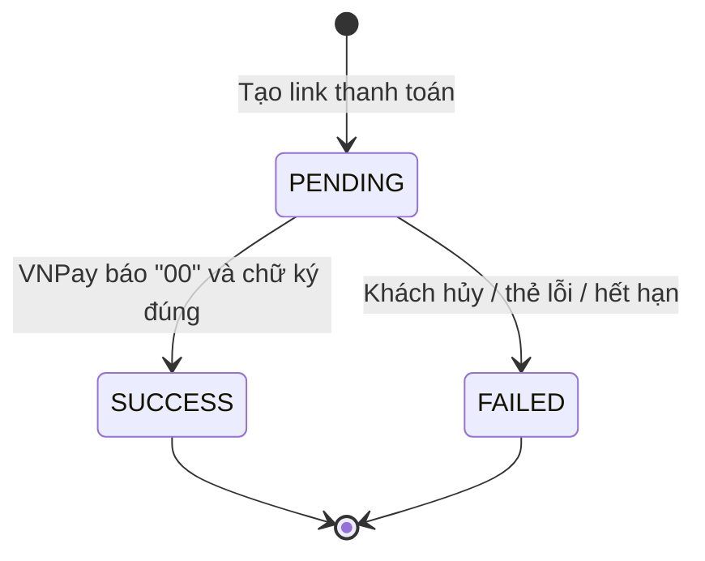

**Việc vệ sinh (`CleaningTask.status`)** — `CLEANING_FLOW` trong `cleaning.controller.js`:

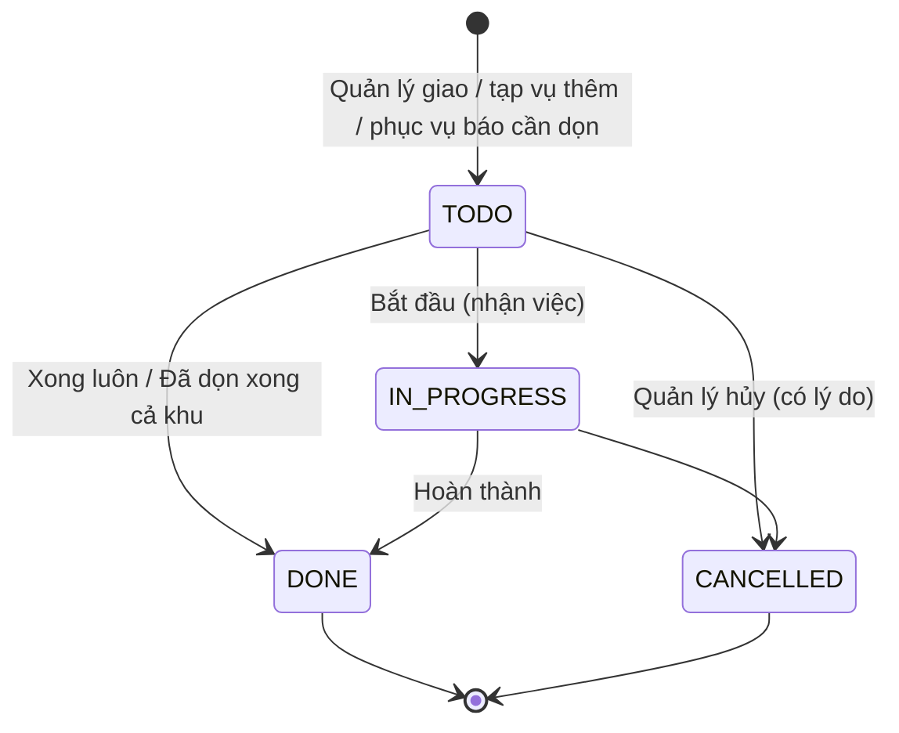

| Trạng thái | Nhãn |
|---|---|
| TODO | Chờ làm |
| IN_PROGRESS | Đang làm |
| DONE | Đã xong |
| CANCELLED | Đã hủy |

**Phiếu sửa chữa (`RepairTicket.status`)** — `REPAIR_FLOW` trong `maintenance.controller.js`:

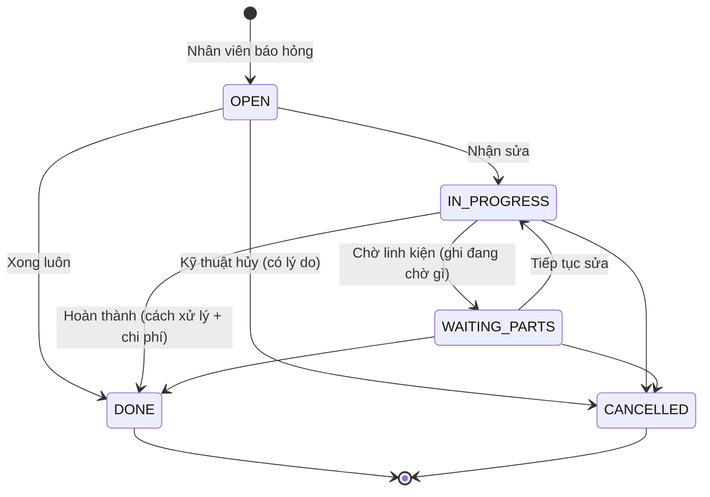

| Trạng thái | Nhãn |
|---|---|
| OPEN | Mới báo |
| IN_PROGRESS | Đang sửa |
| WAITING_PARTS | Chờ linh kiện |
| DONE | Đã sửa xong |
| CANCELLED | Đã hủy |

Bảo trì định kỳ không đi qua quy trình này: bấm "Đã bảo trì" tạo thẳng 1 phiếu `type = MAINTENANCE` ở trạng thái DONE.

**Từng món của đơn ăn tại quán (`OrderItem.status`)**, trong `dine-in.service.js` (đơn online không dùng cột này). Chỉ món bán theo kg đi qua `WEIGHING`:

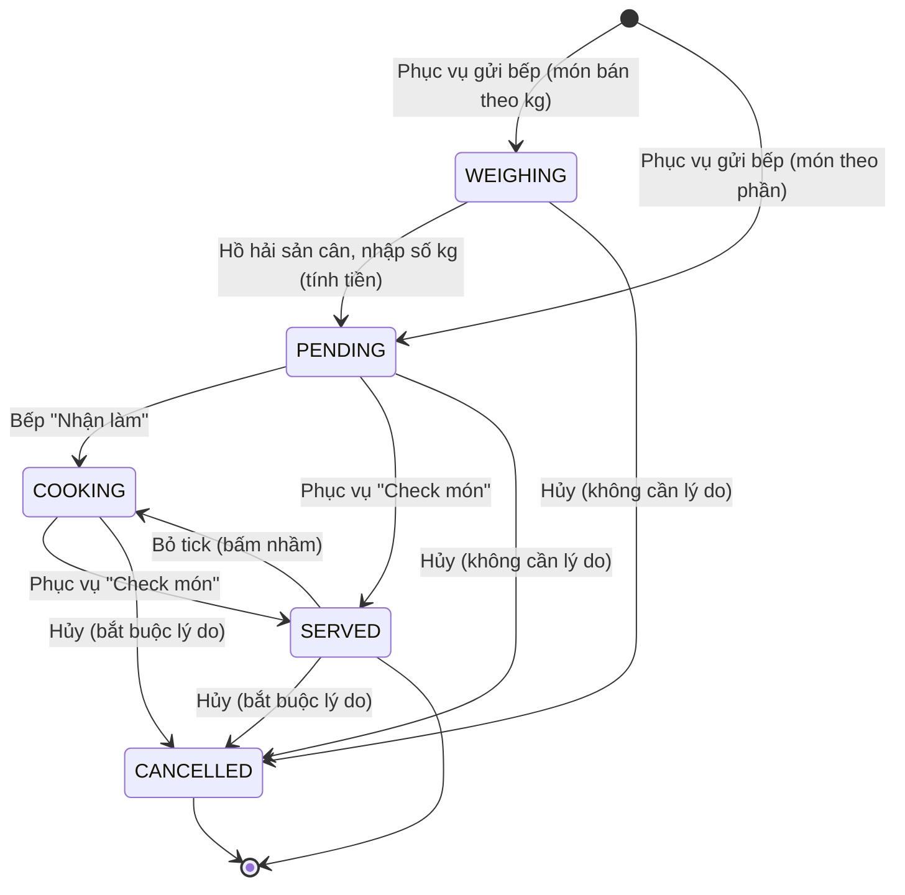

| Trạng thái | Nhãn |
|---|---|
| WEIGHING | Chờ cân (tiền tạm theo số kg phục vụ ghi, bếp chưa thấy) |
| PENDING | Chờ bếp |
| COOKING | Bếp đang làm |
| SERVED | Đã ra bàn |
| CANCELLED | Đã hủy |

Món theo kg ở PENDING (đã cân, bếp chưa nhận làm) vẫn **cân lại** được: số kg và tiền đổi, trạng thái giữ nguyên PENDING. Còn món ở WEIGHING thì đơn chưa gửi thanh toán, chưa thu tiền được (R41).

**Đơn ăn tại quán (`Order.status` khi `type = DINE_IN`)**: backend **tự suy ra từ các món** (`syncOrderStatus` trong `dine-in.service.js`, R51), chỉ "Đã thu tiền" và "Hủy cả đơn" là do người bấm. Cùng enum `OrderStatus` với đơn online nhưng nhãn trên app khác:

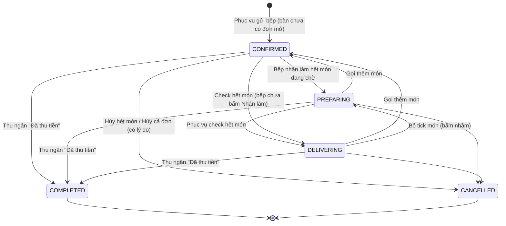

| Trạng thái | Nhãn trên app | Khi nào |
|---|---|---|
| CONFIRMED | Đã gửi bếp | Còn món Chờ cân hoặc Chờ bếp |
| PREPARING | Đang chế biến | Không còn món chờ, còn món Bếp đang làm |
| DELIVERING | Đã lên đủ món | Mọi món còn lại đã ra bàn |
| COMPLETED | Đã thu tiền | Thu ngân bấm "Đã thu tiền" (kèm `paymentStatus = PAID`) |
| CANCELLED | Đã hủy | Hủy hết món ("Đã hủy hết món") hoặc "Hủy cả đơn" (lý do bắt buộc) |

"Chờ thu tiền" (ô bàn màu cam) **không phải trạng thái** mà là cột thời điểm `billRequestedAt` khác rỗng: đơn vẫn giữ trạng thái theo món, nên gọi thêm món sau khi gửi thanh toán thì chỉ cần xóa mốc này. Khi quản lý đổi trạng thái cả đơn trên trang Đơn hàng web, bảng bước hợp lệ là `DINE_IN_FLOW` (`orders.service.js`: từ Đã xác nhận đi thẳng Đã lên món / Hoàn thành được) và các món được đổi theo cho khớp (`syncDineInItems`).

### 4.8 Sơ đồ tuần tự và sơ đồ hoạt động

**Đặt món** (từ bấm nút tới khi có đơn):

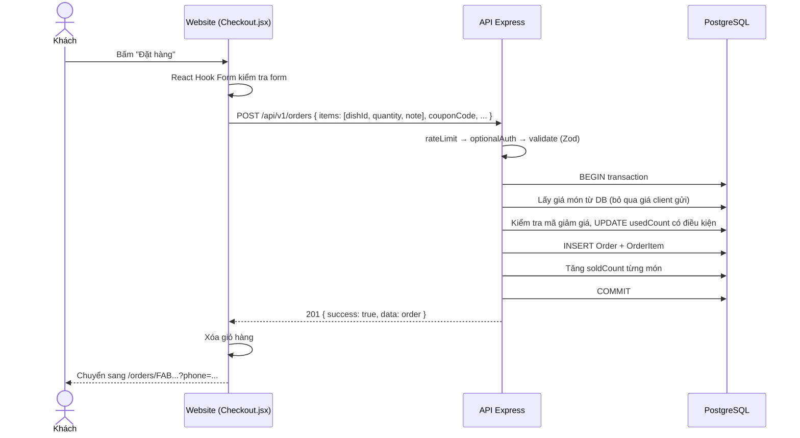

**Thanh toán VNPay** (`docs/11-thanh-toan-vnpay.md`):

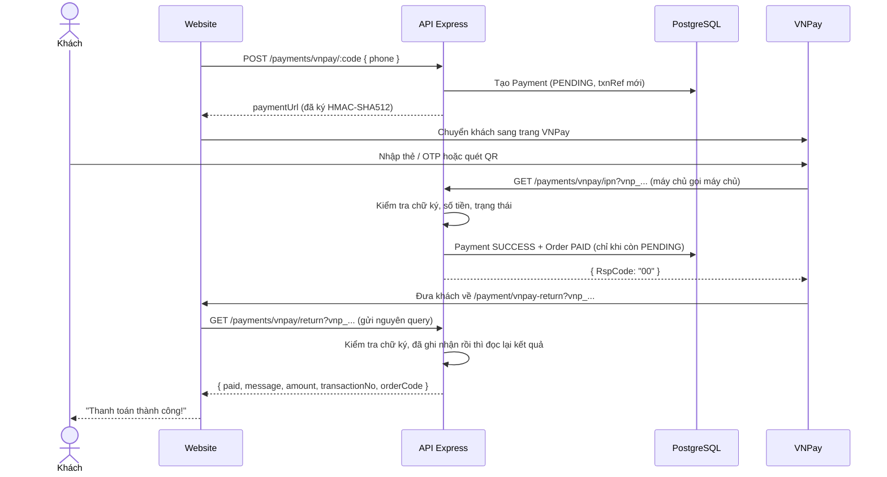

Điểm để giải thích: IPN là kênh đáng tin nhất (chạy cả khi khách tắt trình duyệt). Khi chạy trên máy cá nhân, VNPay không gọi được IPN vào `localhost`, nên trang trả về cũng ghi nhận được (vì dữ liệu có chữ ký). Hai kênh dùng chung một hàm xử lý và câu UPDATE có điều kiện `status = PENDING`, nên không bao giờ ghi nhận 2 lần.

**Đặt bàn có chọn bàn:**

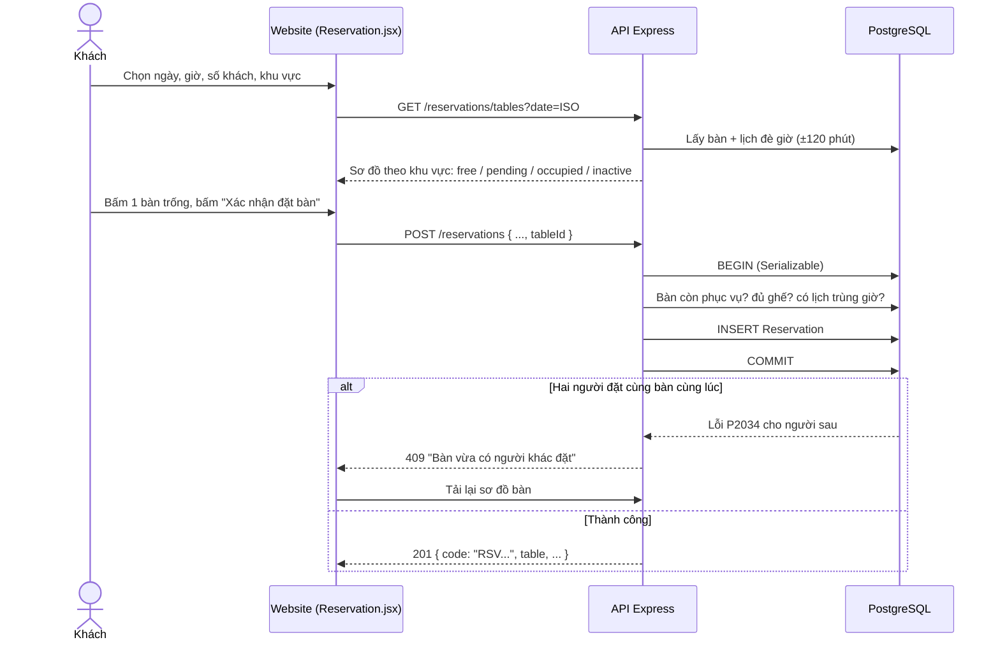

**Lễ tân chuyển bàn** (`MoveTableDialog.jsx`, `reservations.controller.js > moveTable`):

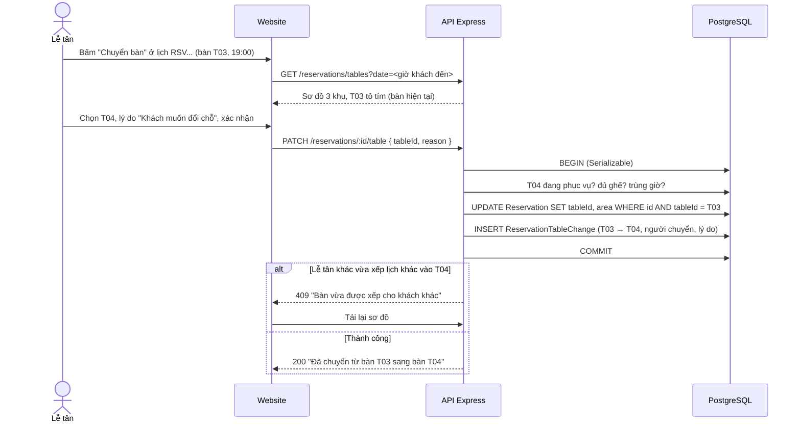

**Báo hỏng → kỹ thuật sửa** (`ReportIssueButton.jsx`, `maintenance.controller.js`):

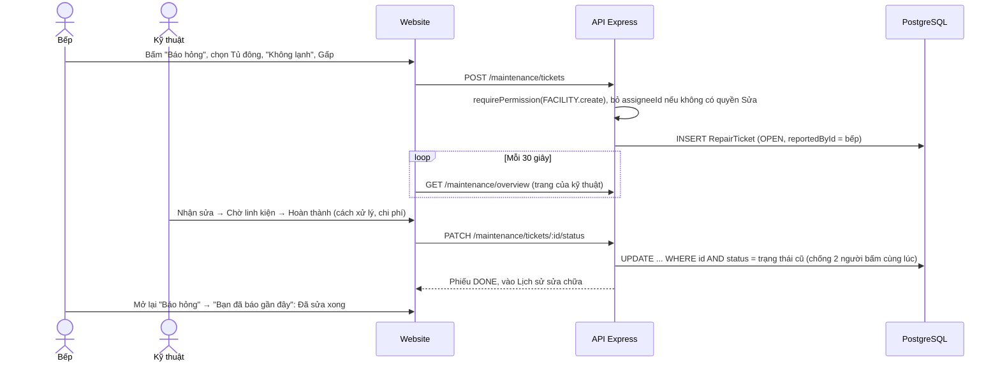

**Cân hải sản bán theo kg** (`Weighing.jsx`, `dine-in.service.js > addItems, weighItem`):

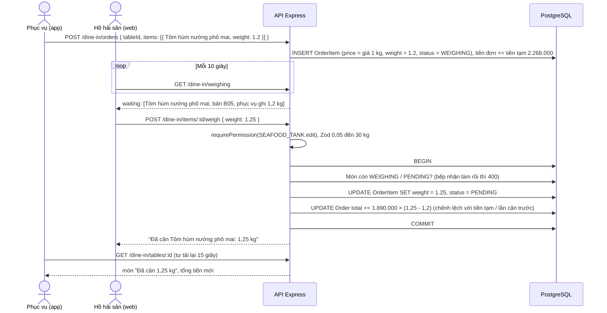

**Ăn tại quán: gửi bếp → nhận làm → check món → gửi thanh toán → in bill → thu tiền** (`s08_cart_screen.dart`, `Kitchen.jsx`, `Cashier.jsx`, `dine-in.service.js`):

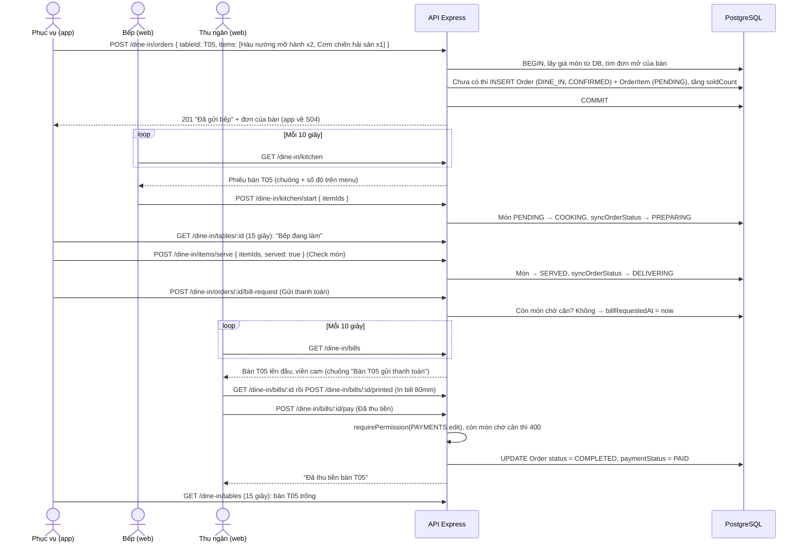

Điểm để giải thích: các bên không gọi nhau trực tiếp mà cùng đọc / ghi một đơn trong DB; mỗi bên tự hỏi lại server theo chu kỳ (polling), nên chậm nhất 10 đến 15 giây là thấy thay đổi. Nếu phục vụ gọi thêm sau khi đã gửi thanh toán, `addItems` xóa `billRequestedAt`, bàn tự rời khỏi đầu danh sách của thu ngân.

**Sơ đồ hoạt động: phục vụ một bàn ăn tại quán** (mỗi khung là một bộ phận; đề cương mục 2.5 yêu cầu sơ đồ hoạt động):

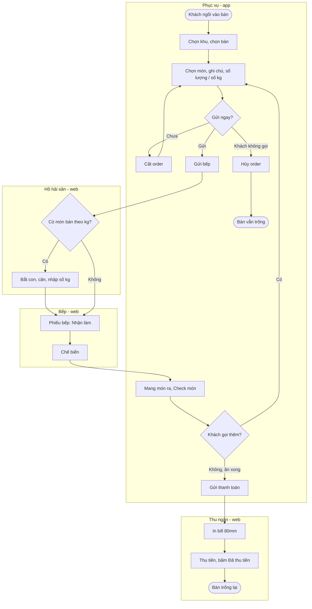

Các nhánh phụ không vẽ để sơ đồ gọn: hủy món (bếp đã làm thì ghi lý do), hủy cả đơn, rút yêu cầu thanh toán, cân lại. Muốn có thêm sơ đồ hoạt động đặt món online / đặt bàn thì vẽ theo luồng chính của UC01, UC03 ở mục 4.5.

### 4.9 Kiến trúc hệ thống

**Kiến trúc tổng thể (client - server, 3 lớp):**

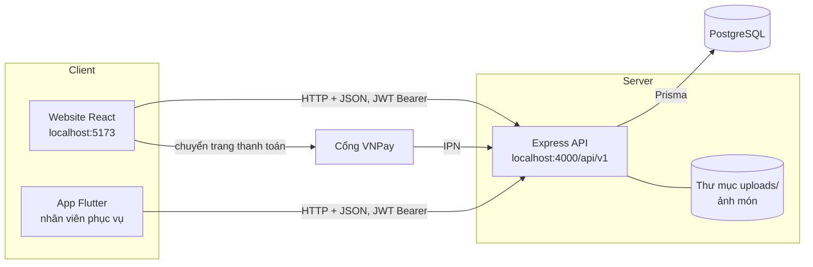

- Frontend chỉ hiển thị và tương tác, không nối thẳng vào DB.
- Backend nhận request, kiểm tra quyền, kiểm tra dữ liệu, xử lý nghiệp vụ, đọc / ghi DB, trả JSON.
- Khi dev, Vite chuyển tiếp (proxy) `/api` và `/uploads` sang cổng 4000 nên không vướng CORS.

**Kiến trúc backend: chia theo module, mỗi module chia lớp:**

```mermaid
flowchart TB
    R[Request] --> MW1[Middleware chung<br/>helmet, cors, json 1MB, morgan]
    MW1 --> RT[routes.js<br/>gắn module vào /api/v1]
    RT --> MW2[Middleware của route<br/>rateLimit → requireAuth / optionalAuth / requirePermission → validate Zod]
    MW2 --> C[Controller<br/>đọc request, trả response]
    C --> S[Service<br/>logic nghiệp vụ: tính tiền, state machine, VNPay]
    S --> P[Prisma Client]
    P --> DB[(PostgreSQL)]
    C -. throw ApiError .-> E[errorHandler<br/>trả JSON lỗi thống nhất]
```

15 module trong `backend/src/modules/`: `auth`, `categories`, `dishes`, `orders`, `payments`, `reservations`, `reviews`, `coupons`, `users`, `stats`, `permissions`, `upload`, `cleaning` (vệ sinh), `maintenance` (kỹ thuật), `dine-in` (ăn tại quán: gọi món tại bàn, phiếu bếp, thu ngân, cân hải sản) (cộng 2 route chung `/health`, `/info`). Mỗi module có `*.routes.js`, `*.controller.js`, `*.validation.js`, và `*.service.js` nếu logic phức tạp.

**Kiến trúc frontend:**

| Lớp | Thư mục | Vai trò |
|---|---|---|
| Trang | `src/pages/` (`account/`, `admin/`) | Mỗi trang 1 file, tải trễ bằng `lazy()` |
| Component | `src/components/` (`ui/`, `layout/`, `cleaning/`, `maintenance/`, `dine-in/`) | Nút, form, modal, bảng, badge...; khung trang khách / admin; sơ đồ bàn, hộp thoại chuyển bàn, ghi chú món; thẻ việc vệ sinh, thẻ phiếu sửa chữa, nút Báo hỏng; chuông báo món chờ cân / gửi bếp / gửi thanh toán, cách tính tiền dòng món theo kg |
| Gọi API | `src/services/index.js` | Toàn bộ hàm gọi API ở một chỗ |
| Trạng thái client | `src/stores/` | Zustand: `auth` (token + user), `cart` (giỏ hàng), cả hai lưu localStorage |
| Tiện ích | `src/lib/` | axios + interceptor, định dạng tiền / ngày, hằng số trạng thái, kiểm tra quyền, menu admin |

**Ba loại trạng thái và công cụ cho từng loại:** dữ liệu từ server → React Query; trạng thái dùng chung phía client (giỏ, đăng nhập) → Zustand; trạng thái của form → React Hook Form. Bộ lọc thực đơn, tab đơn hàng → lưu trên URL.

**Kiến trúc app mobile** (`mobile/lib/`, chi tiết ở [docs/19](19-app-mobile.md) mục 2), chia lớp giống web:

| Lớp | Thư mục | Vai trò | Tương ứng ở web |
|---|---|---|---|
| Màn hình | `screens/` | Mỗi màn 1 file, tên bắt đầu bằng mã màn (`tables/s04_table_order_screen.dart`); màn dài tách khối vào `parts/` | `pages/` |
| Mảnh giao diện dùng chung | `widgets/` | Thẻ món, thanh phiếu nổi, nhãn trạng thái, bộ chọn số lượng / số kg (bấm số để gõ), ô ghi chú... | `components/` |
| Gọi API | `services/` | `api_client.dart` (gắn token, bóc `data` / `meta`, đổi lỗi sang tiếng Việt, xử lý 401, 429), `auth_service.dart`, `dish_service.dart`, `dine_in_service.dart` | `services/index.js`, `lib/api.js` |
| Trạng thái dùng chung | `state/` | Riverpod: `auth_state.dart` (chỉ nhận nhân viên có quyền đơn hàng), `cart_state.dart` (phiếu gọi món, order đã cất) | `stores/` |
| Dữ liệu | `models/` | `User` (+ quyền), `Dish`, `CartItem`, `Order` + `OrderItem` (trạng thái món, `lineTotal`), `DiningTable` | |
| Khung app | `app/` | `router.dart` (go_router), `app_drawer.dart` (menu trái), `main_shell.dart` (3 màn chính, nút quay lại về S03) | `App.jsx`, `AdminLayout.jsx` |
| Tiện ích, giao diện | `utils/`, `theme/` | Định dạng tiền / giờ VN / số kg; bảng màu và font dùng chung với web | `lib/format.js`, `index.css` |

### 4.10 Thiết kế cơ sở dữ liệu

#### 4.10.1 Sơ đồ quan hệ (ERD) đầy đủ

```mermaid
erDiagram
    StaffRole ||--o{ RolePermission : "có quyền"
    StaffRole |o--o{ User : "gán cho"
    User |o--o{ Order : "đặt"
    User |o--o{ Reservation : "đặt bàn"
    User ||--o{ Review : "viết"
    Category ||--o{ Dish : "chứa"
    Dish ||--o{ OrderItem : "nằm trong"
    Dish ||--o{ Review : "được đánh giá"
    Order ||--|{ OrderItem : "gồm"
    Order ||--o{ Payment : "thanh toán"
    DiningTable |o--o{ Reservation : "được đặt"
    DiningTable |o--o{ Order : "đơn tại bàn"
    User |o--o{ Order : "nhân viên mở đơn"
    Reservation ||--o{ ReservationTableChange : "lịch sử chuyển bàn"
    User |o--o{ ReservationTableChange : "chuyển"
    CleaningArea ||--o{ CleaningTask : "có việc"
    User |o--o{ CleaningTask : "làm / báo"
    Equipment ||--o{ RepairTicket : "có phiếu"
    User |o--o{ RepairTicket : "báo / sửa"

    User {
      int id PK
      string email UK
      string passwordHash
      enum role "CUSTOMER | STAFF | ADMIN"
      bool isActive
      int staffRoleId FK "chỉ khi STAFF"
    }
    StaffRole {
      int id PK
      string key UK
      string name
      bool isSystem
    }
    RolePermission {
      int id PK
      int roleId FK
      string module
      bool canView
      bool canCreate
      bool canEdit
      bool canDelete
    }
    Category {
      int id PK
      string slug UK
      int sortOrder
    }
    Dish {
      int id PK
      string slug UK
      int price "món kg: giá 1 kg"
      int salePrice "có thể trống"
      string unit "kg = bán theo kg"
      bool isAvailable
      bool isFeatured "Best seller"
      int soldCount
      float ratingAvg
      int categoryId FK
    }
    Order {
      int id PK
      string code UK
      int userId FK "trống = khách vãng lai"
      int tableId FK "đơn tại quán"
      int staffId FK "đơn tại quán"
      enum type "DELIVERY | PICKUP | DINE_IN"
      enum status
      enum paymentMethod
      enum paymentStatus
      int total
      string couponCode
      string cancelReason
      datetime billRequestedAt "gửi thanh toán lúc"
      datetime billPrintedAt
    }
    OrderItem {
      int id PK
      int orderId FK
      int dishId FK
      string name "lưu lúc đặt"
      int price "lưu lúc đặt"
      int quantity
      string note
      enum status "đơn tại quán"
      float weight "số kg, món theo kg"
    }
    Payment {
      int id PK
      int orderId FK
      string txnRef UK
      int amount
      enum status
      string transactionNo
    }
    Reservation {
      int id PK
      string code UK
      datetime date
      int guests
      int tableId FK
      enum status
      string cancelReason
    }
    DiningTable {
      int id PK
      string code UK
      string area
      int seats
      int x
      int y
      bool isActive
    }
    Review {
      int id PK
      int userId FK
      int dishId FK
      int rating "1 đến 5"
    }
    Coupon {
      int id PK
      string code UK
      enum type
      int value
      int usageLimit
      int usedCount
    }
    ReservationTableChange {
      int id PK
      int reservationId FK
      string fromTableCode "trống = xếp bàn lần đầu"
      string toTableCode
      string reason
      int changedById FK
    }
    CleaningArea {
      int id PK
      string name UK
      bool isActive
      datetime lastCleanedAt
    }
    CleaningTask {
      int id PK
      string title
      int areaId FK
      enum priority
      enum status
      int assigneeId FK
      int createdById FK
      datetime completedAt
    }
    Equipment {
      int id PK
      string name UK
      string category
      int maintenanceDays
      datetime lastMaintainedAt
      bool isActive
    }
    RepairTicket {
      int id PK
      enum type "REPAIR | MAINTENANCE"
      int equipmentId FK
      enum priority
      enum status
      int reportedById FK
      int assigneeId FK
      int cost "VNĐ"
      datetime completedAt
    }
```

Ghi chú: `Coupon` không nối khóa ngoại với `Order`; đơn lưu `couponCode` dạng chữ để mã có bị xóa thì đơn cũ vẫn còn thông tin.

#### 4.10.2 Từ điển dữ liệu

Kiểu: `Int` số nguyên, `String` chuỗi (PostgreSQL `TEXT`), `Boolean`, `DateTime` (lưu giờ UTC), `Float`, `Json`. "?" = được để trống. Mọi bảng có `id Int` khóa chính tự tăng.

**User (tài khoản)**

| Cột | Kiểu | Ràng buộc / mặc định | Ý nghĩa |
|---|---|---|---|
| name | String | | Họ tên |
| email | String | Duy nhất | Email đăng nhập |
| phone | String? | | Số điện thoại |
| passwordHash | String | | Mật khẩu đã băm bcrypt |
| role | Role | Mặc định CUSTOMER | Loại tài khoản |
| address | String? | | Địa chỉ mặc định khi đặt hàng |
| avatar | String? | | Ảnh đại diện |
| isActive | Boolean | Mặc định true | false = bị khóa |
| staffRoleId | Int? | FK → StaffRole, xóa vai trò thì đặt null | Vai trò nhân viên |
| createdAt, updatedAt | DateTime | Tự điền | |

**StaffRole (vai trò nhân viên)**

| Cột | Kiểu | Ràng buộc / mặc định | Ý nghĩa |
|---|---|---|---|
| key | String | Duy nhất | Mã viết hoa, vd `CASHIER`; tạo từ tên, vd "Bảo vệ ca đêm" → `BAO_VE_CA_DEM` |
| name | String | | Tên hiển thị |
| description | String? | | Công việc chính |
| sortOrder | Int | 0 | Thứ tự hiển thị |
| isSystem | Boolean | false | Vai trò mặc định, không cho xóa |

**RolePermission (quyền của vai trò trên 1 chức năng)**

| Cột | Kiểu | Ràng buộc | Ý nghĩa |
|---|---|---|---|
| roleId | Int | FK → StaffRole, xóa vai trò thì xóa theo | |
| module | String | Duy nhất cùng roleId | Mã chức năng, vd `ORDERS` |
| canView, canCreate, canEdit, canDelete | Boolean | Mặc định false | Xem / Thêm / Sửa / Xóa |

**Category (danh mục)**

| Cột | Kiểu | Ràng buộc / mặc định | Ý nghĩa |
|---|---|---|---|
| name | String | | Tên danh mục |
| slug | String | Duy nhất | Tên không dấu cho URL, vd `tom-hum` |
| description, image | String? | | |
| sortOrder | Int | 0 | Số nhỏ hiện trước |

**Dish (món ăn)**

| Cột | Kiểu | Ràng buộc / mặc định | Ý nghĩa |
|---|---|---|---|
| name | String | | Tên món |
| slug | String | Duy nhất | Trùng thì thêm số: `tom-hap-bia-2` |
| description | String? | | |
| price | Int | > 0 | Giá gốc (VNĐ). Món bán theo kg: giá 1 kg |
| salePrice | Int? | < price | Giá khuyến mãi |
| unit | String | "phần" | Đơn vị: phần, kg, lon, chai...; `kg` = **bán theo kg** (không đặt online, tại quán cân rồi mới tính tiền) |
| image | String? | | Link ảnh hoặc `/uploads/...` |
| isAvailable | Boolean | true | Đang bán |
| isFeatured | Boolean | false | **Best seller**: hiện ở khối Best seller trang chủ, nhãn cam trên thẻ món |
| soldCount | Int | 0 | Số đã bán (lưu sẵn) |
| ratingAvg | Float | 0 | Điểm trung bình (lưu sẵn) |
| ratingCount | Int | 0 | Số lượt đánh giá (lưu sẵn) |
| categoryId | Int | FK → Category, có index | |

**Order (đơn hàng)**

| Cột | Kiểu | Ràng buộc / mặc định | Ý nghĩa |
|---|---|---|---|
| code | String | Duy nhất | Mã đơn cho khách, vd `FAB261022482913` (đơn tại quán cũng có mã `FAB...`) |
| userId | Int? | FK → User, có index | Trống = khách vãng lai (đơn tại quán luôn trống) |
| customerName, phone | String | | Người nhận. Đơn tại quán: "Khách bàn B05", SĐT để trống |
| address | String? | | Chỉ có khi giao tận nơi |
| tableId | Int? | FK → DiningTable, xóa bàn thì đặt null; index (tableId, status) | Đơn tại quán: bàn của khách (tìm nhanh đơn mở của bàn) |
| staffId | Int? | FK → User, xóa người thì đặt null | Đơn tại quán: nhân viên mở đơn (tên in trên bill, phiếu bếp) |
| type | OrderType | DELIVERY | Giao tận nơi / đến lấy / ăn tại quán (`DINE_IN`) |
| status | OrderStatus | PENDING, có index | |
| paymentMethod | PaymentMethod | COD | |
| paymentStatus | PaymentStatus | UNPAID | |
| subtotal | Int | | Tạm tính |
| discount | Int | 0 | Số tiền giảm |
| shippingFee | Int | 0 | Phí giao |
| total | Int | | Tổng phải trả |
| couponCode | String? | | Mã đã dùng |
| note | String? | | Ghi chú đơn |
| cancelReason | String? | ≤ 300 ký tự | Lý do nhà hàng hủy đơn, khách xem được; trống = khách tự hủy |
| billRequestedAt | DateTime? | | Đơn tại quán: lúc phục vụ bấm "Gửi thanh toán" (khác rỗng = bàn "Chờ thu tiền"); gọi thêm món thì xóa |
| billPrintedAt | DateTime? | | Đơn tại quán: lần in bill gần nhất |
| createdAt | DateTime | có index | Đơn tại quán: lúc mở bàn (lần gửi bếp đầu tiên) |

**OrderItem (chi tiết đơn)**

| Cột | Kiểu | Ràng buộc | Ý nghĩa |
|---|---|---|---|
| orderId | Int | FK → Order, xóa đơn thì xóa theo; index (orderId, status) | |
| dishId | Int | FK → Dish | |
| name, price | String, Int | | Tên và giá **tại lúc đặt**. Món bán theo kg: `price` là giá 1 kg |
| quantity | Int | 1 đến 50 | |
| note | String? | ≤ 200 ký tự | Ghi chú khẩu vị của món |
| createdAt | DateTime | Tự điền | Đơn tại quán: lúc gửi bếp (mỗi lần gọi thêm là dòng mới) |
| status | OrderItemStatus | PENDING | Chỉ đơn tại quán: Chờ cân / Chờ bếp / Bếp đang làm / Đã ra bàn / Đã hủy |
| servedAt | DateTime? | | Lúc phục vụ "Check món" |
| cancelReason, cancelledAt | String?, DateTime? | | Lý do hủy món (bắt buộc khi bếp đã làm), lúc hủy |
| weight | Float? | Kiểm tra ở API: 0,05 đến 30, làm tròn tới gam | Số kg thực tế hồ hải sản cân. `null` = món theo phần hoặc chưa cân. Tiền dòng = `price × weight` |
| weighedAt | DateTime? | | Lúc cân |

**Payment (một lần thanh toán VNPay)**

| Cột | Kiểu | Ràng buộc / mặc định | Ý nghĩa |
|---|---|---|---|
| orderId | Int | FK → Order, có index | |
| provider | String | "VNPAY" | |
| txnRef | String | Duy nhất | Mã giao dịch gửi VNPay = mã đơn + thời điểm (cơ số 36) |
| amount | Int | | Số tiền lúc tạo link |
| status | PaymentTxnStatus | PENDING | |
| transactionNo | String? | | Mã giao dịch phía VNPay |
| bankCode, responseCode | String? | | Ngân hàng, mã phản hồi ("00" = thành công) |
| paidAt | DateTime? | | Thời điểm trả tiền |
| rawData | Json? | | Toàn bộ dữ liệu VNPay gửi về, để đối soát |

**Reservation (lịch đặt bàn)**

| Cột | Kiểu | Ràng buộc / mặc định | Ý nghĩa |
|---|---|---|---|
| code | String | Duy nhất | vd `RSV261022123456` |
| userId | Int? | FK → User | |
| name, phone | String | | |
| email | String? | | |
| date | DateTime | có index | Ngày giờ đến |
| guests | Int | 1 đến 50 | Số khách |
| area | String? | | Khu vực mong muốn |
| tableId | Int? | FK → DiningTable, xóa bàn thì đặt null; index (tableId, date) | Bàn đã chọn |
| note | String? | | |
| status | ReservationStatus | PENDING | |
| cancelReason | String? | ≤ 300 ký tự | Lý do nhà hàng hủy; trống = khách tự hủy |

**DiningTable (bàn)**

| Cột | Kiểu | Ràng buộc / mặc định | Ý nghĩa |
|---|---|---|---|
| code | String | Duy nhất | Số bàn: T01, B03, VIP1 |
| area | String | | Khớp 1 trong 3 khu vực |
| seats | Int | | Số ghế tối đa |
| x, y | Int | | Cột, hàng trên sơ đồ (từ 1) |
| isActive | Boolean | true | false = bàn hỏng / đang sửa |

**Review (đánh giá)**

| Cột | Kiểu | Ràng buộc | Ý nghĩa |
|---|---|---|---|
| userId | Int | FK → User, xóa theo | |
| dishId | Int | FK → Dish, xóa theo | |
| rating | Int | 1 đến 5 | |
| comment | String? | ≤ 1000 ký tự | |
| | | Duy nhất (userId, dishId) | Mỗi người 1 đánh giá / món |

**Coupon (mã giảm giá)**

| Cột | Kiểu | Ràng buộc / mặc định | Ý nghĩa |
|---|---|---|---|
| code | String | Duy nhất, viết hoa, 3 đến 30 ký tự | |
| description | String? | | |
| type | CouponType | | PERCENT (%) / FIXED (số tiền) |
| value | Int | > 0; % thì ≤ 100 | |
| minOrder | Int | 0 | Đơn tối thiểu |
| maxDiscount | Int? | | Giảm tối đa (cho loại %) |
| usageLimit | Int? | | Trống = không giới hạn |
| usedCount | Int | 0 | Đã dùng |
| startsAt, expiresAt | DateTime? | | Thời gian hiệu lực |
| isActive | Boolean | true | |

**ReservationTableChange (lịch sử chuyển bàn)**

| Cột | Kiểu | Ràng buộc / mặc định | Ý nghĩa |
|---|---|---|---|
| reservationId | Int | FK → Reservation, xóa lịch thì xóa theo; có index | |
| fromTableCode, fromArea | String? | | Bàn cũ (lưu mã dạng chữ); trống = lần xếp bàn đầu tiên |
| toTableCode, toArea | String | | Bàn mới |
| reason | String? | ≤ 200 ký tự | Lý do, chỉ nhân viên thấy |
| changedById | Int? | FK → User, xóa người thì đặt null | Nhân viên chuyển |
| createdAt | DateTime | Tự điền | |

**CleaningArea (khu vực vệ sinh)**

| Cột | Kiểu | Ràng buộc / mặc định | Ý nghĩa |
|---|---|---|---|
| name | String | Duy nhất | vd "Nhà vệ sinh nữ", "Khu rửa chén bát" |
| description | String? | | Việc thường làm ở khu này |
| sortOrder | Int | 0 | Thứ tự hiển thị |
| isActive | Boolean | true | false = ẩn (đang sửa chữa) |
| lastCleanedAt | DateTime? | | Lần gần nhất có việc ở khu này xong |

**CleaningTask (việc vệ sinh)**

| Cột | Kiểu | Ràng buộc / mặc định | Ý nghĩa |
|---|---|---|---|
| title | String | 2 đến 120 ký tự | vd "Nhà vệ sinh nữ hết giấy" |
| note | String? | ≤ 500 ký tự | Mô tả thêm lúc tạo |
| areaId | Int | FK → CleaningArea; index (areaId, status) | |
| priority | CleaningPriority | NORMAL | Gấp thì xếp lên đầu |
| status | CleaningStatus | TODO, có index | |
| assigneeId | Int? | FK → User, có index | Người làm; trống = chưa ai nhận |
| createdById | Int? | FK → User | Người giao / báo |
| startedAt, completedAt | DateTime? | completedAt có index | Lúc bắt đầu, lúc xong / hủy |
| resultNote | String? | ≤ 300 ký tự | Ghi chú khi xong hoặc lý do hủy |

**Equipment (thiết bị)**

| Cột | Kiểu | Ràng buộc / mặc định | Ý nghĩa |
|---|---|---|---|
| name | String | Duy nhất | vd "Máy sục khí hồ tôm hùm" |
| category | String | Thuộc 6 nhóm cố định | Điện lạnh, Hồ hải sản, Bếp, Điện nước, An toàn, Khác |
| location | String? | | Vị trí |
| maintenanceDays | Int? | 1 đến 3650 | Chu kỳ bảo trì; trống = không bảo trì định kỳ |
| lastMaintainedAt | DateTime? | | Lần bảo trì gần nhất |
| note | String? | | Hãng, SĐT thợ bảo hành |
| sortOrder | Int | 0 | |
| isActive | Boolean | true | false = ngưng sử dụng / thanh lý |

**RepairTicket (phiếu sửa chữa / lần bảo trì)**

| Cột | Kiểu | Ràng buộc / mặc định | Ý nghĩa |
|---|---|---|---|
| type | RepairType | REPAIR | Sửa sự cố / bảo trì định kỳ |
| title | String | 3 đến 120 ký tự | vd "Tủ đông hải sản không lạnh" |
| description | String? | ≤ 500 ký tự | Mô tả của người báo |
| equipmentId | Int | FK → Equipment; index (equipmentId, status) | |
| priority | RepairPriority | NORMAL | Gấp = ảnh hưởng khách / an toàn |
| status | RepairStatus | OPEN, có index | |
| reportedById | Int? | FK → User, có index | Người báo |
| assigneeId | Int? | FK → User, có index | Kỹ thuật nhận sửa |
| waitingNote | String? | | Đang chờ gì (khi Chờ linh kiện) |
| resolution | String? | ≤ 500 ký tự | Cách xử lý (bắt buộc khi xong) hoặc lý do hủy |
| cost | Int? | ≥ 0 | Chi phí VNĐ (linh kiện, thuê thợ) |
| startedAt, completedAt | DateTime? | completedAt có index | |

**Các kiểu liệt kê (enum):**

| Enum | Giá trị |
|---|---|
| Role | CUSTOMER, STAFF, ADMIN |
| OrderType | DELIVERY, PICKUP, DINE_IN (ăn tại quán) |
| OrderStatus | PENDING, CONFIRMED, PREPARING, DELIVERING, COMPLETED, CANCELLED |
| OrderItemStatus | WEIGHING (chờ cân, chỉ món bán theo kg), PENDING, COOKING, SERVED, CANCELLED |
| PaymentMethod | COD, ONLINE |
| PaymentStatus | UNPAID, PAID, REFUNDED |
| PaymentTxnStatus | PENDING, SUCCESS, FAILED |
| ReservationStatus | PENDING, CONFIRMED, CANCELLED, COMPLETED |
| CouponType | PERCENT, FIXED |
| CleaningStatus | TODO, IN_PROGRESS, DONE, CANCELLED |
| CleaningPriority | NORMAL, URGENT |
| RepairStatus | OPEN, IN_PROGRESS, WAITING_PARTS, DONE, CANCELLED |
| RepairType | REPAIR, MAINTENANCE |
| RepairPriority | NORMAL, URGENT |

#### 4.10.3 Các quyết định thiết kế (nên giải thích trong báo cáo)

| Quyết định | Lý do |
|---|---|
| Tiền lưu kiểu số nguyên (VNĐ) | Số thực bị sai số (`0.1 + 0.2 = 0.30000000000000004`); tiền Việt không có phần lẻ |
| `Order.userId` được để trống | Khách không cần tài khoản vẫn đặt được, tăng tỉ lệ chốt đơn |
| `OrderItem` lưu lại tên và giá | "Ảnh chụp" lúc mua; món đổi giá sau đó thì đơn cũ vẫn đúng |
| Mã đơn `code` riêng ngoài `id` | Không lộ `id` tăng dần (đoán được số đơn của quán); mã dễ đọc qua điện thoại |
| Lưu sẵn `soldCount`, `ratingAvg`, `ratingCount` | Sắp xếp "bán chạy", "đánh giá cao" nhanh, không phải tính lại mỗi lần đọc; đổi lại phải cập nhật khi có đơn / đánh giá |
| Bảng `Payment` riêng | Một đơn có thể thanh toán nhiều lần (hủy rồi trả lại); lưu mã giao dịch VNPay để đối soát khi có khiếu nại |
| Quyền lưu trong DB, danh sách chức năng nằm trong code | Admin chỉnh quyền trên giao diện không cần sửa code; chức năng mới cần code mới nên khai báo trong code là hợp lý |
| Bàn có tọa độ x, y | Vẽ sơ đồ giống vị trí thật trong nhà hàng |
| `cancelReason` trống / có | Có lý do ⇒ nhà hàng hủy; trống ⇒ khách tự hủy. Không cần thêm cột "ai hủy" |
| Index trên `Order.status`, `createdAt`, `userId`, `(tableId, status)`, `OrderItem(orderId, status)`, `Dish.categoryId`, `Reservation.date`, `(tableId, date)` | Tăng tốc các truy vấn lọc hay dùng (vd tìm đơn mở của 1 bàn, món chờ bếp của 1 đơn) |
| `slug` | URL đẹp, tốt cho SEO: `/menu/tom-su-hap-bia` |
| "Khu vực cần dọn", "thiết bị có sự cố" **tính từ bảng việc / phiếu**, không lưu cột trạng thái riêng | Một nguồn dữ liệu: việc xong là khu tự xanh lại, không bao giờ lệch giữa "khu bẩn" và "danh sách việc" |
| Bảo trì định kỳ lưu chung bảng `RepairTicket` (`type = MAINTENANCE`) | Lịch sử và tổng chi phí của sửa chữa lẫn bảo trì nằm một chỗ, lọc được theo loại |
| `ReservationTableChange` lưu **mã bàn dạng chữ** | Giống `OrderItem` lưu tên món: bàn đổi mã hoặc bị xóa thì lịch sử vẫn đọc đúng |
| Tách chức năng `CLEANING` khỏi `FACILITY` | Nếu dùng chung, Kỹ thuật / Bếp / Hồ hải sản (có quyền Thiết bị) sẽ thấy thêm 4 trang vệ sinh không liên quan |
| Migration kèm câu SQL cấp quyền | Chức năng mới thêm vào code thì vai trò cũ trong DB chưa có quyền; migration `them_ve_sinh` tự `INSERT RolePermission` cho vai trò mặc định nên máy đang có dữ liệu chỉ cần `db:deploy` |
| Bán theo kg nhận biết bằng `Dish.unit = 'kg'`, không thêm cột riêng | Admin đổi món sang bán theo kg ngay trên form Món ăn, không cần sửa code; một hàm `isSoldByWeight` dùng chung |
| `OrderItem.price` của món theo kg là **giá 1 kg**, số kg để riêng ở `weight` | Bill in được "1,25 kg x 1.890.000/kg"; cân lại chỉ cần đổi `weight`, tiền tính lại từ 2 cột, không mất giá gốc |
| Món chờ cân **cộng tiền tạm** theo số kg phục vụ ghi (mặc định 1 kg) | Phục vụ, thu ngân thấy ngay tổng tiền gần đúng; hồ hải sản cân thật thì chỉ cộng / trừ phần chênh lệch. Còn món chờ cân thì chưa gửi thanh toán / thu tiền được, nên khách không bao giờ trả theo số tạm |
| Trạng thái `WEIGHING` thêm vào trước `PENDING` thay vì cờ "đã cân" riêng | Phiếu bếp chỉ lấy món PENDING / COOKING nên tự không thấy món chưa cân; gửi thanh toán / thu tiền chỉ cần kiểm "còn món WEIGHING không" |
| Đổi thực đơn **không xóa** món đã bán | Đơn cũ trỏ tới món qua `dishId`; món cũ đã bán chỉ ẩn và gom vào nhóm "Ngừng bán (thực đơn cũ)", lịch sử đơn và đánh giá vẫn đúng |
| Đơn ăn tại quán dùng chung bảng `Order` (`type = DINE_IN`), không tạo bảng riêng | Doanh thu ở Tổng quan, trang Đơn hàng, mã đơn, số đã bán dùng lại được ngay; chỉ thêm vài cột cho phép trống (`tableId`, `staffId`, `billRequestedAt`, `billPrintedAt`) nên đơn online không đổi gì |
| Trạng thái từng món (`OrderItem.status`) + trạng thái đơn **suy ra từ món** | Tại quán mỗi món đi một nhịp (món này đã ra, món kia bếp đang làm, món nọ bị hủy) nên trạng thái phải nằm ở từng món; trạng thái đơn tính lại sau mỗi thay đổi (`syncOrderStatus`) nên không bao giờ lệch với các món |
| Mỗi lần gửi bếp là **dòng món mới**, không cộng dồn vào dòng cũ | Bếp biết món nào gọi sau (giờ gửi = `OrderItem.createdAt`), món cũ có thể đã làm / đã ra; hủy một phần thì tách thành dòng riêng để giữ lý do và giờ hủy |
| "Gửi thanh toán" lưu thành **thời điểm** `billRequestedAt`, không thêm trạng thái mới | Bàn đang chờ thu tiền vẫn có thể còn món bếp đang làm; gọi thêm chỉ cần xóa mốc này, không đụng tới trạng thái đơn |
| Phiếu chưa gửi bếp và order đã cất **lưu trên điện thoại**, không lưu DB | Chưa gửi bếp thì chưa ảnh hưởng ai, khỏi phải dọn đơn nháp trên server; đổi lại máy khác không thấy (nêu ở hạn chế) |

#### 4.10.4 Lịch sử thay đổi cấu trúc (migration)

| Migration | Nội dung |
|---|---|
| `20261001071005_init` | 8 bảng ban đầu: User, Category, Dish, Order, OrderItem, Reservation, Review, Coupon và 7 enum |
| `20261009020552_add_payment` | Bảng Payment + enum PaymentTxnStatus |
| `20261013011838_add_role_permissions` | Bảng StaffRole, RolePermission |
| `20261013025332_add_staff_accounts` | Thêm giá trị STAFF vào Role, cột `User.staffRoleId` |
| `20261013061006_add_dining_tables` | Bảng DiningTable, cột `Reservation.tableId` |
| `20261021100003_them_ly_do_huy_dat_ban` | Cột `Reservation.cancelReason` |
| `20261022093956_them_ghi_chu_tung_mon` | Cột `OrderItem.note` |
| `20261112131225_them_ly_do_huy_don_hang` | Cột `Order.cancelReason` |
| `20261119031859_them_ve_sinh` | Bảng CleaningArea, CleaningTask, 2 enum; **kèm dữ liệu**: cấp quyền `CLEANING` cho các vai trò có sẵn, bỏ quyền xem Đặt bàn của Tạp vụ |
| `20261119034706_them_lich_su_chuyen_ban` | Bảng ReservationTableChange |
| `20261119075222_them_ky_thuat_sua_chua` | Bảng Equipment, RepairTicket, 3 enum |
| `20261120142816_them_don_an_tai_quan` | Đơn ăn tại quán: giá trị `DINE_IN` của OrderType, cột `Order.tableId`, `staffId`, `OrderItem.createdAt` |
| `20261120152428_them_trang_thai_mon_thanh_toan_tai_ban` | Enum OrderItemStatus, cột `OrderItem.status`, `servedAt`, `cancelReason`, `cancelledAt`; `Order.billRequestedAt`, `billPrintedAt`; **kèm dữ liệu**: món của đơn tại quán cũ lấy trạng thái theo đơn |
| `20261122011700_can_hai_san_theo_kg` | Thêm giá trị `WEIGHING` (chờ cân) vào OrderItemStatus; cột `OrderItem.weight` (số kg), `weighedAt` |

Các migration sau đều chỉ **thêm** bảng / cột cho phép trống (hoặc giá trị enum mới), nên cập nhật trên máy đang có dữ liệu không mất dữ liệu cũ (`npm --prefix backend run db:deploy`).

### 4.11 Thiết kế API

**Quy ước chung:**
- Địa chỉ gốc: `http://localhost:4000/api/v1`
- Xác thực: header `Authorization: Bearer <token>` (lấy từ đăng nhập)
- Phân trang: `?page=1&limit=12` (tối đa 100), trả về `meta: { total, page, limit, totalPages }`
- Thành công: `{ "success": true, "data": ..., "meta": ... }`
- Lỗi: `{ "success": false, "message": "Thông báo tiếng Việt", "errors": [{ "field": "phone", "message": "..." }] }`

**Mã lỗi:**

| Mã | Khi nào |
|---|---|
| 400 | Dữ liệu sai (Zod), vi phạm quy tắc nghiệp vụ, JSON hỏng, file ảnh sai loại / quá lớn |
| 401 | Chưa đăng nhập, token sai / hết hạn, sai email hoặc mật khẩu |
| 403 | Không có quyền, tài khoản bị khóa |
| 404 | Không tìm thấy (kể cả khi tra cứu sai SĐT, để không lộ đơn có tồn tại) |
| 409 | Trùng dữ liệu (email, mã), bàn vừa có người đặt, dữ liệu đang được dùng nên không xóa được |
| 429 | Gọi quá nhiều lần trong 15 phút |
| 500 | Lỗi máy chủ (chỉ trả chi tiết `stack` khi chạy development) |
| 503 | Nhà hàng chưa bật VNPay |

**Danh sách 94 endpoint.** Ký hiệu quyền: 🌐 công khai; 🔓 không bắt buộc đăng nhập (có token thì nhận diện); 🔐 phải đăng nhập; 🛡️ cần quyền `CHỨC_NĂNG.quyền`; 👑 chỉ ADMIN.

| Nhóm | Method | Đường dẫn | Quyền | Việc |
|---|---|---|---|---|
| Chung | GET | `/health` | 🌐 | Kiểm tra server sống |
| | GET | `/info` | 🌐 | Thông tin nhà hàng, giờ mở cửa, khu vực, phí ship, có bật VNPay không |
| Auth | POST | `/auth/register` | 🌐 (20 lần/15') | Đăng ký, trả token |
| | POST | `/auth/login` | 🌐 (20 lần/15') | Đăng nhập, trả token + user + permissions |
| | GET | `/auth/me` | 🔐 | Thông tin tài khoản + ma trận quyền |
| | PATCH | `/auth/me` | 🔐 | Sửa tên, SĐT, địa chỉ |
| | POST | `/auth/change-password` | 🔐 (20 lần/15') | Đổi mật khẩu |
| Danh mục | GET | `/categories` | 🌐 | Danh sách, kèm số món **đang bán** (`_count.dishes`) |
| | POST | `/categories` | 🛡️ MENU.create | Thêm |
| | PUT | `/categories/:id` | 🛡️ MENU.edit | Sửa |
| | DELETE | `/categories/:id` | 🛡️ MENU.delete | Xóa (chặn nếu còn món) |
| Món ăn | GET | `/dishes` | 🌐 | `search`, `category`, `featured` (Best seller), `available`, `minPrice`, `maxPrice`, `sort`, `page`, `limit` |
| | GET | `/dishes/:idOrSlug` | 🌐 | Chi tiết + 20 đánh giá + 4 món liên quan |
| | POST | `/dishes` | 🛡️ MENU.create | Thêm |
| | PUT | `/dishes/:id` | 🛡️ MENU.edit | Sửa |
| | PATCH | `/dishes/:id/toggle` | 🛡️ MENU.edit | Bật / tắt đang bán |
| | DELETE | `/dishes/:id` | 🛡️ MENU.delete | Xóa (đã có trong đơn thì chuyển ngừng bán) |
| Đơn hàng | POST | `/orders` | 🔓 (10 lần/15') | Đặt hàng (có món bán theo kg thì 400) |
| | GET | `/orders/my` | 🔐 | Đơn của tôi (phân trang) |
| | GET | `/orders/track/:code?phone=` | 🔓 (60 lần/15') | Xem đơn bằng mã + SĐT |
| | POST | `/orders/:code/cancel` | 🔓 (60 lần/15') | Khách tự hủy |
| | GET | `/orders` | 🛡️ ORDERS.view | Danh sách, lọc theo trạng thái / **hình thức** (`type`) / từ khóa / khoảng ngày, kèm số đơn mỗi trạng thái |
| | GET | `/orders/:id` | 🛡️ ORDERS.view | Chi tiết + lịch sử thanh toán |
| | PATCH | `/orders/:id/status` | 🛡️ ORDERS.edit | Chuyển trạng thái; hủy phải có `reason` (app dùng để "Hủy cả đơn" tại bàn) |
| Thanh toán | POST | `/payments/vnpay/:code` | 🔓 (30 lần/15') | Tạo link VNPay |
| | GET | `/payments/vnpay/ipn` | 🌐 (chỉ VNPay gọi, kiểm chữ ký) | Nhận kết quả từ máy chủ VNPay |
| | GET | `/payments/vnpay/return` | 🌐 (kiểm chữ ký) | Trang kết quả gửi lại dữ liệu VNPay |
| Đặt bàn | POST | `/reservations` | 🔓 (10 lần/15') | Đặt bàn (có thể kèm `tableId`) |
| | GET | `/reservations/my` | 🔐 | Lịch của tôi |
| | GET | `/reservations/tables?date=` | 🔓 (300 lần/15') | Sơ đồ bàn tại 1 thời điểm; nhân viên có quyền thấy thêm tên, SĐT khách |
| | GET | `/reservations/track/:code?phone=` | 🔓 (60 lần/15') | Xem lịch bằng mã + SĐT |
| | POST | `/reservations/:code/cancel` | 🔓 (60 lần/15') | Khách tự hủy |
| | GET | `/reservations` | 🛡️ RESERVATIONS.view | Danh sách, lọc theo ngày / trạng thái / tìm kiếm |
| | PATCH | `/reservations/:id/status` | 🛡️ RESERVATIONS.edit | Chuyển trạng thái; hủy phải có `reason` |
| | PATCH | `/reservations/:id/table` | 🛡️ RESERVATIONS.edit | Chuyển / xếp bàn `{ tableId, reason? }`, lưu lịch sử |
| Đánh giá | POST | `/reviews` | 🔐 | Tạo / sửa đánh giá |
| | GET | `/reviews` | 🛡️ REVIEWS.view | Danh sách |
| | DELETE | `/reviews/:id` | 🛡️ REVIEWS.delete | Xóa |
| Mã giảm giá | GET | `/coupons/public` | 🌐 | Mã đang hiệu lực (gợi ý ở trang thanh toán) |
| | POST | `/coupons/check` | 🌐 | Kiểm tra mã với tạm tính, trả số tiền giảm |
| | GET | `/coupons` | 🛡️ COUPONS.view | Danh sách (admin) |
| | POST | `/coupons` | 🛡️ COUPONS.create | Thêm |
| | PUT | `/coupons/:id` | 🛡️ COUPONS.edit | Sửa |
| | DELETE | `/coupons/:id` | 🛡️ COUPONS.delete | Xóa |
| Người dùng | GET | `/users` | 🛡️ STAFF.view | Danh sách, tìm, lọc |
| | POST | `/users` | 🛡️ STAFF.create | Tạo tài khoản nhân viên |
| | PATCH | `/users/:id` | 🛡️ STAFF.edit | Đổi loại tài khoản, vai trò, khóa / mở |
| | POST | `/users/:id/reset-password` | 🛡️ STAFF.edit | Đặt lại mật khẩu |
| Thống kê | GET | `/stats/overview?days=` | 🛡️ DASHBOARD.view | Số liệu tổng quan (7 đến 365 ngày), gồm `revenueByType` tách doanh thu online và ăn tại quán |
| Phân quyền | GET | `/permissions` | 🛡️ STAFF.view | Danh sách chức năng + quyền + vai trò |
| | GET | `/permissions/roles/:id` | 🛡️ STAFF.view | Chi tiết 1 vai trò |
| | POST | `/permissions/roles` | 👑 | Thêm vai trò |
| | PUT | `/permissions/roles/:id` | 👑 | Sửa tên, mô tả, ma trận quyền |
| | DELETE | `/permissions/roles/:id` | 👑 | Xóa vai trò tự tạo không còn ai giữ |
| Upload | POST | `/upload` | 🛡️ MENU.create hoặc MENU.edit | Upload ảnh (multipart, trường `image`), trả `/uploads/xxx.jpg` |
| Vệ sinh | GET | `/cleaning/overview` | 🛡️ CLEANING.view | Số liệu tổng quan vệ sinh |
| | GET | `/cleaning/areas` | 🛡️ CLEANING.view | Khu vực + việc chưa xong, `needsCleaning`, `isStale` |
| | POST | `/cleaning/areas` | 🛡️ CLEANING.delete | Thêm khu vực |
| | PUT | `/cleaning/areas/:id` | 🛡️ CLEANING.delete | Sửa / ẩn khu vực |
| | POST | `/cleaning/areas/:id/clean` | 🛡️ CLEANING.edit | "Đã dọn xong" cả khu |
| | GET | `/cleaning/tasks` | 🛡️ CLEANING.view | Việc chưa xong, lọc `status`, `mine`, `areaId` |
| | POST | `/cleaning/tasks` | 🛡️ CLEANING.create | Thêm việc / báo cần dọn |
| | PUT | `/cleaning/tasks/:id` | 🛡️ CLEANING.edit | Sửa / giao việc |
| | PATCH | `/cleaning/tasks/:id/status` | 🛡️ CLEANING.edit (hủy cần .delete) | Bắt đầu / hoàn thành / hủy |
| | GET | `/cleaning/history` | 🛡️ CLEANING.view | Việc đã xong / hủy theo ngày, số việc từng người |
| | GET | `/cleaning/staff` | 🛡️ CLEANING.create hoặc .edit | Người giao việc được |
| Kỹ thuật | GET | `/maintenance/overview` | 🛡️ FACILITY.view | Số liệu tổng quan kỹ thuật, chi phí tháng |
| | GET | `/maintenance/equipment` | 🛡️ FACILITY.view hoặc .create | Thiết bị + phiếu đang mở + hạn bảo trì |
| | POST | `/maintenance/equipment` | 🛡️ FACILITY.delete | Thêm thiết bị |
| | PUT | `/maintenance/equipment/:id` | 🛡️ FACILITY.delete | Sửa / ngưng dùng thiết bị |
| | POST | `/maintenance/equipment/:id/maintain` | 🛡️ FACILITY.edit | Ghi bảo trì định kỳ (1 lần / ngày); `closeTickets: true` đóng luôn phiếu sửa chữa |
| | GET | `/maintenance/tickets` | 🛡️ FACILITY.view | Phiếu chưa xong, lọc `status`, `mine`, `category` |
| | GET | `/maintenance/tickets/reported` | 🛡️ FACILITY.create hoặc .view | 10 phiếu tôi đã báo |
| | POST | `/maintenance/tickets` | 🛡️ FACILITY.create | Báo hỏng / tạo phiếu |
| | PUT | `/maintenance/tickets/:id` | 🛡️ FACILITY.edit | Sửa / giao phiếu |
| | PATCH | `/maintenance/tickets/:id/status` | 🛡️ FACILITY.edit (hủy cần .delete) | Nhận sửa / chờ linh kiện / hoàn thành / hủy |
| | GET | `/maintenance/history` | 🛡️ FACILITY.view | Lịch sử, tổng chi phí, theo người |
| | GET | `/maintenance/staff` | 🛡️ FACILITY.create hoặc .edit | Người nhận sửa được |
| Ăn tại quán | GET | `/dine-in/tables` | 🛡️ ORDERS.view | Sơ đồ bàn theo khu kèm đơn đang mở (tiền, số món, món chưa ra, `weighingCount` món chờ cân, đã gửi thanh toán chưa) |
| | GET | `/dine-in/tables/:id` | 🛡️ ORDERS.view | 1 bàn + đơn đang mở (cả món đã hủy; món có `status`, `weight`, `weighedAt`) |
| | GET | `/dine-in/orders` | 🛡️ ORDERS.view | Đơn tại bàn hôm nay |
| | POST | `/dine-in/orders` | 🛡️ ORDERS.create | Gửi bếp / gọi thêm (`items[].weight` = số kg ghi; món theo kg vào "Chờ cân", tiền tạm) |
| | POST | `/dine-in/items/serve` | 🛡️ ORDERS.edit | Check món / bỏ tick |
| | POST | `/dine-in/items/:id/cancel` | 🛡️ ORDERS.edit | Hủy món (cả dòng / bớt phần; món theo kg chỉ cả dòng) |
| | POST | `/dine-in/orders/:id/bill-request` | 🛡️ ORDERS.edit | Gửi thanh toán (còn món chờ cân thì 400) |
| | DELETE | `/dine-in/orders/:id/bill-request` | 🛡️ ORDERS.edit | Rút yêu cầu thanh toán |
| | GET | `/dine-in/kitchen` | 🛡️ KITCHEN.view | Phiếu bếp: món chờ bếp / đang làm (món chờ cân chưa hiện) |
| | POST | `/dine-in/kitchen/start` | 🛡️ KITCHEN.edit | Nhận làm |
| | GET | `/dine-in/bills` | 🛡️ PAYMENTS.view | Bàn đang mở, bàn gửi thanh toán xếp trước |
| | GET | `/dine-in/bills/:id` | 🛡️ PAYMENTS.view | 1 bill để in |
| | POST | `/dine-in/bills/:id/printed` | 🛡️ PAYMENTS.view | Ghi nhận đã in bill |
| | POST | `/dine-in/bills/:id/pay` | 🛡️ PAYMENTS.edit | Đã thu tiền (còn món chờ cân thì 400) |
| | GET | `/dine-in/weighing` | 🛡️ SEAFOOD_TANK.view | Cân hải sản: món chờ cân (gọi sớm trước) + món đã cân hôm nay |
| | POST | `/dine-in/items/:id/weigh` | 🛡️ SEAFOOD_TANK.edit | Cân / cân lại `{ weight }` (0,05 đến 30 kg): tính tiền dòng, món sang Chờ bếp |

Chi tiết từng API và ví dụ: [docs/06-api-reference.md](06-api-reference.md), gọi thử bằng [docs/api.http](api.http).

### 4.12 Thiết kế phân quyền

**Ba lớp:**
1. **Loại tài khoản (`User.role`):** CUSTOMER (khách, không vào được trang quản trị), STAFF (nhân viên, quyền theo vai trò), ADMIN (toàn quyền).
2. **Vai trò (`StaffRole`):** 12 vai trò tạo sẵn, admin thêm được vai trò mới.
3. **Ma trận (`RolePermission`):** mỗi vai trò × 13 chức năng × 4 quyền.

**13 chức năng (module):**

| Mã | Tên | Đã có trang |
|---|---|---|
| DASHBOARD | Tổng quan & báo cáo | Có |
| ORDERS | Đơn hàng & gọi món | Có |
| RESERVATIONS | Đặt bàn | Có |
| MENU | Thực đơn & danh mục | Có (Món ăn, Danh mục) |
| KITCHEN | Phiếu bếp & chế biến | Có (Phiếu bếp) |
| SEAFOOD_TANK | Hồ hải sản & nhập hàng | Có (Cân hải sản); nhập / xuất hồ chưa có |
| PAYMENTS | Thu ngân & thanh toán | Có (Thanh toán tại bàn, In bill) |
| COUPONS | Khuyến mãi & mã giảm giá | Có |
| REVIEWS | Đánh giá khách hàng | Có |
| STAFF | Nhân sự & phân quyền | Có (Người dùng, Phân quyền) |
| FACILITY | Thiết bị & bảo trì | Có (Tổng quan, Phiếu sửa chữa, Thiết bị & bảo trì, Lịch sử sửa chữa; nút Báo hỏng) |
| CLEANING | Vệ sinh & dọn dẹp | Có (Tổng quan, Nhiệm vụ vệ sinh, Khu vực cần dọn, Lịch sử công việc) |

**Ý nghĩa 4 quyền ở 2 chức năng hậu cần** (các chức năng khác: Xem = vào trang, Thêm / Sửa / Xóa = nút tương ứng):

| Quyền | Vệ sinh (`CLEANING`) | Thiết bị & bảo trì (`FACILITY`) |
|---|---|---|
| Xem | Trang Khu vực cần dọn | Trang Thiết bị & bảo trì |
| Thêm | Báo cần dọn / thêm việc | Nút Báo hỏng |
| Sửa | Thấy cả 4 trang; nhận việc, hoàn thành, giao việc | Thấy cả 4 trang; nhận sửa, chờ linh kiện, hoàn thành, ghi bảo trì |
| Xóa | Hủy việc, quản lý khu vực | Hủy phiếu, quản lý thiết bị |

**Hồ hải sản & nhập hàng (`SEAFOOD_TANK`)** hiện dùng cho trang **Cân hải sản**: Xem = xem danh sách món chờ cân (API `GET /dine-in/weighing`), Sửa = nhập số kg, cân lại. Mục menu Cân hải sản khai báo `action: 'edit'` nên chỉ người cân được mới thấy (mặc định: Chủ, Admin, Quản lý, Bếp, Hồ hải sản); Tổ trưởng, Phục vụ, Kỹ thuật chỉ có Xem.

**Ý nghĩa quyền ở 3 chức năng ăn tại quán:**

| Quyền | Đơn hàng & gọi món (`ORDERS`), dùng ở app | Phiếu bếp (`KITCHEN`) | Thu ngân & thanh toán (`PAYMENTS`) |
|---|---|---|---|
| Xem | Đăng nhập app, xem sơ đồ bàn, đơn của bàn, đơn hôm nay (web: trang Đơn hàng) | Thấy trang Phiếu bếp (chuông chỉ kêu cho người có quyền Sửa) | Thấy trang Thanh toán tại bàn, **In bill** |
| Thêm | Ghi món, **Gửi bếp**, gọi thêm, Cất order | | |
| Sửa | Check món, Hủy món, Hủy cả đơn, Gửi / rút thanh toán | **Nhận làm** | **Đã thu tiền** |

Mặc định dùng được app (có Xem `ORDERS`): Chủ, Admin, Quản lý, Tổ trưởng, Phục vụ, Lễ tân, Thu ngân, Bếp, Tiếp thực, Hồ hải sản; trong đó ghi món được: Chủ, Admin, Quản lý, Tổ trưởng, Phục vụ. Kỹ thuật, Tạp vụ không có quyền đơn hàng nên bị chặn ở màn đăng nhập app.

**Ma trận mặc định** (V = Xem, C = Thêm, E = Sửa, D = Xóa, "-" = không có quyền), lấy từ `DEFAULT_ROLES`:

| Vai trò | DASH | ORDERS | RESERV | MENU | KITCHEN | TANK | PAYMENTS | COUPONS | REVIEWS | STAFF | FACILITY | CLEANING |
|---|---|---|---|---|---|---|---|---|---|---|---|---|
| Chủ nhà hàng | VCED | VCED | VCED | VCED | VCED | VCED | VCED | VCED | VCED | VCED | VCED | VCED |
| Admin | VCED | VCED | VCED | VCED | VCED | VCED | VCED | VCED | VCED | VCED | VCED | VCED |
| Quản lý | V | VCED | VCED | VCED | VCE | VCE | VE | VCED | VD | V | VCE | VCED |
| Tổ trưởng | V | VCE | VCE | V | V | V | V | - | V | V | VC | VCE |
| Phục vụ | - | VCE | V | V | V | V | - | - | - | - | C | VC |
| Lễ tân | - | V | VCE | V | - | - | - | V | V | - | C | VC |
| Thu ngân | V | VE | V | V | - | - | VCE | V | - | - | - | - |
| Kỹ thuật | - | - | - | - | V | V | - | - | - | - | VCED | - |
| Tạp vụ | - | - | - | - | - | - | - | - | - | - | C | VCE |
| Bếp | - | V | - | VE | VCE | VE | - | - | - | - | VC | VC |
| Tiếp thực | - | VE | V | V | VE | - | - | - | - | - | - | - |
| Hồ hải sản | - | V | - | VE | V | VCED | - | - | - | - | VC | - |

**Cách hoạt động:**
- Backend: mỗi request nạp lại user + vai trò + quyền từ DB (`loadUser`), nên khóa tài khoản hay đổi quyền có hiệu lực ngay. Route dùng `requirePermission('ORDERS', 'edit')`; ADMIN luôn qua, STAFF xét ma trận, CUSTOMER bị chặn (403).
- App mobile: đăng nhập cũng nhận `permissions`, `User.canUseApp` / `canTakeOrder` / `canUpdateOrder` quyết định có vào được app và nút nào hiện; mỗi lần mở app gọi lại `/auth/me`, tài khoản mất quyền thì về màn đăng nhập.
- Frontend: `/auth/login` và `/auth/me` trả kèm `permissions`. Menu admin chỉ hiện mục có quyền Xem (mục nào cần quyền khác thì khai báo `action`, vd 3 trang vệ sinh cần Sửa để phục vụ chỉ thấy "Khu vực cần dọn", trang Cân hải sản cần Sửa); menu chia nhóm (Vệ sinh, Kỹ thuật, Tại quán); nút Báo hỏng trên thanh tiêu đề hiện cho ai có quyền Thêm Thiết bị; nút Thêm / Sửa / Xóa ẩn theo quyền; `ProtectedRoute module="..."` chặn vào trang bằng URL. **Việc ẩn ở frontend chỉ để giao diện gọn, chặn thật nằm ở backend.**
- Vào `/admin` mà không có quyền Tổng quan thì tự chuyển tới trang đầu tiên được phép (vd Tạp vụ → Tổng quan vệ sinh, Kỹ thuật → Tổng quan kỹ thuật).

**Chống tự nâng quyền:**
- Chỉ ADMIN và Chủ nhà hàng sửa được ma trận (nhân viên có quyền Nhân sự chỉ xem).
- Không ai tự sửa / khóa / đặt lại mật khẩu của chính mình trong trang quản trị.
- Người không phải ADMIN / Chủ nhà hàng không thay đổi được tài khoản ADMIN hay người giữ vai trò Chủ nhà hàng, không tạo được tài khoản ADMIN, không gán được vai trò Chủ.
- Người chỉ có quyền Thêm (báo cần dọn / báo hỏng) gửi kèm `assigneeId` cũng bị bỏ qua: chỉ người có quyền Sửa mới giao việc được.
- Vai trò Chủ nhà hàng bị khóa ở toàn quyền.
- Zod bỏ trường lạ, nên khách gửi `role: "ADMIN"` khi đăng ký hay sửa hồ sơ cũng không có tác dụng.

### 4.13 Thiết kế giao diện

**Sơ đồ trang (sitemap):**

| Khu | Đường dẫn | Trang |
|---|---|---|
| Khách | `/` | Trang chủ |
| | `/menu` (`?category=tom-hum`, `?best=1`), `/menu/:slug` | Thực đơn (lọc danh mục, chỉ Best seller), chi tiết món |
| | `/checkout` | Thanh toán |
| | `/orders/:code` | Chi tiết / theo dõi đơn |
| | `/payment/vnpay-return` | Kết quả thanh toán VNPay |
| | `/track` (`?tab=reservation`) | Tra cứu đơn / đặt bàn |
| | `/reservation`, `/reservations/:code` | Đặt bàn, chi tiết đặt bàn |
| | `/login`, `/register` | Đăng nhập, đăng ký |
| | `*` | Trang 404 |
| Tài khoản (phải đăng nhập) | `/account`, `/account/orders`, `/account/reservations` | Hồ sơ + đổi mật khẩu, đơn của tôi, lịch đặt bàn |
| Quản trị (ADMIN / STAFF có quyền) | `/admin` | Tổng quan |
| | `/admin/orders`, `/admin/reservations` | Đơn hàng, đặt bàn |
| | `/admin/dishes`, `/admin/categories` | Món ăn, danh mục |
| | `/admin/coupons`, `/admin/reviews` | Mã giảm giá, đánh giá |
| | `/admin/users`, `/admin/permissions` | Người dùng, phân quyền |
| Nhóm Vệ sinh | `/admin/cleaning`, `/admin/cleaning/tasks`, `/admin/cleaning/areas`, `/admin/cleaning/history` | Tổng quan, Nhiệm vụ vệ sinh, Khu vực cần dọn, Lịch sử công việc |
| Nhóm Kỹ thuật | `/admin/maintenance`, `/admin/maintenance/tickets`, `/admin/maintenance/equipment`, `/admin/maintenance/history` | Tổng quan, Phiếu sửa chữa, Thiết bị & bảo trì, Lịch sử sửa chữa |
| Nhóm Tại quán | `/admin/weighing`, `/admin/kitchen`, `/admin/cashier`, `/admin/bill/:id/print` | Cân hải sản, Phiếu bếp, Thanh toán tại bàn, In bill (khổ 80mm, mở từ trang Thanh toán tại bàn) |

Giỏ hàng là ngăn kéo trượt từ phải, mở được ở mọi trang khách. Mọi trang khách có **thanh thông tin** trên cùng (hotline, giờ mở cửa) và **nút Gọi / Đặt bàn** luôn thấy (máy tính: nút nổi góc dưới phải; điện thoại: thanh cố định ở đáy). Trang Đặt bàn của admin có 3 tab: Hôm nay (mặc định), Danh sách, Sơ đồ bàn. Nút **Báo hỏng** nằm trên thanh tiêu đề mọi trang admin (không phải mục menu, để menu tạp vụ / phục vụ không dài thêm). Nhóm menu **Tại quán** có số đỏ cạnh mục khi có món chờ cân / món mới gửi bếp / bàn gửi thanh toán.

**Bố cục trang chủ** (từ trên xuống, [docs/25](25-giao-dien-trang-khach.md)): thanh thông tin → thanh menu (dính trên cùng khi cuộn) → ảnh bìa phóng to rất chậm, 2 nhãn (Biển Mỹ Khê · Chọn con tại hồ, cân tại chỗ), nút **Đặt bàn ngay** / Xem thực đơn, dải số liệu; bên phải là **thẻ món đinh** kính mờ bồng bềnh → khối **Best seller** → khu **"Chọn con nào, cân con đó"** (3 bước) → danh mục → ưu đãi → về chúng tôi → cảm nhận khách → đặt bàn, bản đồ. Các khối hiện dần khi cuộn tới.

**Màn hình app nhân viên** (17 màn, đường đi trong `lib/app/routes.dart`). S03, S10, S11 và **S15 Quản lý** là các màn chính, chuyển bằng **menu trái** (nút ☰ hoặc vuốt từ mép trái, giống app CukCuk); S04 đến S08, S14 là màn "con" của Sơ đồ bàn; S16, S17 là màn con của Quản lý. Mục Quản lý chỉ hiện với tài khoản có quyền Xem "Tổng quan" ([docs/28](28-app-quan-ly.md)); **Kiểm bia nước** (S17) cần thêm quyền DRINKS ([docs/29](29-kiem-bia-nuoc.md)):

| Mã | Màn | Đường đi / cách mở | Có gì |
|---|---|---|---|
| S01 | Splash | `/splash`, tự mở khi vào app | Logo, kiểm tra đăng nhập; mất mạng thì "Thử lại" |
| S02 | Đăng nhập nhân viên | `/login` | Email, mật khẩu, nút điền nhanh tài khoản demo; chặn tài khoản không dùng được app |
| S03 | Sơ đồ bàn (màn đầu) | `/tables` | 3 ô khu, sơ đồ bàn theo vị trí x, y (trắng trống, xanh có khách, cam chờ thu tiền), chú thích màu, khung "Order đã cất" |
| S04 | Đơn của bàn | `/tables/:id` | Món theo từng lần gửi bếp + nhãn trạng thái, tạm tính; 3 nút **Check món / Hủy món / Order** + **Gửi thanh toán** (đã gửi: "Rút yêu cầu thanh toán"); menu ⋮ Hủy cả đơn |
| S05 | Chọn món | `/tables/:id/menu` | Tìm, chip danh mục, sắp xếp, lưới món có nút "+", thanh phiếu nổi |
| S06 | Chi tiết món | `/tables/:id/menu/dish/:slug` | Ảnh, mô tả, đánh giá, ghi chú khẩu vị, `[ − ] 1 [ + ]` (món kg: `1 kg`), "Thêm vào phiếu · tiền" |
| S07 | Ghi chú món (sheet) | Bấm món trong phiếu | Chip gợi ý theo loại món + ô 200 ký tự |
| S08 | Phiếu gọi món | `/tables/:id/ticket` | Danh sách món, đổi số lượng / số kg, tạm tính; dưới cùng 3 nút **Hủy order · Cất order · Gửi bếp** |
| S09 | Gửi thanh toán (sheet) | Nút Gửi thanh toán ở S04 | Bill xem lại, nhắc món chưa ra, khóa khi còn món chưa cân |
| S10 | Đơn hôm nay | Menu trái, `/orders` | Đã thu hôm nay, đang phục vụ, lọc 3 trạng thái, xem lại đơn |
| S11 | Tài khoản | Menu trái, `/account` | Vai trò, việc làm được theo quyền, đăng xuất |
| S12 | Check món (sheet) | Nút Check món ở S04 | Tick / bỏ tick, Chọn hết, Lưu |
| S13 | Hủy món (sheet) | Nút Hủy món ở S04 | Chọn món, số phần hủy, lý do (chip) |
| S14 | Nhập số kg (cân hải sản) | Nút "Nhập số kg" ở S04 | Mỗi món 1 bộ `[ − ] 1 kg [ + ]` (bấm số để gõ, 0,05–30 kg), tiền xem trước, "Lưu số kg (N món)" |
| S15 | Quản lý (màn chính) | Menu trái, `/manager` | Doanh thu hôm nay / tháng (tách tại quán / online), đơn đã hủy, bàn có khách / trống / chờ thu tiền, bia & nước bán hôm nay, tồn hồ hải sản (gần hết tô vàng, hết tô đỏ), món bán chạy. Tự tải lại 60s |
| S16 | Đơn đã hủy | Thẻ "Đơn đã hủy" ở S15 | Chip Hôm nay / 7 ngày / Tháng này; hủy cả đơn (mã, bàn, lý do, nhân viên) + món hủy lẻ |
| S17 | Kiểm bia nước | Thẻ "Bia & nước hôm nay" ở S15 | Từng loại: xuất ra quầy · bán (tự tính) · trả lại; lệch âm = thiếu hàng; nhập theo thùng / lon lẻ, xem lại 90 ngày |

Luồng chuyển màn chính của phục vụ: S02 → S03 → bấm bàn → S04 → Order / Ghi món → S05 (→ S06 → S07) → S08 → Gửi bếp → S04 → Check món (S12) / Hủy món (S13) / Nhập số kg (S14) / Order → ... → Gửi thanh toán (S09) → S03. Quản lý / chủ / thu ngân: S02 → S15 (→ S16, S17).

**Hệ thống thiết kế (design system)**, khai báo trong `frontend/src/index.css`:

| Thành phần | Giá trị |
|---|---|
| Màu chủ đạo "Đại dương" (ocean) | `#1f7aa3` (500), `#0b3954` (900), `#072538` (950): chữ tiêu đề, nền footer, sidebar admin |
| Màu nhấn "San hô" (coral) | `#ff7f50` (400), `#f5602e` (500): nút chính, giá tiền, huy hiệu giảm giá |
| Màu nền "Cát" (sand) | `#fdfbf7` (50): nền trang khách |
| Font nội dung | Be Vietnam Pro (hỗ trợ tiếng Việt tốt) |
| Font tiêu đề | Playfair Display |
| Bo góc | Thẻ (card) bo 16px, nút bo 12px |
| Màu trạng thái | Chờ: vàng; Đã xác nhận: xanh dương; Hoàn thành: xanh lá; Hủy: đỏ |
| Màu bàn | Trống: xanh lá; Bạn chọn: xanh đậm; Chờ xác nhận: vàng; Có khách: đỏ; Không đủ ghế: xám viền đứt; Tạm ngưng: xám gạch ngang; Bàn hiện tại của khách (khi lễ tân chuyển bàn): tím |
| Màu khu vực / thiết bị | Viền trái: đỏ = cần dọn / có sự cố; vàng = lâu chưa dọn / đến hạn bảo trì; xanh = sạch / hoạt động tốt. Việc / phiếu Gấp có viền đỏ |
| Nhãn trên thẻ món | **Best seller**: nền san hô (coral 500) + biểu tượng ngọn lửa; **Cân tại hồ** (món bán theo kg, thay nút "+"): nền xanh nhạt (ocean 50) + biểu tượng cái cân. Khối Best seller ở trang chủ nền xanh đậm (ocean 950) để nổi ngay dưới ảnh bìa |
| Hiệu ứng trang chủ | `animate-slow-zoom` (ảnh bìa phóng to 1 → 1,08 trong 20 giây rồi thu lại), `animate-float` (thẻ món đinh lên xuống 10px mỗi 6 giây), `reveal` (khối mờ + thấp 28px → rõ trong 0,7 giây khi cuộn tới, dùng `IntersectionObserver`); máy bật **giảm chuyển động** thì tắt hết |
| App nhân viên | Cùng bảng màu (ocean, coral, sand) và 2 font với web (`lib/theme/app_colors.dart`, `app_theme.dart`); nhãn trạng thái món: Chờ cân, Chờ bếp, Bếp đang làm, Đã ra bàn, Đã hủy (gạch ngang); ô bàn: trắng trống, xanh có khách, cam chờ thu tiền, viền cam + dấu trang = có order đã cất |
| Bill in | Khổ 80mm, chữ đơn cách (monospace) 12px, đường kẻ đứt giữa các phần, CSS `@page { size: 80mm auto }` |

Ý tưởng màu: xanh biển + san hô + cát gợi nhà hàng hải sản ven biển Đà Nẵng.

---

## 5. Chương 3: Cài đặt, kết quả và kiểm thử

### 5.1 Môi trường phát triển và cài đặt

| Thành phần | Yêu cầu |
|---|---|
| Hệ điều hành | Windows / macOS / Linux [Tự điền máy bạn dùng] |
| Node.js | 20 trở lên |
| CSDL | PostgreSQL 14 trở lên (Docker dùng bản 16) |
| Trình soạn thảo | VS Code (+ extension Flutter) |
| Trình duyệt | Chrome / Edge / Firefox bản mới |
| App mobile | Flutter 3.41, Android SDK (đã chấp nhận giấy phép: `flutter doctor --android-licenses`), JDK 17; máy ảo Android hoặc điện thoại Android bật "Gỡ lỗi USB". Windows không build được iOS |

**Các bước cài đặt (từ thư mục gốc):**

```bash
npm run install:all     # cài thư viện cho gốc, backend, frontend; tự tạo backend/.env từ .env.example
docker compose up -d    # bật PostgreSQL (user/pass postgres/postgres)
npm run setup           # tạo bảng + dữ liệu mẫu (XÓA dữ liệu cũ)
npm run dev             # backend :4000, frontend :5173 chạy song song
```

Máy đã có dữ liệu từ trước khi đổi thực đơn: `npm --prefix backend run db:seed-menu` đổi sang thực đơn 12 nhóm / 70 món, không xóa đơn hàng.

**Chạy app nhân viên** (backend đang chạy `npm run dev`; chi tiết [docs/19](19-app-mobile.md) mục 1):

```bash
cd mobile
flutter run                                                     # máy ảo: API mặc định http://10.0.2.2:4000/api/v1
flutter run --dart-define=API_URL=http://192.168.1.10:4000/api/v1   # điện thoại thật: IP máy tính cùng Wi-Fi
flutter build apk --debug                                       # file cài: build/app/outputs/flutter-apk/app-debug.apk
```

Đăng nhập app bằng nút tài khoản demo "Phục vụ" (`phucvu@fab.vn` / `123456`). Khi chụp ảnh / demo nên cài **bản release** (`flutter build apk --release --target-platform android-x64` cho máy ảo, rồi `adb install -r <đường dẫn app-release.apk>`): đo trên máy ảo ngày 21/11, bản debug mở app mất 11 đến 31 giây, bản release 1,8 đến 5,2 giây; file APK debug khoảng 160 MB, release khoảng 20 MB.

**Biến môi trường backend (`backend/.env`):**

| Biến | Ý nghĩa |
|---|---|
| `PORT`, `NODE_ENV` | Cổng (4000), môi trường |
| `DATABASE_URL` | Chuỗi kết nối PostgreSQL (bắt buộc) |
| `JWT_SECRET`, `JWT_EXPIRES_IN` | Khóa ký token (bắt buộc, phải đổi khi deploy), thời hạn (7d) |
| `CORS_ORIGIN` | Địa chỉ frontend được gọi API |
| `SHIPPING_FEE`, `FREE_SHIPPING_MIN` | 20000, 500000 |
| `VNP_TMN_CODE`, `VNP_HASH_SECRET`, `VNP_URL`, `VNP_RETURN_URL` | Cấu hình VNPay; bỏ trống 2 biến đầu thì web chỉ nhận tiền mặt |

Frontend có `VITE_API_URL` (để trống khi dev vì đã có proxy).

### 5.2 Cấu trúc mã nguồn

```
fab-restaurant/
├── backend/
│   ├── prisma/            schema.prisma, migrations/ (14), seed.js, seed-staff.js, menu.js (thực đơn 12 nhóm / 70 món)
│   └── src/
│       ├── config/        env.js, permissions.js (chức năng + 12 vai trò), restaurant.js (thông tin quán), tables.js (23 bàn), cleaning.js (10 khu vực), equipment.js (18 thiết bị)
│       ├── lib/           prisma.js (1 kết nối dùng chung)
│       ├── middlewares/   auth.js, validate.js, error.js, rateLimit.js, upload.js
│       ├── modules/       15 module, mỗi module: routes + controller + validation (+ service)
│       ├── utils/         ApiError.js, helpers.js (slug, sinh mã, phân trang, isSoldByWeight)
│       ├── routes.js      gắn module vào /api/v1
│       ├── app.js         cấu hình Express
│       └── server.js      khởi động, tắt gọn kết nối DB
├── frontend/src/
│   ├── pages/             12 trang khách, account/ (3 + layout), admin/ (9 + tab Hôm nay), admin/cleaning/ (4), admin/maintenance/ (4), admin/dine-in/ (4: Weighing, Kitchen, Cashier, BillPrint)
│   ├── components/        ui/ (Button, Form, Modal, Table, Badge, Feedback, QuantityInput), layout/ (Header, TopBar, FloatingContact, Footer, CartDrawer, AdminLayout...), cleaning/, maintenance/, dine-in/ (bill.js: tiền dòng món, gộp bill; useDineInAlerts.js: chuông + số đỏ), TableMap, MoveTableDialog, CancelReasonDialog, ItemNote, CancelNotice, DishCard, ImageUpload, Reveal (hiện dần), ErrorBoundary
│   ├── services/index.js  toàn bộ hàm gọi API
│   ├── stores/            auth.js, cart.js (Zustand + localStorage)
│   └── lib/               api.js (axios), format.js, constants.js, permissions.js, reservation.js, hooks.js, adminMenu.js
├── mobile/                app Flutter "FAB Phục vụ" (docs/19)
│   ├── lib/               app/ (router, menu trái), screens/ (S01 đến S13), widgets/, services/ (api_client, dine_in_service...), state/ (auth, phiếu gọi món), models/, utils/, theme/
│   ├── test/              14 file test (server giả + 1 file gọi backend thật)
│   └── android/           cấu hình Android (tên app "FAB Phục vụ")
├── docs/                  25 tài liệu + api.http
└── docker-compose.yml     PostgreSQL cho dev
```

Bản đồ chi tiết từng file: [docs/08-ban-do-ma-nguon.md](08-ban-do-ma-nguon.md).

### 5.3 Các kỹ thuật nổi bật (nên trình bày kèm đoạn code)

**1. Không tin giá do client gửi** (`orders.service.js`): giỏ hàng gửi lên chỉ có `dishId`, `quantity`, `note`; giá lấy từ DB trong transaction.

```js
// 1. Lấy giá từ DB - KHÔNG BAO GIỜ tin giá do client gửi lên
const dishes = await tx.dish.findMany({ where: { id: { in: [...qtyByDish.keys()] } } });
const items = dishes.map((d) => {
  if (!d.isAvailable) throw ApiError.badRequest(`Món "${d.name}" hiện đã hết`);
  return { dishId: d.id, name: d.name, price: d.salePrice ?? d.price, quantity: qtyByDish.get(d.id), note: noteByDish.get(d.id) ?? null };
});
```

**2. Chống dùng lố lượt mã giảm giá khi nhiều người đặt cùng lúc:** kiểm tra và cộng lượt trong **cùng một câu UPDATE**; PostgreSQL khóa dòng khi UPDATE nên đơn thứ hai phải chờ rồi kiểm tra lại với số lượt mới nhất.

```js
const { count } = await tx.coupon.updateMany({
  where: { id: applied.coupon.id, OR: [{ usageLimit: null }, { usedCount: { lt: tx.coupon.fields.usageLimit } }] },
  data: { usedCount: { increment: 1 } },
});
if (count === 0) throw ApiError.badRequest('Mã giảm giá đã hết lượt sử dụng');
```

**3. Chống đặt trùng bàn bằng transaction Serializable** (`reservations.controller.js`):

```js
return await prisma.$transaction(async (tx) => {
  const table = await assertTableAvailable(tx, tableId, data.date, data.guests);
  return tx.reservation.create({ data: { ...data, code, tableId, area: table.area }, include });
}, { isolationLevel: 'Serializable' });
// P2034: 2 người đặt cùng bàn cùng lúc, người sau bị hủy giao dịch -> trả 409
```

**4. State machine trạng thái đơn** (`orders.service.js`): một bảng khai báo bước hợp lệ, mọi lần đổi trạng thái đều kiểm tra qua bảng này.

```js
export const STATUS_FLOW = {
  PENDING: ['CONFIRMED', 'CANCELLED'],
  CONFIRMED: ['PREPARING', 'CANCELLED'],
  PREPARING: ['DELIVERING', 'COMPLETED', 'CANCELLED'],
  DELIVERING: ['COMPLETED', 'CANCELLED'],
  COMPLETED: [],
  CANCELLED: [],
};
```

Hủy đơn chạy trong transaction: trả lại số đã bán của từng món và lượt dùng mã.

**5. Kiểm tra chữ ký VNPay** (`vnpay.js`): sắp xếp tham số a-z, ký HMAC-SHA512 bằng khóa bí mật, so sánh bằng `timingSafeEqual` (thời gian so sánh như nhau dù sai ở ký tự nào, không đoán dần được chữ ký).

```js
export function verifySignature(query) {
  const { vnp_SecureHash: received, vnp_SecureHashType, ...rest } = query;
  if (typeof received !== 'string') return false;
  const expected = sign(buildQuery(rest));
  const a = Buffer.from(expected, 'utf-8');
  const b = Buffer.from(received.toLowerCase(), 'utf-8');
  return a.length === b.length && crypto.timingSafeEqual(a, b);
}
```

**6. Ghi nhận thanh toán đúng một lần (idempotent):** IPN và trang trả về dùng chung `handleVnpayResult`; câu `updateMany where status = 'PENDING'` đảm bảo chỉ một bên cập nhật được, bên còn lại đọc lại kết quả mới nhất.

**7. Chống ghi đè khi 2 nhân viên cùng bấm** (`reservations.controller.js > updateStatus`): điều kiện trạng thái cũ nằm trong `where`; nếu người khác vừa đổi thì `count = 0` → báo 409 "vui lòng tải lại trang".

**8. Mã đơn khó đoán, không trùng** (`utils/helpers.js`): `FAB` + ngày theo giờ Việt Nam + 6 số từ `crypto.randomInt` (1 triệu mã / ngày). Nếu trùng (lỗi unique) thì chạy lại **cả transaction** với mã mới, tối đa 5 lần (lỗi trong transaction PostgreSQL làm hỏng cả transaction nên không thử lại riêng lệnh INSERT được).

**9. Xử lý múi giờ Việt Nam:** server deploy thường chạy giờ UTC.
- Ngày trong mã đơn lấy theo `Asia/Ho_Chi_Minh`.
- Thống kê doanh thu theo ngày dùng SQL thuần: `("createdAt" AT TIME ZONE 'UTC') AT TIME ZONE 'Asia/Ho_Chi_Minh'`, rồi lấp các ngày không có đơn bằng 0 cho biểu đồ liên tục.
- Đặt bàn: frontend ghép ngày + giờ thành `...T19:00:00+07:00`; backend kiểm tra giờ mở cửa theo UTC+7.

**10. Giới hạn tần suất tự viết** (`middlewares/rateLimit.js`): đếm theo `IP + đường dẫn` trong bộ nhớ, tự dọn bộ đếm hết hạn, trả header `RateLimit-Remaining`, `Retry-After`, lỗi 429.

| API | Giới hạn mỗi IP / 15 phút |
|---|---|
| Đăng ký, đăng nhập, đổi mật khẩu | 20 |
| Đặt món, đặt bàn | 10 |
| Tạo link VNPay | 30 |
| Tra cứu, hủy đơn / lịch bằng mã + SĐT | 60 |
| Sơ đồ bàn | 300 |

**11. Xử lý lỗi tập trung** (`middlewares/error.js`): mọi chỗ chỉ cần `throw ApiError...`; Express 5 tự bắt lỗi của hàm async. Lỗi Prisma được dịch: P2002 → 409 "đã tồn tại", P2025 → 404, P2003 → 409 "đang được sử dụng". Lỗi Multer → 400 "File quá lớn (tối đa 5MB)".

**12. Frontend:**
- **Tải trễ (lazy load)** mọi trang trừ trang chủ → trang chủ tải nhanh.
- **React Query:** cache 30 giây, thử lại 1 lần; `keepPreviousData` khi chuyển trang để không nháy; tự tải lại: chi tiết đơn 15 giây, danh sách đơn admin 30 giây, sơ đồ bàn 30 giây.
- **Axios interceptor:** tự gắn token; gặp 401 thì tự đăng xuất; luôn có thông báo lỗi tiếng Việt từ backend.
- **Mỗi lần mở web gọi lại `/auth/me`** để cập nhật quyền mới nhất (admin vừa đổi quyền / khóa tài khoản).
- **Giỏ hàng lưu localStorage**, giá trong giỏ chỉ để hiển thị.
- **Tìm kiếm có debounce 400ms**, bộ lọc thực đơn lưu trên URL (chia sẻ link được, F5 không mất).
- **Error Boundary** bắt lỗi giao diện, không bị trắng trang.
- **Tiêu đề tab trình duyệt** riêng cho từng trang (`useDocumentTitle`).
- **Đặt lại lịch bị hủy:** truyền thông tin cũ qua `state` của React Router, không hiện SĐT trên URL.

**13. Một nguồn dữ liệu cho trạng thái** (`cleaning.controller.js`, `maintenance.controller.js`): không có cột "khu bẩn" hay "máy hỏng"; API tính từ việc / phiếu chưa xong mỗi lần đọc. Việc xong là khu tự xanh, không phải nhớ cập nhật 2 chỗ.

```js
const areas = await prisma.cleaningArea.findMany({
  include: { tasks: { where: { status: { in: ['TODO', 'IN_PROGRESS'] } } } },
});
areas.map(({ tasks, ...a }) => ({ ...a, openTasks: tasks, needsCleaning: tasks.length > 0 }));
```

**14. Chuyển bàn dùng lại luật đặt bàn** (`moveTable`): gọi lại `assertTableAvailable` (đã dùng khi khách đặt) trong transaction Serializable, cộng điều kiện bàn cũ trong `where` để 2 lễ tân không ghi đè nhau:

```js
const table = await assertTableAvailable(tx, tableId, current.date, current.guests);
const { count } = await tx.reservation.updateMany({
  where: { id, tableId: current.tableId, status: { in: MOVABLE } },
  data: { tableId: table.id, area: table.area },
});
if (count === 0) throw ApiError.conflict('Lịch này vừa được người khác cập nhật, vui lòng tải lại');
```

**15. Menu theo quyền chi tiết** (`lib/adminMenu.js`): mỗi mục khai báo chức năng và quyền cần có; cùng một hàm dùng cho sidebar, route và trang mặc định khi vào `/admin`.

```js
{ to: '/admin/cleaning/tasks', label: 'Nhiệm vụ vệ sinh', module: 'CLEANING', action: 'edit', group: 'Vệ sinh' },
{ to: '/admin/cleaning/areas', label: 'Khu vực cần dọn', module: 'CLEANING', group: 'Vệ sinh' }, // chỉ cần Xem
export const allowedMenu = (user, can) => ADMIN_MENU.filter((m) => can(user, m.module, m.action));
```

**16. Migration kèm dữ liệu** (`20261119031859_them_ve_sinh`): ngoài tạo bảng, migration chạy SQL cấp quyền chức năng mới cho vai trò đang có, `ON CONFLICT DO NOTHING` để không ghi đè quyền admin đã tự chỉnh.

**17. Món bán theo kg: tiền tính ở server lúc cân** (`dine-in.service.js`). Một công thức tiền dòng món dùng chung; cân / cân lại chỉ cộng **phần chênh lệch** vào đơn, trong transaction, và chặn cân lại khi bếp đã nhận làm:

```js
const byWeight = (i) => i.status === 'WEIGHING' || i.weight != null;
export const lineTotal = (i) => (byWeight(i) ? Math.round(i.price * (i.weight ?? 0)) : i.price * i.quantity);

// weighItem: kg = số kg đã làm tròn tới gam
if (!['WEIGHING', 'PENDING'].includes(item.status)) throw ApiError.badRequest('Bếp đã nhận làm món này, không cân lại được');
const diff = lineTotal({ ...item, weight: kg }) - lineTotal(item); // lần đầu: trừ đi tiền tạm theo số kg phục vụ ghi
await tx.orderItem.update({ where: { id: item.id }, data: { weight: kg, weighedAt: new Date(), status: 'PENDING' } });
await tx.order.update({ where: { id: order.id }, data: { subtotal: { increment: diff }, total: { increment: diff } } });
```

Web (`components/dine-in/bill.js > lineAmount`) và app (`OrderItem.lineTotal`) viết lại đúng công thức này để hiển thị; số tiền thật vẫn là số backend lưu.

**18. Đổi thực đơn an toàn trên database đang chạy** (`prisma/menu.js > applyMenu`): chạy trong 1 transaction; danh mục và món tìm theo slug, có thì cập nhật, chưa có thì tạo (ảnh admin đã tự tải lên `/uploads/...` được giữ nguyên); món cũ không còn trong danh sách thì kiểm tra có nằm trong đơn / đánh giá không: không có thì xóa, có thì ẩn và chuyển sang nhóm "Ngừng bán (thực đơn cũ)". Nhờ vậy `npm run db:seed-menu` chạy lại nhiều lần được và không làm hỏng lịch sử đơn.

**19. Trạng thái đơn tại quán suy ra từ các món** (`dine-in.service.js > syncOrderStatus`): mọi thao tác đổi món (gửi bếp, nhận làm, check, hủy, cân) đều gọi hàm này trong cùng transaction, nên trạng thái đơn luôn khớp với món.

```js
const live = order.items.filter((i) => i.status !== 'CANCELLED');
let status = 'DELIVERING';
if (live.length === 0) status = 'CANCELLED';
else if (live.some((i) => i.status === 'PENDING' || i.status === 'WEIGHING')) status = 'CONFIRMED';
else if (live.some((i) => i.status === 'COOKING')) status = 'PREPARING';
if (status === order.status) return;
```

**20. Gọi thêm cộng vào đơn đang mở và tự rút yêu cầu thanh toán** (`addItems`): tìm đơn mở của bàn trong transaction; có rồi thì thêm dòng món mới, cộng tiền bằng `increment` và xóa mốc gửi thanh toán vì bill cũ không còn đúng.

```js
const order = await findOpenOrder(tx, tableId);
if (!order) {
  await tx.order.create({ data: { code, type: 'DINE_IN', status: 'CONFIRMED', tableId, staffId: staff.id, /* ... */ items: { create: items } } });
} else {
  await tx.orderItem.createMany({ data: items.map((i) => ({ ...i, orderId: order.id })) });
  // Gọi thêm sau khi đã gửi thanh toán -> bill cũ không còn đúng, rút yêu cầu
  const data = { subtotal: { increment: added }, total: { increment: added }, billRequestedAt: null };
  await tx.order.update({ where: { id: order.id }, data });
  await syncOrderStatus(tx, order.id);
}
```

**21. Chuông báo việc mới không cần server realtime** (`components/dine-in/useDineInAlerts.js`): mọi trang admin hỏi API 10 giây / lần, so với danh sách đã thấy lần trước; lần tải đầu chỉ ghi nhớ. Khóa của bàn gửi thanh toán là `id + giờ gửi`, nên rút rồi gửi lại vẫn báo lần nữa. Tiếng "ting ting" tạo bằng Web Audio (2 nốt 880 Hz, 1320 Hz), không cần file âm thanh.

```js
const keyOf = (o) => `${o.id}@${o.billRequestedAt}`;
if (seenBills.current && ringCashier) {
  const fresh = requested.filter((o) => !seenBills.current.has(keyOf(o)));
  for (const o of fresh) toast.warning(`Bàn ${o.table?.code} gửi thanh toán`, { /* ... */ });
  if (fresh.length) playDing();
}
seenBills.current = new Set(requested.map(keyOf));
```

**22. App: phiếu gọi món và "Cất order" lưu trên máy** (`mobile/lib/state/cart_state.dart`): phiếu đang ghi và các order đã cất (theo id bàn) lưu JSON vào `shared_preferences`, tắt app không mất. Ghi món cho bàn khác thì phiếu bàn cũ tự cất, không gửi nhầm bàn:

```dart
SavedTicket? openFor(TicketTable table) {
  final current = ref.read(ticketTableProvider);
  final stashedOther = current != null && current.id != table.id ? stashCurrent() : null;
  final saved = state[table.id];
  if (saved != null) {
    final cart = ref.read(cartProvider.notifier);
    for (final item in saved.items) {
      cart.add(item);
    }
    _save({...state}..remove(table.id));
  }
  ref.read(ticketTableProvider.notifier).set(table);
  return stashedOther;
}
```

**23. Test app bằng server giả** (`mobile/test/helpers/fake_server.dart`, `test_app.dart`): `pumpApp()` mở cả app với server giả trả dữ liệu mẫu (tài khoản phục vụ / thu ngân / bếp / tạp vụ / khách, sơ đồ bàn, đơn đang mở) ở khổ 360 × 800, rồi bấm nút như người dùng và kiểm tra dữ liệu app gửi đi. Chạy không cần bật backend; riêng `live_api_test.dart` gọi backend thật khi bật `--dart-define=LIVE_API=true`.

**24. In bill khổ 80mm bằng trình duyệt** (`pages/admin/dine-in/BillPrint.jsx`): trang bill chỉ dùng CSS in `@media print { @page { size: 80mm auto; margin: 3mm; } }`, tải xong tự gọi `window.print()` và ghi nhận "đã in"; máy in nhiệt cắm vào máy thu ngân chọn trong hộp thoại in là in được, không cần driver hay dịch vụ in riêng.

**25. Hiện dần khi cuộn, tôn trọng "giảm chuyển động"** (`components/Reveal.jsx`, cuối `index.css`): `IntersectionObserver` thêm class `is-visible` khi khối cuộn vào màn hình; trình duyệt không hỗ trợ thì hiện luôn (không bao giờ ẩn mất nội dung); `@media (prefers-reduced-motion: reduce)` tắt mọi hiệu ứng cho người bật giảm chuyển động.

### 5.4 Kết quả: các màn hình đã làm (ảnh cần chụp)

Đăng nhập bằng tài khoản demo ở [mục 5.5](#55-dữ-liệu-mẫu-và-tài-khoản-demo). Gợi ý đặt tên hình theo chương: Hình 3.1, 3.2...

| # | Màn hình | Đường dẫn | Tài khoản | Nên thể hiện trong ảnh |
|---|---|---|---|---|
| 1 | Trang chủ | `/` | Không cần | Thanh thông tin trên cùng (hotline, giờ mở cửa), ảnh bìa có **thẻ món đinh** (tôm hùm) bên phải và dải số liệu, **khối Best seller** nền xanh đậm (8 món, nhãn cam), khu **"Chọn con nào, cân con đó"** 3 bước, danh mục, ưu đãi, nút nổi Gọi / Đặt bàn góc phải (chụp thêm khổ điện thoại: thanh đáy "Gọi ngay \| Đặt bàn"), [docs/25](25-giao-dien-trang-khach.md) |
| 2 | Thực đơn | `/menu?category=tom-hum`, `/menu?best=1` | Không cần | Dải danh mục + chip Best seller, ô tìm kiếm, sắp xếp, lưới món, phân trang; thẻ món theo kg ghi "/kg" và "Cân tại hồ" |
| 3 | Chi tiết món (bán theo phần) | `/menu/hau-nuong-mo-hanh` | Không cần | Giá, đánh giá sao, nút thêm vào giỏ, món liên quan |
| 4 | Giỏ hàng | bấm icon giỏ | Không cần | Ngăn kéo trượt, ô ghi chú khẩu vị đang mở với gợi ý |
| 5 | Thanh toán | `/checkout` | `khach@fab.vn` | 3 bước, mã giảm giá đã áp, tóm tắt tiền |
| 6 | Theo dõi đơn | sau khi đặt | | Dòng thời gian trạng thái, ghi chú món |
| 7 | Trang VNPay + kết quả | khi chọn VNPay | | Cần cấu hình sandbox (xem docs/11) |
| 8 | Tra cứu | `/track`, `/track?tab=reservation` | Không cần | 2 tab |
| 9 | Đặt bàn + sơ đồ bàn | `/reservation`, chọn khu vực "Ngoài trời - view biển" | Không cần | Các màu bàn, bàn đã chọn |
| 10 | Đặt bàn thành công | sau khi đặt | | Mã RSV, bàn đã chọn |
| 11 | Lịch bị hủy có lý do | `/account/reservations` | `khach@fab.vn` (sau khi admin hủy lịch `RSV0000001` kèm lý do) | Khung đỏ lý do + nút đặt lại |
| 12 | Đăng nhập / đăng ký | `/login`, `/register` | | Nút điền nhanh tài khoản demo |
| 13 | Tài khoản | `/account`, `/account/orders` | `khach@fab.vn` | Hồ sơ, lịch sử đơn |
| 14 | Đánh giá món | `/menu/<món trong đơn FAB0000DEMO>` | `khach@fab.vn` | Form chọn sao |
| 15 | Giao diện điện thoại | các trang trên, chế độ giả lập mobile (F12) | | Menu thu gọn, giỏ hàng toàn màn hình |
| 16 | Tổng quan | `/admin` | `admin@fab.vn` | Thẻ số liệu, biểu đồ doanh thu, món bán chạy, **doanh thu theo kênh** |
| 17 | Quản lý đơn hàng | `/admin/orders` | `admin@fab.vn` | Tab trạng thái, hộp chi tiết đơn có nút chuyển trạng thái |
| 18 | Quản lý đặt bàn: danh sách | `/admin/reservations` | `letan@fab.vn` | Nút Xác nhận / Hủy, dòng lý do hủy |
| 19 | Quản lý đặt bàn: sơ đồ | `/admin/reservations`, tab "Sơ đồ bàn" | `letan@fab.vn` | Đếm bàn trống / có khách, hộp thông tin khách |
| 20 | Hộp thoại hủy kèm lý do | bấm Hủy | `letan@fab.vn` | Các lý do có sẵn |
| 21 | Quản lý món ăn | `/admin/dishes` + form thêm món | `admin@fab.vn` | Công tắc đang bán, upload ảnh, ô "Best seller", món đơn vị kg |
| 22 | Danh mục, mã giảm giá, đánh giá | `/admin/categories`, `/admin/coupons`, `/admin/reviews` | `admin@fab.vn` | |
| 23 | Người dùng + tạo nhân viên | `/admin/users` | `admin@fab.vn` | Hộp hiện thông tin đăng nhập một lần |
| 24 | Ma trận phân quyền | `/admin/permissions` (2 chế độ xem) + form sửa quyền | `admin@fab.vn` | Bảng tích quyền |
| 25 | Cùng trang admin nhưng ít quyền | `/admin` | `bep@fab.vn` | Menu chỉ có mục của bếp (Đơn hàng, Món ăn, Danh mục, Khu vực cần dọn, Thiết bị & bảo trì, nhóm Tại quán: Cân hải sản, Phiếu bếp); không có Mã giảm giá, Người dùng, không có nút Thêm món |
| 26 | Quản lý chỉ được xem ma trận | `/admin/permissions` | `quanly@fab.vn` | Dòng "Bạn chỉ được xem" |
| 27 | Hủy đơn kèm lý do | `/admin/orders`, mở đơn, bấm Hủy đơn | `admin@fab.vn` | Các lý do có sẵn; trang chi tiết đơn của khách hiện lý do |
| 28 | Đặt bàn: tab Hôm nay | `/admin/reservations` | `letan@fab.vn` | Thẻ khách sắp đến (vàng) / trễ (đỏ), "chưa xếp bàn", nút Chuyển bàn |
| 29 | Hộp thoại chuyển bàn | bấm Chuyển bàn | `letan@fab.vn` | Bàn hiện tại tím, bàn mới xanh đậm, lý do nhanh, lịch sử chuyển bàn |
| 30 | Menu tạp vụ | `/admin` | `tapvu@fab.vn` | Chỉ nhóm Vệ sinh 4 mục + nút Báo hỏng |
| 31 | Tổng quan / Nhiệm vụ vệ sinh | `/admin/cleaning`, `/admin/cleaning/tasks` | `tapvu@fab.vn` | Việc gấp viền đỏ, nút Bắt đầu / Hoàn thành |
| 32 | Khu vực cần dọn | `/admin/cleaning/areas` | `tapvu@fab.vn` và `phucvu@fab.vn` | Ô đỏ / vàng / xanh; phục vụ chỉ có nút Báo cần dọn |
| 33 | Lịch sử công việc | `/admin/cleaning/history` | `tapvu@fab.vn` | Gom theo ngày, số việc từng người |
| 34 | Tổng quan kỹ thuật | `/admin/maintenance` | `kythuat@fab.vn` | Phiếu gấp, bảo trì đến hạn, chi phí tháng |
| 35 | Phiếu sửa chữa + hộp thoại hoàn thành | `/admin/maintenance/tickets` | `kythuat@fab.vn` | Phiếu chờ linh kiện, ô cách xử lý + chi phí |
| 36 | Thiết bị & bảo trì | `/admin/maintenance/equipment` | `kythuat@fab.vn` | Thiết bị theo nhóm, máy quá hạn bảo trì, nút Đã bảo trì |
| 37 | Lịch sử sửa chữa | `/admin/maintenance/history` | `kythuat@fab.vn` | Tổng chi phí, thời gian xử lý |
| 38 | Báo hỏng từ bộ phận khác | bấm nút Báo hỏng trên thanh tiêu đề | `bep@fab.vn` | Form báo hỏng + "Bạn đã báo gần đây" |
| 39 | Trang vệ sinh / kỹ thuật trên điện thoại | chế độ giả lập mobile (F12) | `tapvu@fab.vn`, `kythuat@fab.vn` | Menu thu gọn, tab cuộn ngang, nút Báo hỏng chỉ còn biểu tượng |
| 40 | Chi tiết món bán theo kg | `/menu/tom-hum-nuong-pho-mai` | Không cần | Giá "/kg", khung "Hải sản sống, bán theo kg", nút **Đặt bàn để thưởng thức** (không có "Thêm vào giỏ") |
| 41 | Cân hải sản | `/admin/weighing` | `hohaisan@fab.vn` (trước đó `phucvu@fab.vn` gọi 1 món tôm hùm trên app và Gửi bếp) | Thẻ món "Chờ cân" (bàn, người gọi, giá / kg, "Phục vụ ghi 1,2 kg"), ô số kg điền sẵn `1,2`, sửa thành `1,25` kèm thành tiền xem trước, số đỏ trên menu "Cân hải sản"; sau khi cân: bảng "Đã cân hôm nay" có nút Cân lại |
| 42 | App: món chờ cân / đã cân | App S04 của bàn vừa gọi | `phucvu@fab.vn` | Nhãn "Chờ cân", "Ghi 1,2 kg × 1.890.000đ/kg · chờ hồ hải sản cân" + tiền tạm; sau khi cân: "Đã cân 1,25 kg × 1.890.000đ/kg"; S09 khóa "Gửi thanh toán" khi còn món chưa cân |
| 43 | Bill có món theo kg | `/admin/cashier` → In bill | `thungan@fab.vn` | Dòng "1,25 kg x 1.890.000/kg" trên bill 80mm |
| 44 | App: sửa số kg / số phần ở phiếu | App S08 (phiếu có tôm hùm + cơm) | `phucvu@fab.vn` | Tôm hùm `[ − ] 1 kg [ + ]`; bấm vào số mở hộp "Số kg", gõ `0,98`; tiền dòng và tạm tính đổi theo |
| 45 | App: Splash, Đăng nhập nhân viên | App S01, S02 | | Logo; nút điền nhanh tài khoản demo; thử `khach@fab.vn` để chụp câu báo "Tài khoản này không dùng được app phục vụ..." |
| 46 | App: menu trái | App, bấm ☰ ở S03 | `phucvu@fab.vn` | Tên, vai trò, 3 số của ca (bàn có khách, bàn trống, tiền đang phục vụ), 4 mục menu |
| 47 | App: Sơ đồ bàn | App S03, khu "Trong nhà" | `phucvu@fab.vn` (trước đó gửi bếp 2 bàn, 1 bàn gửi thanh toán, 1 bàn cất order) | 3 ô khu kèm số bàn có khách; ô trắng / xanh (tiền, "2 chưa ra") / cam "Chờ thu tiền"; khung "Order đã cất" + ô bàn viền cam |
| 48 | App: Chọn món, chi tiết món | App S05, S06 | `phucvu@fab.vn` | Chip danh mục, nút "+", thanh phiếu nổi "Bàn T05 · 3 món"; S06 có ghi chú khẩu vị, nút "Thêm vào phiếu" |
| 49 | App: Phiếu gọi món | App S08 | `phucvu@fab.vn` | Món + ghi chú, tạm tính, 3 nút **Hủy order · Cất order · Gửi bếp**; hộp hỏi "Gửi bếp?" |
| 50 | App: Đơn của bàn | App S04 | `phucvu@fab.vn` | Món gom theo lần gửi bếp (2 nhóm giờ), nhãn Chờ bếp / Bếp đang làm / Đã ra bàn, 1 món hủy gạch ngang kèm lý do, 3 nút + Gửi thanh toán |
| 51 | App: Check món, Hủy món | App S12, S13 | `phucvu@fab.vn` | S12 tick món, "Lưu (2 món)"; S13 chọn số phần, chip lý do, báo bắt buộc lý do khi bếp đã làm |
| 52 | App: Gửi thanh toán | App S09 | `phucvu@fab.vn` | Bill xem lại, dòng nhắc còn món chưa ra bàn |
| 53 | App: Đơn hôm nay, Tài khoản | App S10, S11 | `phucvu@fab.vn` | Tổng đã thu, đang phục vụ, lọc Đã hủy; S11 vai trò + việc làm được |
| 54 | App: nút theo quyền | App S04 | `thungan@fab.vn`, `bep@fab.vn` | Thu ngân: có Check món / Hủy món, không có Order; Bếp: chỉ xem |
| 55 | Phiếu bếp | `/admin/kitchen` | `bep@fab.vn` (sau khi phục vụ gửi bếp) | Phiếu theo bàn, thời gian chờ, ghi chú món, nút Nhận làm / Nhận làm cả bàn, số đỏ trên menu, thông báo góc màn hình |
| 56 | Thanh toán tại bàn | `/admin/cashier` | `thungan@fab.vn` (sau khi phục vụ gửi thanh toán) | Bàn gửi thanh toán viền cam trên cùng, bàn đang ăn bên dưới, nhãn "Còn N phần chưa lên", thông báo "Bàn ... gửi thanh toán"; hộp "Thu tiền bàn ..." |
| 57 | In bill (món theo phần) | `/admin/cashier` → In bill | `thungan@fab.vn` | Bill 80mm: tên quán, bàn, mã đơn, giờ vào, phục vụ, món gộp, tổng cộng; bản in lại sau khi thu: "HÓA ĐƠN (ĐÃ THANH TOÁN)" |
| 58 | Menu thu ngân | `/admin` | `thungan@fab.vn` | Tổng quan, Đơn hàng, Đặt bàn, Món ăn, Danh mục, Mã giảm giá, nhóm Tại quán: Thanh toán tại bàn |
| 59 | Trang chủ trên điện thoại | `/`, giả lập 390px (F12) | Không cần | Thanh thông tin, ảnh bìa, thanh đáy "Gọi ngay \| Đặt bàn" không che chữ |
| 60 | Khu "Chọn con nào, cân con đó" | `/`, cuộn xuống dưới khối Best seller | Không cần | 3 bước kèm biểu tượng, nút "Đặt bàn để chọn hải sản"; chụp lúc các thẻ đã hiện xong |
| 61 | App: Nhập số kg tại hồ | App S14 (bấm "Nhập số kg" ở S04) | `phucvu@fab.vn` (bàn có món tôm hùm chờ cân) | Mỗi món 1 bộ `[ − ] 1 kg [ + ]`, tiền xem trước, nút "Lưu số kg (N món)" |
| 62 | App: Quản lý – Doanh thu | App S15 | `quanly@fab.vn` hoặc `chunha@fab.vn` | Doanh thu hôm nay / tháng tách tại quán - online, thanh tỉ lệ; bàn có khách / trống; bia & nước; tồn hồ (gần hết tô vàng); món bán chạy |
| 63 | App: Quản lý – Đơn đã hủy | App S16 (bấm thẻ "Đơn đã hủy" ở S15) | `quanly@fab.vn` | Chip Hôm nay / 7 ngày / Tháng này; mã đơn, bàn, lý do, nhân viên; phần món hủy lẻ |
| 64 | App: Kiểm bia nước | App S17 (bấm thẻ "Bia & nước" ở S15) | `thungan@fab.vn` | Thẻ từng loại: xuất · bán · trả lại; nhãn lệch; bấm mở sheet nhập số thùng / lon lẻ |
| 65 | App: Tồn hồ trên Quản lý | App S15, cuộn xuống phần Tồn hồ | `quanly@fab.vn` | Loại gần hết tô vàng, hết tô đỏ, nhắc "Cần nhập hàng" |
| 66 | Tồn hồ hải sản (web) | `/admin/tank` | `hohaisan@fab.vn` | 6 loại hải sản, số kg hiện có, nút Nhập hàng / Kiểm hồ / Hao hụt; sổ nhập - xuất |
| 67 | App: menu trái Quản lý | App, bấm ☰ ở S15 | `quanly@fab.vn` | Tên, vai trò, 4 mục menu; mục "Quản lý" đang chọn |
| 68 | App: menu trái Thu ngân | App, bấm ☰ | `thungan@fab.vn` | Có cả "Sơ đồ bàn" và "Quản lý"; mục "Kiểm bia nước" trong nhóm Quản lý |

### 5.5 Dữ liệu mẫu và tài khoản demo

Tạo bằng `npm run setup` (hoặc `npm --prefix backend run db:seed`). **Xóa dữ liệu cũ** trước khi tạo.

| Vai trò | Email | Mật khẩu | Thấy gì |
|---|---|---|---|
| Admin | `admin@fab.vn` | `admin123` | Toàn bộ trang quản trị |
| Chủ nhà hàng | `chunha@fab.vn` | `123456` | Ngang Admin |
| Quản lý | `quanly@fab.vn` | `123456` | Gần hết; Nhân sự & phân quyền chỉ xem; hủy việc vệ sinh, quản lý khu vực; 4 trang kỹ thuật |
| Tổ trưởng | `totruong@fab.vn` | `123456` | **App**: ghi món như phục vụ. Web: Tổng quan, đơn, đặt bàn, món, đánh giá, xem nhân sự, 4 trang vệ sinh, xem thiết bị, xem Phiếu bếp, Thanh toán tại bàn (in bill, không thu tiền) |
| Phục vụ | `phucvu@fab.vn` | `123456` | **App FAB Phục vụ**: ghi món, gửi bếp, cất / hủy order, check / hủy món, gửi thanh toán. Web: đơn hàng, đặt bàn (xem), món, xem Phiếu bếp, Khu vực cần dọn (báo), nút Báo hỏng |
| Lễ tân | `letan@fab.vn` | `123456` | Đặt bàn: tab Hôm nay, xác nhận / hủy, chuyển / xếp bàn; xem đơn, món, mã giảm giá, đánh giá; báo cần dọn, báo hỏng. App: chỉ xem |
| Thu ngân | `thungan@fab.vn` | `123456` | Web: Tổng quan, đơn hàng, đặt bàn, món, mã giảm giá, **Thanh toán tại bàn** (in bill, đã thu tiền). App: nhóm **Quản lý** + **Kiểm bia nước** ([docs/29](29-kiem-bia-nuoc.md)); check / hủy món, gửi thanh toán (không ghi món) |
| Kỹ thuật | `kythuat@fab.vn` | `123456` | Nhóm Kỹ thuật 4 trang, xem Phiếu bếp. Không vào được app |
| Tạp vụ | `tapvu@fab.vn` | `123456` | Nhóm Vệ sinh 4 trang, nút Báo hỏng. Không vào được app |
| Bếp | `bep@fab.vn` | `123456` | Web: **Phiếu bếp** (nhận làm), Cân hải sản, đơn hàng, món ăn, danh mục, báo cần dọn, xem thiết bị, nút Báo hỏng. App: chỉ xem |
| Tiếp thực | `tiepthuc@fab.vn` | `123456` | App: check / hủy món, gửi thanh toán (không ghi món). Web: đơn hàng, đặt bàn (xem), món, Phiếu bếp (nhận làm được) |
| Hồ hải sản | `hohaisan@fab.vn` | `123456` | Web: **Cân hải sản** (nhập số kg món bán theo kg), đơn hàng, món, xem Phiếu bếp, xem thiết bị, nút Báo hỏng. App: chỉ xem |
| Khách hàng | `khach@fab.vn` | `123456` | Có sẵn đơn hoàn thành `FAB0000DEMO` để thử đánh giá, lịch `RSV0000001` |

Thêm 2 khách mẫu `binh@fab.vn`, `chau@fab.vn` (mật khẩu `123456`), là người viết các đánh giá mẫu. Danh sách nhân viên demo ở `backend/prisma/seed-staff.js`; database cũ thiếu tài khoản thì chạy `npm --prefix backend run db:seed-staff` (không xóa gì). Database cũ còn thực đơn cũ (Khai vị, Món Nhật...) thì chạy `npm --prefix backend run db:seed-menu` (không xóa đơn hàng, đánh giá). Cột "Thấy gì" là quyền mặc định, admin sửa được trên giao diện.

| Dữ liệu | Số lượng / nội dung |
|---|---|
| Danh mục | 12 nhóm, theo thứ tự hiện trên web / app: Tôm hùm, Tôm sú, Cua, Cá mú, Tôm tít (5 nhóm bán theo kg), Hàu, Sò điệp, Nghêu, Cháo, Cơm, Rau, Nước uống |
| Món ăn | 70 món (danh sách ở `backend/prisma/menu.js`, xem [docs/24](24-thuc-don-ban-theo-kg.md)): 28 món bán theo kg (tôm hùm 1.890.000 đến 2.090.000đ / kg, tôm sú, cua, cá mú, tôm tít), 42 món theo phần / lon / chai (15.000 đến 149.000đ). Ảnh minh họa miễn phí từ Unsplash: 70/70 món có ảnh, 66 ảnh khác nhau (5 món tôm tít dùng chung 1 ảnh tôm tít sống), vài món Việt chỉ có ảnh gần đúng (cháo hàu, cháo chíp chíp, mồng tơi...), không phải ảnh món thật của quán. 8 món Best seller: Tôm hùm nướng phô mai, Tôm sú sốt trứng muối, Cua gạch hấp bia, Cá mú hấp Hồng Kông, Tôm tít cháy tỏi, Hàu nướng mỡ hành, Sò điệp nướng phô mai, Cơm chiên hải sản |
| Đơn hàng | 80 đơn ngẫu nhiên trong 30 ngày (90% hoàn thành, 10% hủy; đơn hôm nay ở đủ trạng thái; chỉ chọn món bán theo phần vì món theo kg không đặt online) + đơn `FAB0000DEMO` (3 món Best seller bán theo phần) |
| Mã giảm giá | `WELCOME10` (giảm 10%, đơn từ 200.000đ, tối đa 50.000đ), `FAB50K` (giảm 50.000đ, đơn từ 500.000đ, 100 lượt), `HAISAN20` (giảm 20%, đơn từ 800.000đ, tối đa 150.000đ); hết hạn sau 60 ngày kể từ lúc seed |
| Đánh giá | 2 đánh giá 4 đến 5 sao cho mỗi món Best seller |
| Bàn | 23 bàn: Trong nhà T01 đến T12 (2 đến 10 ghế), Ngoài trời B01 đến B08 (2 đến 8 ghế), VIP1 (10), VIP2 (12), VIP3 (20) |
| Đặt bàn | 4 lịch: ngày mai 19:00 bàn B03 (đã xác nhận, sinh nhật), hôm nay 20:00 bàn T01 (chờ), 3 ngày nữa VIP2 tiệc công ty 12 khách (chờ), 2 ngày trước T03 (đã đến) |
| Vai trò | 12 vai trò mặc định với ma trận ở [mục 4.12](#412-thiết-kế-phân-quyền) |
| Vệ sinh | 10 khu vực; 5 việc đang chờ / đang làm (2 việc gấp do lễ tân, phục vụ báo); lịch sử 7 ngày, mỗi ngày 8 việc định kỳ (rửa chén, rửa ly, dọn nhà vệ sinh, đổ rác...) |
| Kỹ thuật | 18 thiết bị (máy sục khí hồ quá hạn bảo trì, máy hút khói và máy lạnh VIP sắp đến hạn); 5 phiếu đang mở (có phiếu gấp, phiếu chờ linh kiện); 6 phiếu đã sửa trong 30 ngày có chi phí + các lần bảo trì |
| Ăn tại quán | Không có đơn mẫu: mọi bàn trống khi mới seed. Tạo đơn bằng app (`phucvu@fab.vn`) khi chạy thử; xong thì thu tiền hoặc "Hủy cả đơn" để bàn trống lại |

### 5.6 Kiểm thử

**Hiện trạng (nói thật trong báo cáo):** backend và website **chưa có bộ kiểm thử tự động** (unit test / API test chạy lại được); app mobile **có** test tự động. Việc kiểm tra gồm:
- Kiểm thử thủ công theo kịch bản trên giao diện và qua `docs/api.http`.
- Lint + build frontend trước mỗi lần hoàn thành: `cd frontend && npx oxlint src && npx vite build`.
- Script gọi API thật chạy một lần khi làm tính năng (không lưu trong repo, dữ liệu thử đã xóa sau khi chạy):

| Ngày | Phần | Kết quả | Các bước chính |
|---|---|---|---|
| 21/11 | Cả quy trình ăn tại quán | **28/28 bước** | Quyền (khách, bếp, phục vụ thu tiền = 403), gửi bếp, bếp nhận làm, hủy món chờ bếp / bếp đang làm (thiếu lý do = 400) / hủy bớt, check món / bỏ tick / check món đã hủy = 400, gửi thanh toán, gọi thêm tự rút yêu cầu, rút lại, thu ngân xem bill / in / thu tiền, bàn trống lại, hủy hết món, hủy cả đơn; số đã bán trả lại như cũ |
| 22/11 | Cân hải sản bán theo kg | **13/13 bước** | Gửi bếp món kg, chặn gửi thanh toán, phiếu bếp chưa có món chờ cân, quyền 403, cân, số kg sai, cân lại, gửi thanh toán, chặn đặt online |
| 22/11 | Phục vụ ghi số kg trên app | **14/14 bước** | Gửi 0,98 kg / không gửi số kg = 1 kg / món theo phần bỏ qua số kg, tiền tạm, 0,01 và 31 kg báo 400, Cân hải sản thấy số kg ghi, cân xác nhận + cân sửa đổi tiền đúng |

- App mobile có test Flutter tự động (`cd mobile && flutter analyze && flutter test`, dùng **server giả**, không cần bật backend): **83 test qua** ngày 22/11; thêm `test/live_api_test.dart` gọi backend thật (2/2 ngày 21/11, mặc định bỏ qua). Build APK debug thành công; bố cục chụp kiểm tra ở khổ 360 × 800.

| File test | Kiểm tra gì |
|---|---|
| `test/widget_test.dart` | Chưa đăng nhập → S02; đã đăng nhập → S03; menu trái (tên, vai trò, 3 số của ca), đi qua 3 màn chính; nút quay lại ở S10 về S03; bấm bàn → S04; đăng xuất |
| `test/screens/s02_login_test.dart` | Nút tài khoản demo, đăng nhập → S03; tài khoản khách bị chặn; sai mật khẩu |
| `test/screens/s03_s04_table_test.dart` | Chọn khu, bàn "Chờ thu tiền"; món theo lần gửi bếp + nhãn; Check món (tick / bỏ tick); Hủy món chờ bếp (không lý do, hủy bớt) / bếp đang làm (bắt lý do); Gửi thanh toán, Rút yêu cầu; Hủy cả đơn; Order → S05; nút theo quyền (thu ngân, bếp); món kg chờ cân / đã cân, S09 khóa |
| `test/screens/s05_s08_ticket_test.dart` | Nút "+", thanh phiếu nổi; Gửi bếp hỏi lại, dữ liệu gửi đi, về S04; món hết giữ phiếu; Cất order, Mở order, Hủy order; đổi bàn tự cất phiếu |
| `test/screens/s10_s11_test.dart` | Đơn hôm nay (tổng, lọc Đã hủy, lý do hủy); Tài khoản (vai trò, quyền), đăng xuất xóa phiếu |
| `test/models/weight_test.dart` | Định dạng kg, đọc số gõ "0,98" / "0.98", tiền dòng món theo kg (tạm / đã cân), phiếu mặc định 1 kg |
| `test/services/api_client_test.dart` | Bóc `data` / `meta`, gắn token, câu lỗi tiếng Việt, lỗi từng ô, 401, 429, mất mạng |
| `test/state/auth_state_test.dart` | Mở app có / không có token, token hết hạn, mất quyền, chặn khách / tạp vụ, đăng xuất |
| `test/state/cart_state_test.dart` | Phiếu: cộng dồn, tối đa 50, xóa / hoàn tác, ghi chú 200 ký tự, tắt app vẫn còn; order đã cất giữ số kg + ghi chú |
| `test/utils/*.dart` | Định dạng tiền, giờ VN, kiểm tra SĐT / email; gợi ý ghi chú theo danh mục |

**Các ca kiểm thử đề xuất.** Cột "Kết quả mong đợi" suy ra từ code; bạn chạy thử rồi ghi kết quả thật (Đạt / Không đạt) và chụp ảnh nếu cần.

| Mã | Chức năng | Các bước / dữ liệu vào | Kết quả mong đợi | Kết quả |
|---|---|---|---|---|
| TC01 | Đăng ký | Đăng ký bằng email đã có (`khach@fab.vn`) | Báo "Email đã được sử dụng" (409) | |
| TC02 | Đăng nhập | Sai mật khẩu | "Email hoặc mật khẩu không đúng" (401), không nói email có tồn tại hay không | |
| TC03 | Chống dò mật khẩu | Đăng nhập sai 21 lần trong 15 phút | Lần thứ 21 bị chặn, mã 429 | |
| TC04 | Tài khoản bị khóa | Admin khóa `bep@fab.vn`, rồi đăng nhập bằng tài khoản đó | "Tài khoản đã bị khóa" (403); token cũ đang dùng cũng bị từ chối ngay | |
| TC05 | Đặt món | Giao tận nơi, bỏ trống địa chỉ | "Vui lòng nhập địa chỉ giao hàng" | |
| TC06 | Chống sửa giá | Gọi `POST /orders` kèm `price: 1` trong items | Trường lạ bị bỏ, tổng tiền tính theo giá trong DB | |
| TC07 | Phí giao hàng | Đơn giao 300.000đ; đơn giao 600.000đ; đơn đến lấy 300.000đ | Phí lần lượt 20.000đ, 0đ, 0đ | |
| TC08 | Mã giảm giá | `WELCOME10` với tạm tính 150.000đ | "Đơn tối thiểu 200.000đ để dùng mã này" | |
| TC09 | Mã giảm giá | `WELCOME10` với tạm tính 1.000.000đ | Giảm 50.000đ (bị chặn ở mức tối đa, không phải 100.000đ) | |
| TC10 | Món hết hàng | Admin tắt "đang bán" một món đang có trong giỏ, khách đặt | "Món ... hiện đã hết" | |
| TC11 | Khách hủy đơn | Hủy đơn đang Chờ xác nhận có dùng mã | Đơn Đã hủy; số đã bán của món giảm lại; lượt dùng mã giảm 1 | |
| TC12 | Khách hủy đơn | Hủy đơn đã được xác nhận | "Chỉ có thể hủy đơn đang chờ xác nhận" | |
| TC13 | Quy trình đơn | Gọi API chuyển đơn Chờ xác nhận → Hoàn thành | "Không thể chuyển đơn từ PENDING sang COMPLETED" | |
| TC14 | Tự đổi thanh toán | Đơn tiền mặt đi hết quy trình tới Hoàn thành | Thanh toán đổi thành "Đã thanh toán" | |
| TC15 | Tra cứu | Đúng mã đơn, sai SĐT | "Không tìm thấy đơn hàng" (404) | |
| TC16 | Tự cập nhật | Mở trang đơn ở điện thoại, admin xác nhận đơn trên máy tính | Trong tối đa 15 giây trạng thái ở điện thoại tự đổi | |
| TC17 | Giờ đặt bàn | Gọi API đặt lúc 21:30 | "Nhà hàng nhận khách từ 10:00, đặt muộn nhất trước giờ đóng cửa 1 tiếng" | |
| TC18 | Đặt bàn sát giờ | Đặt cho 15 phút nữa | "Vui lòng đặt trước ít nhất 30 phút" | |
| TC19 | Bàn không đủ ghế | 4 khách, chọn bàn T01 (2 ghế) | Trên sơ đồ bàn hiện "Không đủ ghế", không bấm được; gọi API thì báo "Bàn T01 chỉ có 2 ghế..." | |
| TC20 | Trùng bàn | Đặt bàn T01 lúc 21:00 hôm nay (đã có lịch 20:00) | Bàn hiện màu vàng; gọi API báo "đã có khách đặt vào khung giờ này" (409) | |
| TC21 | Đặt cùng lúc | Hai trình duyệt cùng chọn 1 bàn trống, bấm đặt gần như cùng lúc | Chỉ 1 lịch được tạo, người còn lại nhận 409 và sơ đồ tự tải lại | |
| TC22 | Hủy lịch không lý do | Gọi `PATCH /reservations/:id/status` với `CANCELLED`, không có `reason` | "Vui lòng nhập lý do hủy" (400); trên giao diện nút Hủy lịch bị mờ | |
| TC23 | Đặt lại sau khi bị hủy | Khách mở lịch bị hủy, bấm "Đặt lại ngày/giờ khác" | Form điền sẵn tên, SĐT, email, số khách, khu vực | |
| TC24 | Hủy lịch đã qua | Khách hủy lịch có ngày đã qua | "Lịch đặt bàn đã qua, không thể hủy" | |
| TC25 | Đánh giá | Khách đánh giá món chưa từng nhận | "Bạn cần đặt và nhận món này trước khi đánh giá" (403) | |
| TC26 | Đánh giá lại | Đánh giá lại cùng món | Cập nhật đánh giá cũ, không thêm dòng mới; điểm trung bình tính lại | |
| TC27 | Phân quyền giao diện | Đăng nhập `bep@fab.vn`, gõ `/admin/coupons` | Bị chuyển về trang admin được phép; menu không có Mã giảm giá | |
| TC28 | Phân quyền API | Dùng token của `bep@fab.vn` gọi `GET /coupons` | 403 "Bạn không có quyền thực hiện thao tác này" | |
| TC29 | Chống tự nâng quyền | `quanly@fab.vn` gọi `PUT /permissions/roles/:id` | 403 | |
| TC30 | Bảo vệ tài khoản ADMIN | `quanly@fab.vn` đặt lại mật khẩu của `admin@fab.vn` | "Chỉ quản trị viên (ADMIN) mới được thay đổi tài khoản này" (403) | |
| TC31 | Upload ảnh | Upload file PDF; upload ảnh 6MB | "Chỉ chấp nhận ảnh JPG, PNG, WEBP, GIF"; "File quá lớn (tối đa 5MB)" | |
| TC32 | Xóa món đã bán | Xóa một món có trong đơn cũ | Món chuyển sang ngừng bán, không bị xóa | |
| TC33 | Xóa danh mục | Xóa danh mục còn món | "Danh mục đang có N món, hãy chuyển hoặc xóa món trước" | |
| TC34 | VNPay thành công | Cấu hình sandbox, thanh toán bằng thẻ test | Trang kết quả "Thanh toán thành công!", đơn Đã thanh toán, admin thấy lịch sử giao dịch | |
| TC35 | VNPay giả mạo | Sửa `vnp_ResponseCode` trên URL trang kết quả rồi tải lại | "Dữ liệu thanh toán không hợp lệ (sai chữ ký)" | |
| TC36 | Giao diện mobile | Mở các trang ở chiều rộng 375px | Không tràn ngang, menu thu gọn hoạt động | |
| TC37 | Hủy đơn không lý do | Gọi `PATCH /orders/:id/status` với `CANCELLED`, không có `reason` | 400; trên giao diện nút hủy bị mờ khi chưa chọn lý do | |
| TC38 | Chuyển bàn | Lễ tân chuyển lịch từ T03 sang T04 có lý do | "Đã chuyển từ bàn T03 sang bàn T04"; danh sách ghi "chuyển từ T03"; hộp thoại hiện lịch sử | |
| TC39 | Chuyển vào bàn bận / không đủ ghế | Chuyển lịch 4 khách sang T01 (2 ghế), sang bàn đã có lịch cùng giờ | "Bàn T01 chỉ có 2 ghế..." (400); bàn đã có khách: 409 | |
| TC40 | 2 lễ tân cùng chuyển | Hai tài khoản cùng chuyển 2 lịch khác nhau vào 1 bàn trống | Chỉ 1 người thành công, người còn lại 409 | |
| TC41 | Khách không thấy lịch sử chuyển bàn | Khách tra cứu lịch đã bị chuyển bàn | Thấy bàn mới, không có `tableChanges` (tên nhân viên, lý do) | |
| TC42 | Menu tạp vụ | Đăng nhập `tapvu@fab.vn` | Chỉ nhóm Vệ sinh 4 mục; vào `/admin/reservations` bị chuyển về Tổng quan vệ sinh | |
| TC43 | Phục vụ báo cần dọn | `phucvu@fab.vn` báo cần dọn kèm `assigneeId` | Việc được tạo, `assigneeId` bị bỏ qua; phục vụ bấm Bắt đầu (gọi API) bị 403 | |
| TC44 | Hoàn thành việc của người khác | Tạp vụ A bấm Hoàn thành việc tạp vụ B đang làm | 403 "Việc này đang giao cho ..." | |
| TC45 | Đã dọn xong cả khu | Khu có 2 việc chờ; khu không có việc | Khu 1: "Đã hoàn thành 2 việc"; khu 2: ghi 1 lần "Dọn định kỳ" vào lịch sử | |
| TC46 | Tạp vụ hủy việc | `tapvu@fab.vn` gọi hủy việc | 403 (chỉ quyền Xóa mới hủy) | |
| TC47 | Báo hỏng | `tapvu@fab.vn` bấm Báo hỏng, chọn thiết bị, gửi | Phiếu "Mới báo"; tạp vụ không xem được trang Phiếu sửa chữa (403 / bị chuyển trang) | |
| TC48 | Quy trình sửa chữa | Kỹ thuật: Nhận sửa → Chờ linh kiện không ghi chú | 400 "Vui lòng ghi rõ..."; có ghi chú thì chuyển được | |
| TC49 | Hoàn thành thiếu cách xử lý / chi phí âm | Gọi API `DONE` không có `note`; `cost: -5` | Cả hai 400 | |
| TC50 | Bảo trì định kỳ | Bấm Đã bảo trì ở máy quá hạn | Máy về "Hoạt động tốt", hạn mới = hôm nay + chu kỳ; lịch sử có phiếu "Bảo trì định kỳ" | |
| TC51 | Quyền kỹ thuật | `quanly@fab.vn` hủy phiếu / thêm thiết bị; `thungan@fab.vn` xem thiết bị | 403 cả ba | |
| TC52 | Thiết bị ngưng dùng | Ngưng dùng 1 máy rồi báo hỏng máy đó | "Thiết bị không tồn tại hoặc đã ngưng sử dụng" (400) | |
| TC53 | Bảo trì máy đang có sự cố | Máy có phiếu "không chạy": bấm Đã bảo trì không tích ô; lần khác tích "Máy đã sửa xong" và ghi cách xử lý | Không tích: máy vẫn "Có sự cố", hộp thoại đã nhắc trước. Tích: phiếu Đã sửa xong, máy "Hoạt động tốt" | |
| TC54 | Bảo trì 2 lần / ngày | Bấm Đã bảo trì rồi gọi API ghi lần nữa | Nút thành "Đã bảo trì hôm nay" (mờ); API báo "đã được ghi bảo trì hôm nay lúc ..." (400) | |
| TC55 | Hoàn thành trên thẻ thiết bị | Bấm Hoàn thành cạnh phiếu ở trang Thiết bị, ghi cách xử lý + chi phí | Phiếu Đã sửa xong, thẻ hết đỏ, lịch sử có chi phí | |
| TC56 | Không đặt online món theo kg | Web: mở thẻ / chi tiết "Tôm hùm nướng phô mai"; gọi thẳng `POST /orders` có món này | Thẻ món có nhãn "Cân tại hồ" (không có nút "+"), chi tiết món có nút "Đặt bàn để thưởng thức", không có "Thêm vào giỏ"; API trả 400 "Món ... bán theo kg, cần chọn và cân tại hồ..." | |
| TC57 | Gọi món theo kg tại bàn | `phucvu@fab.vn` (app): gọi Tôm hùm nướng phô mai + Cơm chiên hải sản; ở S08 bấm số kg của tôm hùm, gõ `1,2`; Gửi bếp | S08: tôm hùm mặc định "1 kg", sửa xong tạm tính 2.357.000đ; S04: tôm hùm "Chờ cân", "Ghi 1,2 kg × 1.890.000đ/kg", tổng 2.357.000đ (tiền tạm); phiếu bếp (`bep@fab.vn`) chỉ có cơm; S03 ô bàn ghi "1 chờ cân" | |
| TC58 | Cân hải sản | `hohaisan@fab.vn` mở Cân hải sản (ô số kg điền sẵn `1,2`), sửa thành `1,25`, Xác nhận cân | "Đã cân Tôm hùm nướng phô mai: 1,25 kg"; món sang Chờ bếp; tổng đơn tăng 94.500đ (thành 2.451.500đ); phiếu bếp hiện món kèm "Đã cân 1,25 kg" | |
| TC59 | Số kg sai | Trang Cân hải sản nhập `0,01`; gọi API cân với `weight: 31`; gọi `POST /dine-in/orders` với `weight: 0.01`; app S08 gõ `40` | "Ít nhất 0,05 kg"; "Nhiều nhất 30 kg, kiểm tra lại số cân" (400); gửi bếp 400 "Món theo kg ít nhất 0,05 kg"; app báo "Từ 0,05 đến 30 kg", không đổi số | |
| TC60 | Cân lại | Cân lại món vừa cân thành `1,3` khi bếp chưa nhận làm; sau khi bếp bấm Nhận làm thì cân lại lần nữa | Lần 1: tổng đơn tăng thêm phần chênh lệch (94.500đ); lần 2: 400 "Bếp đã nhận làm món này, không cân lại được" | |
| TC61 | Gửi thanh toán / thu tiền khi còn món chờ cân | App mở S09 khi tôm hùm chưa cân; gọi `POST /dine-in/orders/:id/bill-request` và `POST /dine-in/bills/:id/pay` | S09 báo còn món chưa cân, nút Gửi thanh toán bị khóa; cả 2 API trả 400 "Còn món chưa cân: Tôm hùm nướng phô mai..." | |
| TC62 | Quyền cân | `phucvu@fab.vn` gọi `POST /dine-in/items/:id/weigh`; xem menu của `phucvu@fab.vn` trên web | 403; menu không có mục Cân hải sản | |
| TC63 | Hủy món theo kg | App S13 chọn dòng tôm hùm chờ cân, hủy không ghi lý do | Không có ô chọn số phần (món theo kg chỉ hủy cả dòng); hủy thành công không cần lý do; tiền tạm bị trừ khỏi tổng đơn | |
| TC64 | Đổi thực đơn trên database cũ | Database còn thực đơn cũ có đơn hàng: chạy `npm --prefix backend run db:seed-menu` | Thực đơn còn 12 nhóm / 70 món; đơn cũ vẫn xem đúng tên món; nhóm "Ngừng bán (thực đơn cũ)" không hiện ở `/menu`; chạy lại lần 2 không lỗi | |
| TC65 | Best seller | Mở `/`, `/menu?best=1`; admin tắt ô Best seller của 1 món | Trang chủ có khối Best seller ngay dưới ảnh bìa, 8 món có nhãn cam; `/menu?best=1` chỉ có món Best seller; món vừa tắt biến khỏi khối | |
| TC66 | Sửa số lượng trên app | S08: bấm số phần của Cơm, gõ `1,5` rồi `3`; bấm số kg của tôm hùm, gõ `abc`, rồi `0,98`; bấm + rồi − của tôm hùm | "Số phần phải là số nguyên", sau đó cơm 3 phần 267.000đ; "Nhập số, vd 0,98", sau đó "0,98 kg" 1.852.200đ; + / − đổi 0,1 kg (1,08 rồi 0,98 kg); Gửi bếp gửi kèm `weight: 0.98` | |
| TC67 | Cất order / Hủy order | `phucvu@fab.vn` (app): bàn T02 chọn 2 món → S08 bấm **Cất order**; sang bàn T01 bấm Ghi món, chọn 1 món → **Hủy order**; quay lại bàn T02 bấm **Mở order** | Cất: về Sơ đồ bàn, khung "Order đã cất, chưa gửi bếp" có nút "T02 · 2 món", ô T02 viền cam; phiếu bếp không có món nào. Hủy: hỏi lại, phiếu T01 trống, không gửi API nào. Mở order: S08 bàn T02 hiện lại đúng 2 món + ghi chú, Gửi bếp được | |

| TC68 | Ai dùng được app | Đăng nhập app bằng `khach@fab.vn`, `tapvu@fab.vn`, `kythuat@fab.vn`; rồi `phucvu@fab.vn` | 3 tài khoản đầu: "Tài khoản này không dùng được app phục vụ. App dành cho nhân viên có quyền "Đơn hàng & gọi món"."; phục vụ vào S03 Sơ đồ bàn | |
| TC69 | Gửi bếp tạo đơn mới | `phucvu@fab.vn`: bàn T05 trống → Ghi món, chọn Hàu nướng mỡ hành × 2 + Cơm chiên hải sản (ghi chú "ít cay") → Gửi bếp | "Đã gửi bếp 3 món cho bàn T05"; S04 2 món "Chờ bếp"; S03 ô T05 xanh có tiền; trong ≤ 10 giây `bep@fab.vn` nghe chuông, Phiếu bếp có bàn T05 kèm ghi chú; web Đơn hàng có đơn mã `FAB...` | |
| TC70 | Gọi thêm cộng vào cùng đơn | Ở S04 bàn T05 bấm Order, thêm 1 món, Gửi bếp | Cùng mã đơn; S04 có nhóm giờ gửi thứ 2; tổng tiền tăng đúng giá món thêm; đơn về "Đã gửi bếp" | |
| TC71 | Bếp nhận làm | `bep@fab.vn` bấm Nhận làm cả bàn T05 | "Đã nhận làm"; món "Bếp đang làm"; đơn "Đang chế biến"; app S04 đổi nhãn trong ≤ 15 giây | |
| TC72 | Hủy món | Hủy món còn Chờ bếp không ghi lý do; hủy món Bếp đang làm không ghi lý do; hủy bớt 1 trong 2 phần Hàu (có lý do) | Lần 1 thành công; lần 2: 400 "Bếp đã làm món này, vui lòng ghi lý do hủy"; lần 3: Hàu còn 1 phần + 1 dòng gạch ngang kèm lý do; tổng đơn trừ đúng | |
| TC73 | Check món | Check hết món còn lại; bỏ tick 1 món; gọi API check 1 món đã hủy | Đơn "Đã lên đủ món"; bỏ tick thì món về "Bếp đang làm", đơn "Đang chế biến"; API: 400 "Có món đã hủy, không check được" | |
| TC74 | Gửi thanh toán rồi gọi thêm | Gửi thanh toán bàn T05 (S03 ô cam) → Order thêm 1 món, Gửi bếp | Thu ngân thấy bàn T05 viền cam rồi tự về nhóm "đang ăn"; S03 ô T05 xanh lại; nút ở S04 trở lại "Gửi thanh toán" | |
| TC75 | Thu ngân in bill, thu tiền | Gửi thanh toán lại → `thungan@fab.vn`: chuông + thông báo "Bàn T05 gửi thanh toán" → In bill → Đã thu tiền | Cửa sổ bill 80mm tự mở hộp thoại in, thẻ bàn "Đã in HH:mm"; "Đã thu tiền bàn T05"; đơn Hoàn thành + Đã thanh toán; app S03 bàn T05 trắng trong ≤ 15 giây; S10 có đơn ở "Đã thu tiền" | |
| TC76 | Quyền ăn tại quán (API) | Token `phucvu@fab.vn` gọi `POST /dine-in/bills/:id/pay`; token `bep@fab.vn` gọi `POST /dine-in/orders`; token `khach@fab.vn` gọi `GET /dine-in/tables` | Cả 3 trả 403 | |
| TC77 | Nút theo quyền trên app | Đăng nhập app bằng `thungan@fab.vn`, `bep@fab.vn`, mở 1 bàn có đơn | Thu ngân: có Check món / Hủy món / Gửi thanh toán, không có Order / Ghi món; Bếp: không có nút thao tác nào | |
| TC78 | Hủy hết món / hủy cả đơn | Bàn A: hủy lần lượt hết món; bàn B: menu ⋮ Hủy cả đơn bỏ trống lý do, rồi ghi lý do | Bàn A: đơn tự "Đã hủy" (lý do "Đã hủy hết món"), bàn trống; bàn B: lần đầu báo phải có lý do (API: 400 "Vui lòng nhập lý do hủy"), lần sau đơn Đã hủy, số đã bán trả lại | |
| TC79 | Cất order nhiều bàn, đăng xuất | Cất order ở T02 và T03; đăng xuất; đăng nhập lại | Trước khi đăng xuất S03 có 2 nút "T02 · ..." "T03 · ..."; sau khi đăng nhập lại không còn order đã cất (đăng xuất xóa phiếu) | |
| TC80 | Chuông không báo trùng | `thungan@fab.vn` đang mở web, 1 bàn gửi thanh toán; tải lại trang (F5) | Lần gửi: 1 thông báo + chuông; sau F5 không báo lại bàn đó (lần tải đầu chỉ ghi nhớ) | |
| TC81 | Trang chủ mới | Mở `/` ở khổ 1280px và 390px; bật "giảm chuyển động" của hệ điều hành rồi tải lại | Có thanh thông tin, thẻ món đinh (màn rộng), khu 3 bước; 390px: thanh đáy "Gọi ngay \| Đặt bàn" không che chữ, không tràn ngang; bật giảm chuyển động thì ảnh bìa đứng yên, các khối hiện ngay | |
| TC82 | Quản lý xem doanh thu trên app | Đăng nhập app bằng `quanly@fab.vn` | Vào thẳng S15 (không phải Sơ đồ bàn); có doanh thu hôm nay / tháng, tách tại quán - online; bàn có khách / trống; bia & nước; tồn hồ; món bán chạy. Tự tải lại sau 60 giây | |
| TC83 | Đơn đã hủy trên app | Ở S15 bấm thẻ "Đơn đã hủy" | S16: chip Hôm nay / 7 ngày / Tháng này; có cả "Hủy cả đơn" (lý do, nhân viên) và "Món hủy lẻ"; tổng đơn + tổng tiền khớp | |
| TC84 | Kiểm bia nước | Đăng nhập `thungan@fab.vn`, vào S15 → thẻ "Bia & nước" → S17 | Từng loại có thẻ; bấm thẻ mở sheet nhập xuất / trả lại (theo thùng + lon lẻ), lệch tính đúng; trả lại > xuất thì báo lỗi; chọn ngày cũ xem lại được | |
| TC85 | Phục vụ không thấy Quản lý | Đăng nhập app `phucvu@fab.vn`, mở menu trái | Không có mục "Quản lý" trong menu | |
| TC86 | Tồn hồ hải sản (web) | `hohaisan@fab.vn` → `/admin/tank`; nhập hàng 5 kg tôm hùm; kiểm hồ ghi thực tế 4,5 kg; ghi hao hụt 0,2 kg | Số kg cập nhật đúng; sổ nhập - xuất ghi đầy đủ; phục vụ cân 1 kg trên app thì hồ tự trừ 1 kg | |
| TC87 | Nhập số kg trên app | `phucvu@fab.vn` gọi 1 món tôm hùm, Gửi bếp; ở S04 bấm "Nhập số kg" | S14: gõ 1,25 kg; tiền xem trước = 1,25 × giá/kg; Lưu → món sang "Chờ bếp", bếp thấy trên Phiếu bếp; web Cân hải sản hiện "Đã cân hôm nay" | |

TC57 đến TC63 đã chạy bằng script API ngày 22/11 (13/13 bước; sau khi thêm ghi số kg trên app: 14/14 bước); TC66, TC67 và phần app của TC68 đến TC79 có test tự động ở app (server giả); phần API của TC69 đến TC78 nằm trong script 28/28 bước ngày 21/11; TC81 đã chụp kiểm tra ở 2 khổ ngày 22/11; TC82 đến TC87 kiểm thử thủ công trên app + web. Khi viết báo cáo nên thử lại trên giao diện thật rồi ghi kết quả.

Sau khi thử xong, xóa dữ liệu thử đã tạo (đơn, lịch, tài khoản) hoặc chạy lại `npm run setup`.

### 5.7 Triển khai (deploy)

Gợi ý dịch vụ có gói miễn phí (chi tiết ở [docs/02 mục 5](02-cai-dat-va-chay.md)):

| Phần | Dịch vụ |
|---|---|
| CSDL | Neon.tech, Supabase |
| Backend | Render.com, Railway.app (build: `npm install && npx prisma generate && npx prisma migrate deploy`, start: `npm start`) |
| Frontend | Vercel, Netlify (`VITE_API_URL` trỏ tới backend; thêm rewrite để F5 ở mọi đường dẫn không lỗi 404) |
| App nhân viên | Build APK với địa chỉ backend thật: `flutter build apk --release --dart-define=API_URL=https://<backend>/api/v1`, chép file APK cài lên điện thoại của phục vụ (không cần đưa lên cửa hàng ứng dụng). Bản release chỉ gọi được backend `https` |

Lưu ý khi deploy: đổi `JWT_SECRET`; đặt `CORS_ORIGIN` đúng domain frontend; ảnh upload lưu trên ổ đĩa sẽ mất khi Render gói miễn phí deploy lại (nên chuyển sang Cloudinary); chạy sau proxy thì thêm `app.set('trust proxy', 1)` để lấy đúng IP khách. [Tự điền nếu bạn đã deploy: link, dịch vụ đã dùng]

---

## 6. Bảo mật

| # | Mối nguy | Cách dự án chống | Ở đâu |
|---|---|---|---|
| 1 | Lộ DB thì lộ mật khẩu | Chỉ lưu hash bcrypt (cost 10) | `auth.service.js` |
| 2 | Trả `passwordHash` ra ngoài | `toPublicUser()` loại bỏ; trang admin chỉ `select` trường an toàn | `auth.service.js`, `users.controller.js` |
| 3 | Giả mạo token | JWT ký bằng `JWT_SECRET` trong `.env` (không đưa lên git) | `middlewares/auth.js` |
| 4 | Gọi API quản trị khi không có quyền | `requirePermission` / `requireAdmin` ở mọi route quản trị; quyền đọc từ DB mỗi request | `*.routes.js` |
| 5 | Sửa giá trong giỏ | Giá lấy từ DB khi tạo đơn | `orders.service.js` |
| 6 | Gửi dữ liệu bẩn / trường lạ (vd `role: "ADMIN"`) | Zod kiểm tra kiểu, độ dài, định dạng và bỏ trường lạ | `*.validation.js` |
| 7 | SQL injection | Prisma truyền tham số an toàn; `$queryRaw` dạng tagged template cũng vậy | |
| 8 | Dò mật khẩu, dò SĐT, spam đơn ảo | Rate limit → 429 | `middlewares/rateLimit.js` |
| 9 | Dò email nào tồn tại | Cùng một thông báo cho sai email và sai mật khẩu | `auth.service.js > login` |
| 10 | Xem đơn / lịch của người khác | Phải là chủ, nhân viên có quyền, hoặc đúng SĐT; sai trả 404 | `findAccessibleOrder`, `findAccessible` |
| 11 | Giả mạo kết quả thanh toán | Chữ ký HMAC-SHA512, kiểm tra số tiền, so sánh `timingSafeEqual`; trang kết quả không tự đọc mã thành công mà hỏi backend | `vnpay.js`, `PaymentResult.jsx` |
| 12 | Ghi nhận thanh toán 2 lần | UPDATE có điều kiện `status = PENDING` | `payments.service.js` |
| 13 | Tự nâng quyền | Chỉ ADMIN sửa ma trận; không sửa chính mình; không đụng ADMIN / Chủ | `users.controller.js`, `permissions.routes.js` |
| 14 | Tài khoản bị khóa vẫn dùng token cũ | Mỗi request kiểm tra `isActive` trong DB | `middlewares/auth.js > loadUser` |
| 15 | Upload file độc hại / quá lớn | Chỉ nhận ảnh, ≤ 5MB, tên file ngẫu nhiên | `middlewares/upload.js` |
| 16 | Body khổng lồ làm treo server | `express.json({ limit: '1mb' })` | `app.js` |
| 17 | Lỗ hổng phổ biến của trình duyệt | `helmet` thêm header bảo mật | `app.js` |
| 18 | Website lạ gọi API | CORS chỉ cho phép `CORS_ORIGIN` | `app.js` |
| 19 | Lộ chi tiết lỗi | Chỉ trả `stack` khi `NODE_ENV=development` | `middlewares/error.js` |
| 20 | Lộ khóa bí mật lên GitHub | `.env` nằm trong `.gitignore`, chỉ commit `.env.example` | `.gitignore` |
| 21 | Lộ thông tin nội bộ cho khách | Lịch sử chuyển bàn (tên nhân viên, lý do) chỉ có trong API quản trị (`adminInclude`), API tra cứu của khách không trả | `reservations.controller.js` |
| 22 | Nhân viên chỉ được báo việc lại tự giao / tự đóng việc | Backend bỏ `assigneeId` nếu không có quyền Sửa; Hoàn thành / Hủy kiểm tra quyền và người nhận ở backend | `cleaning.controller.js`, `maintenance.controller.js` |
| 23 | Sửa tiền món bán theo kg | App / web chỉ gửi số kg; giá 1 kg lấy từ DB lúc gọi món, tiền dòng tính ở backend. Chỉ người có quyền Sửa "Hồ hải sản & nhập hàng" mới cân được (phục vụ gọi API cân: 403); số kg ngoài 0,05 đến 30 bị từ chối | `dine-in.service.js > weighItem`, `dine-in.routes.js` |
| 24 | Sửa giá món tại bàn, phục vụ tự thu tiền | App chỉ gửi `dishId`, số lượng, số kg, ghi chú; giá lấy từ DB lúc gửi bếp. Thu tiền cần quyền Sửa "Thu ngân & thanh toán", nhận làm cần quyền Sửa "Phiếu bếp" (gọi API sai quyền: 403) | `dine-in.service.js > addItems`, `dine-in.routes.js` |
| 25 | Khách / nhân viên không liên quan dùng app | App chặn ở màn đăng nhập và không lưu token của tài khoản không có quyền Xem đơn hàng; dù vậy mọi API `/dine-in` vẫn kiểm tra quyền ở backend | `auth_state.dart > login`, `requirePermission` |
| 26 | Lộ token trên điện thoại | Token lưu bằng `flutter_secure_storage` (mã hóa bằng Android Keystore), không lưu chung với phiếu gọi món; token hết hạn / tài khoản bị khóa thì app tự xóa token, về màn đăng nhập. Đăng xuất xóa cả phiếu chưa gửi và order đã cất | `services/token_store.dart`, `api_client.dart`, `auth_state.dart > logout` |

**Còn thiếu (nên nêu ở phần hạn chế):** token web lưu ở localStorage (nếu web bị chèn mã độc XSS thì có thể bị lấy; mạnh hơn là cookie `httpOnly` + refresh token); chưa có thu hồi token; chưa xác thực email / quên mật khẩu; rate limit lưu trong RAM (chạy nhiều server cần Redis); bản app debug cho gọi `http://` (chỉ để chạy thử trong mạng nội bộ), bản release phải dùng `https`.

---

## 7. Kết luận và hướng phát triển

### 7.1 Kết quả đạt được

- Xây dựng được hệ thống **3 kênh dùng chung 1 backend và 1 cơ sở dữ liệu** như đề cương đặt ra: website khách hàng 19 chức năng (KH01 đến KH19), web quản trị 23 chức năng (QT01 đến QT23), app nhân viên 18 chức năng trên 17 màn — gồm **nhóm Phục vụ** 15 chức năng (PV01 đến PV15, S01–S14) và **nhóm Quản lý** 3 chức năng (QL01 đến QL03, S15–S17: doanh thu, đơn đã hủy, kiểm bia nước).
- Web quản trị có trang công việc cho từng bộ phận: lễ tân (chuyển / xếp bàn), bếp (**Phiếu bếp**, thay cho KDS), thu ngân (**Thanh toán tại bàn**, in bill 80mm), hồ hải sản (cân hải sản bán theo kg), tạp vụ (vệ sinh), kỹ thuật (sửa chữa, bảo trì định kỳ, chi phí).
- Luồng **ăn tại quán** khép kín: phục vụ ghi món tại bàn trên app → hồ hải sản cân (món theo kg) → bếp nhận làm → phục vụ check món, gọi thêm, hủy món có lý do → gửi thanh toán → thu ngân in bill, thu tiền → bàn trống lại; trạng thái đơn tự suy từ từng món, tiền tính ở server; các bên thấy việc mới trong 10 đến 15 giây, có chuông báo.
- App Flutter "FAB Phục vụ" giao diện theo mẫu app MISA CukCuk (menu trái, 3 nút Hủy order / Cất order / Gửi bếp), ẩn nút theo quyền; nhóm **Quản lý** trên app: quản lý / chủ / thu ngân đăng nhập vào thẳng trang doanh thu hôm nay / tháng, đơn hủy, bàn, bia nước, tồn hồ, kiểm bia nước cuối ngày; **83 test tự động** qua, build được file cài Android.
- Một REST API 94 endpoint dùng chung cho website và app ([docs/23](23-app-nhan-vien-phuc-vu.md)).
- Thực đơn hải sản 12 nhóm / 70 món bán đúng như quán hải sản thật: hải sản sống tính tiền **theo kg cân thực tế** (khách không đặt online được, tại quán hồ hải sản cân rồi mới cộng tiền, tiền tính ở server, cân lại được khi bếp chưa làm, chưa cân thì chưa thu tiền); khối Best seller ở trang chủ giới thiệu món bán chạy; đổi thực đơn trên database đang chạy không làm mất đơn cũ.
- Phân quyền chi tiết 12 vai trò × 13 chức năng × 4 quyền, chặn ở cả backend và giao diện, có cơ chế chống tự nâng quyền.
- Tích hợp thanh toán VNPay (sandbox) đúng quy trình: chữ ký, IPN, trang trả về, ghi nhận một lần, lưu lịch sử để đối soát.
- Đặt bàn có sơ đồ bàn trực quan, chặn đặt trùng kể cả khi nhiều người đặt cùng lúc.
- Đảm bảo đúng dữ liệu: tính tiền ở server, transaction, state machine, lưu giá tại thời điểm đặt, xử lý múi giờ Việt Nam.
- Mọi bộ phận trong nhà hàng đều có chỗ làm việc trên hệ thống: phục vụ / lễ tân / bếp báo cần dọn và báo hỏng chỉ bằng 1 nút, bộ phận phụ trách thấy ngay, mọi việc có lịch sử ai làm, lúc nào.
- Trang khách làm nổi bật điểm riêng của quán hải sản: thẻ món đinh, khu "Chọn con nào, cân con đó", nút Gọi / Đặt bàn luôn thấy, hiệu ứng hiện dần có tắt theo cài đặt giảm chuyển động.
- Bộ tài liệu 25 file giải thích kiến trúc, CSDL, API, từng tính năng, cách sửa và bài tập.
- Về bản thân: [Tự điền: kiến thức, kỹ năng học được]

### 7.2 Hạn chế

| Hạn chế | Ghi chú |
|---|---|
| Backend, web chưa có kiểm thử tự động | Mới kiểm thử thủ công, script API chạy một lần, lint + build; chỉ app có 83 test tự động |
| Cập nhật trạng thái bằng polling | Chưa realtime: Phiếu bếp, Thanh toán tại bàn, Cân hải sản chậm tới 10 giây, app 15 giây, trang khác 15 đến 30 giây; tốn request khi không có gì mới; chưa có thông báo đẩy lên điện thoại (phải mở app); trang Đơn hàng chưa có chuông báo đơn online mới |
| Order đã cất chỉ nằm trên 1 điện thoại | Chưa gửi lên server nên máy khác, bếp, thu ngân không thấy; mất điện thoại / đăng xuất thì mất phiếu chưa gửi |
| Hai phục vụ cùng gửi bếp cho 1 bàn **trống** đúng cùng lúc | Có thể tạo 2 đơn mở cho 1 bàn (chưa khóa bàn khi gửi bếp); bàn đã có đơn thì không bị |
| Bếp chưa báo "Món xong" | Món đi thẳng từ "Bếp đang làm" sang "Đã ra bàn" khi phục vụ check; tiếp thực chưa có màn "Món chờ mang ra" |
| Chưa tách / gộp bàn, chuyển đơn sang bàn khác | Khách đổi bàn giữa bữa thì phải hủy món bàn cũ, gọi lại ở bàn mới |
| Đơn tại bàn chưa nối với lịch đặt bàn | Khách đã đặt bàn đến ăn: lịch (`Reservation`) và đơn (`Order`) tách rời, lễ tân đánh dấu "Đã đến" riêng |
| Khách không tự xem đơn của bàn | Chưa có QR trên bàn để khách xem món đã gọi / gọi thêm |
| Không in phiếu bếp, bill in qua trình duyệt | Chưa gửi lệnh ESC/POS tới máy in nhiệt qua mạng LAN như đề cương |
| Tồn hồ chưa tự tắt món khi hết hàng | Trang **Tồn hồ hải sản** đã có nhập hàng, kiểm hồ, hao hụt, tự trừ khi cân ([docs/27](27-ton-ho-hai-san.md)); nhưng hải sản hết hồ chưa tự tắt món (tắt bằng tay), chưa nối cân điện tử |
| Cân hải sản nhập tay | Chưa nối cân điện tử; chưa lưu con nào khách chọn (ảnh, mã con); trang Cân hải sản báo món mới bằng tự tải lại 10 giây |
| Chưa có trang quản lý bàn | Thêm / sửa / tắt bàn đang làm qua Prisma Studio (xếp / chuyển bàn cho lịch đã có) |
| Đơn tại bàn chưa nhận mã giảm giá / VNPay | Thu ngân chỉ ghi nhận "Đã thu tiền", phương thức luôn ghi tiền mặt (`COD`), chưa chọn tiền mặt / chuyển khoản (chuyển khoản tự kiểm), xem [docs/23](23-app-nhan-vien-phuc-vu.md) |
| Ảnh món là ảnh minh họa | Ảnh miễn phí từ Unsplash, không phải món thật của quán; 5 món tôm tít dùng chung 1 ảnh, vài món Việt chỉ có ảnh gần đúng |
| Món chưa có tùy chọn | Chưa chọn size, cách chế biến: mỗi cách chế biến là 1 món riêng (vd Tôm sú có 8 món). Món theo kg chỉ bán tại quán, chưa có đặt trước con hải sản online |
| Mã giảm giá chỉ giới hạn tổng lượt | Chưa giới hạn số lần mỗi khách được dùng |
| Đổi giờ / số khách của lịch đặt bàn | Chưa sửa được, phải hủy rồi đặt lại |
| Chưa có thông báo email / SMS | Khách phải tự vào xem khi đơn đổi trạng thái hay lịch bị hủy |
| Thanh toán | VNPay mới chạy sandbox; hoàn tiền phải làm tay trên trang VNPay; chưa có MoMo / QR chuyển khoản |
| Đánh giá | Admin chỉ xóa được, chưa phản hồi hay ẩn đánh giá |
| Báo cáo | Chưa xuất Excel / PDF |
| Bảo mật | Token ở localStorage, chưa có refresh token, chưa quên mật khẩu; rate limit trong RAM |
| Ảnh upload | Lưu trên ổ đĩa server, mất khi deploy lại trên một số dịch vụ |
| App mới chạy trên Android, chưa thử đủ trên điện thoại thật | Thử trên máy ảo Android và test tự động; chưa chạy thử bằng tay cả ca làm việc với điện thoại thật; chưa build iOS (cần máy Mac) ([docs/19](19-app-mobile.md) mục 6, bước 9) |
| So với đề cương | Chưa làm: WebSocket / STOMP, QR tại bàn, voucher nhiều loại (khách mới, thành viên, tặng món, Happy Hour...), in qua máy in nhiệt LAN, thống kê hiệu quả voucher; app không dành cho khách (xem bảng đối chiếu ở mục 2.3) |
| Việc vệ sinh / bảo trì chưa tự tạo theo lịch | Phải bấm "Đã dọn xong" / thêm việc; bảo trì chỉ nhắc khi đến hạn, chưa tự tạo phiếu |
| Báo hỏng, báo cần dọn chưa đính kèm ảnh | Chỉ có chữ |
| Tạp vụ, kỹ thuật chưa nhận thông báo đẩy | Dùng polling 30 giây, phải mở trang mới thấy việc mới |

### 7.3 Hướng phát triển

1. **Mở rộng app nhân viên** theo nguyên tắc "ai trực tiếp phục vụ khách thì dùng app": tiếp thực có màn "Món chờ mang ra" (bếp bấm **Món xong**, thêm trạng thái READY như đề cương); lễ tân thấy bàn đã đặt trước trên sơ đồ, bấm "Khách đã đến" mở đơn luôn; hồ hải sản bật / tắt hải sản hết ngay tại hồ.
2. **Realtime bằng WebSocket (Socket.IO hoặc STOMP như đề cương) và thông báo đẩy (Firebase Cloud Messaging):** phiếu bếp, thu ngân, app nhận việc mới ngay, bớt request tự tải lại; admin có chuông báo đơn online mới, khách thấy trạng thái đổi ngay.
3. **QR trên bàn:** khách quét mở trang web xem món của bàn, gọi thêm món theo phần (món theo kg vẫn qua phục vụ vì phải cân).
4. **Bàn và đơn tại quán:** trang quản lý bàn (kéo thả bố cục), tách / gộp bàn, chuyển đơn sang bàn khác; khóa bàn khi gửi bếp để không tạo 2 đơn mở; nối lịch đặt bàn với đơn tại bàn; lưu order đã cất lên server để máy khác thấy.
5. **Hậu cần:** việc vệ sinh lặp lại theo lịch (vd dọn nhà vệ sinh mỗi 2 tiếng), ảnh trước / sau khi dọn, ảnh sự cố khi báo hỏng, biểu đồ chi phí sửa chữa theo tháng / thiết bị, đưa báo cần dọn / báo hỏng lên app.
6. **Tùy chọn món** (size, cách chế biến): khách chọn 1 loại hải sản rồi chọn cách chế biến, thay vì mỗi cách là 1 món; cho khách đặt trước con hải sản khi đặt bàn.
7. **Thu ngân:** chọn tiền mặt / chuyển khoản / QR VietQR, mã giảm giá cho đơn tại bàn, chốt ca, đối soát VNPay; **máy in nhiệt qua LAN** (ESC/POS) in phiếu bếp và bill như đề cương. **Hồ hải sản**: hải sản hết hồ tự tắt món, nối cân điện tử để số kg tự nhảy vào ô cân; thêm màn **Tồn hồ trên app** cho nhân viên hồ hải sản (nhập hàng, kiểm hồ — backend API đã sẵn).
8. **Thông báo email / SMS / Zalo** khi xác nhận, hủy đơn hay lịch; **quên mật khẩu** qua email.
9. Thêm cổng **MoMo**, **QR chuyển khoản (VietQR)**.
10. **Tích điểm thành viên**, giới hạn lượt dùng mã theo từng khách, món yêu thích; thêm các loại voucher trong đề cương (khách mới, tặng món, mua X tặng Y, Happy Hour, giới thiệu bạn), thống kê hiệu quả voucher ở Tổng quan.
11. **Kiểm thử tự động** cho backend và web (vitest + supertest, biến các script API đã chạy thành test chạy lại được), **CI** bằng GitHub Actions (lint, test web + `flutter test`, build mỗi lần push).
12. **Bảo mật:** cookie `httpOnly` + refresh token, rate limit bằng Redis, giám sát lỗi (Sentry).
13. **Hạ tầng:** ảnh lên Cloudinary / S3, Docker hóa cả backend + frontend, deploy chính thức.

---

## 8. Tài liệu tham khảo

Tài liệu chính thức của các công nghệ đã dùng (ghi ngày truy cập khi đưa vào báo cáo):

1. React: https://react.dev
2. Vite: https://vite.dev
3. Tailwind CSS: https://tailwindcss.com/docs
4. React Router: https://reactrouter.com
5. TanStack Query: https://tanstack.com/query/latest
6. Zustand: https://zustand.docs.pmnd.rs
7. React Hook Form: https://react-hook-form.com
8. Recharts: https://recharts.org
9. Node.js: https://nodejs.org/docs
10. Express: https://expressjs.com
11. Prisma: https://www.prisma.io/docs
12. PostgreSQL (transaction isolation): https://www.postgresql.org/docs/current/transaction-iso.html
13. Zod: https://zod.dev
14. JSON Web Token, RFC 7519: https://datatracker.ietf.org/doc/html/rfc7519
15. bcrypt.js: https://github.com/dcodeIO/bcrypt.js
16. VNPay, tài liệu tích hợp cổng thanh toán: https://sandbox.vnpayment.vn/apis/
17. OWASP Top 10: https://owasp.org/www-project-top-ten/
18. MDN Web Docs (HTTP, CORS, IntersectionObserver, Web Audio): https://developer.mozilla.org
19. Flutter: https://docs.flutter.dev
20. Dart: https://dart.dev/guides
21. Riverpod: https://riverpod.dev
22. go_router: https://pub.dev/packages/go_router
23. dio: https://pub.dev/packages/dio
24. MISA CukCuk, phần mềm quản lý nhà hàng (tham khảo giao diện app order): [Tự điền link, ngày truy cập]
25. Tài liệu nội bộ dự án: thư mục `docs/` (01 đến 29)

Đề cương còn liệt kê Next.js, TypeScript, Spring Boot, STOMP, Spring WebSocket, ESC/POS: dự án không dùng (xem bảng đối chiếu ở mục 2.3), nên bỏ khỏi danh mục hoặc chỉ nhắc ở phần so sánh công nghệ. [Tự điền thêm giáo trình, sách của trường nếu có]

---

## 9. Phụ lục

### Phụ lục A: Câu hỏi hội đồng hay hỏi và gợi ý trả lời

| Câu hỏi | Gợi ý trả lời |
|---|---|
| Vì sao không tin giá client gửi lên? | Request có thể bị sửa bằng công cụ trình duyệt. Giỏ hàng chỉ gửi mã món và số lượng; backend đọc giá từ DB trong transaction (mục 5.3.1) |
| Hai người dùng mã giảm giá chỉ còn 1 lượt cùng lúc thì sao? | Kiểm tra và cộng lượt trong cùng một câu UPDATE có điều kiện; PostgreSQL khóa dòng nên người sau chờ rồi thấy hết lượt (mục 5.3.2) |
| Hai người đặt cùng một bàn cùng lúc thì sao? | Kiểm tra + tạo trong transaction mức Serializable; người sau bị hủy giao dịch (lỗi P2034) và nhận 409, sơ đồ tự tải lại (mục 5.3.3) |
| Làm sao biết kết quả VNPay là thật? | Dữ liệu VNPay gửi về có chữ ký HMAC-SHA512 tạo bằng khóa bí mật chỉ mình và VNPay giữ; backend ký lại và so sánh, kiểm tra cả số tiền. Trang kết quả không tự đọc mã thành công trên URL |
| IPN khác gì Return URL? | IPN: máy chủ VNPay gọi thẳng backend, chạy cả khi khách tắt trình duyệt, đáng tin nhất. Return URL: khách được đưa về web. Cả hai dùng chung hàm xử lý, chỉ ghi nhận một lần |
| JWT là gì, lưu ở đâu, có rủi ro gì? | Chuỗi đã ký chứa id và loại tài khoản, hết hạn sau 7 ngày, lưu ở localStorage. Rủi ro: nếu bị XSS có thể bị lấy; hướng cải tiến là cookie `httpOnly` + refresh token |
| Ẩn nút ở frontend có đủ để phân quyền không? | Không. Frontend ẩn chỉ để gọn giao diện; mọi API quản trị đều kiểm tra quyền ở backend, quyền đọc từ DB mỗi request |
| Nhân viên có tự nâng quyền được không? | Không: chỉ ADMIN sửa ma trận, không ai sửa được chính mình, nhân viên không đụng được tài khoản ADMIN / Chủ, Zod bỏ trường `role` lạ |
| Vì sao tiền dùng số nguyên? | Tránh sai số số thực; VNĐ không có phần lẻ |
| Vì sao OrderItem lưu lại tên và giá? | Món đổi giá / đổi tên sau này thì đơn cũ vẫn đúng số tiền đã trả |
| Vì sao có bảng Payment riêng? | Một đơn có thể thanh toán nhiều lần (lần đầu hủy, lần sau trả); cần lưu mã giao dịch VNPay để đối soát khiếu nại |
| `soldCount`, `ratingAvg` lưu sẵn có vi phạm chuẩn hóa không? | Có, đó là phi chuẩn hóa có chủ đích để sắp xếp / hiển thị nhanh; được cập nhật trong transaction khi đặt / hủy đơn và khi đánh giá |
| Khách không đăng nhập xem đơn thế nào, có lộ đơn người khác không? | Phải biết cả mã đơn (khó đoán, 6 số ngẫu nhiên) và đúng SĐT; sai thì trả 404; có rate limit chống dò |
| Mã đơn sinh thế nào, có trùng không? | Tiền tố + ngày giờ VN + 6 số `crypto.randomInt`; cột `code` là unique, trùng thì chạy lại cả transaction với mã mới |
| Xử lý múi giờ thế nào? | DB lưu UTC; mọi chỗ tính ngày (mã đơn, thống kê, đặt bàn) đổi sang giờ Việt Nam rõ ràng (mục 5.3.9) |
| Vì sao chọn PostgreSQL thay vì MongoDB? | Dữ liệu có quan hệ chặt (đơn - món - người dùng - bàn), cần transaction và mức cô lập Serializable |
| Server chạy nhiều máy thì rate limit thế nào? | Bản hiện tại đếm trong RAM của 1 server; nhiều server cần lưu bộ đếm ở Redis |
| Vì sao đơn chuyển trạng thái phải theo thứ tự? | Dùng state machine để không thể nhảy bước sai (vd chưa xác nhận đã hoàn thành), giữ đúng quy trình và đúng trạng thái thanh toán |
| Có kiểm thử chưa? | App có 83 test tự động chạy với server giả (đăng nhập, sơ đồ bàn, gửi bếp, check / hủy món, gửi thanh toán, cất order, quyền...) và test gọi backend thật; luồng ăn tại quán kiểm bằng script API 28/28 bước. Backend và web mới kiểm thử thủ công theo kịch bản (mục 5.6) + lint + build; viết test tự động cho phần này là hướng phát triển |
| Hai lễ tân cùng chuyển 2 lịch vào 1 bàn thì sao? | Chuyển bàn dùng lại hàm kiểm tra của đặt bàn trong transaction Serializable; người sau nhận 409 và sơ đồ tự tải lại (mục 5.3.14) |
| Khu vực bẩn / thiết bị hỏng lưu thế nào, có bị lệch không? | Không lưu cột trạng thái riêng; tính từ việc / phiếu chưa xong mỗi lần đọc, nên việc xong là khu tự sạch (mục 5.3.13) |
| Vì sao tách Vệ sinh khỏi Thiết bị & bảo trì? | Nếu chung 1 chức năng, ai có quyền Thiết bị (kỹ thuật, bếp, hồ hải sản) cũng thấy 4 trang vệ sinh; tách ra để mỗi bộ phận chỉ thấy đúng việc của mình |
| Vì sao Báo hỏng là nút, không phải mục menu? | Gần như bộ phận nào cũng cần báo hỏng; nếu thành mục menu thì menu của tạp vụ, phục vụ dài thêm, trong khi họ chỉ cần bấm 1 nút |
| Bấm "Đã bảo trì" mà máy vẫn báo có sự cố là lỗi à? | Không. Bảo trì định kỳ (máy chạy tốt, đến hạn vệ sinh) và sửa sự cố (máy hỏng) là 2 việc khác nhau, bảo trì không tự đóng phiếu hỏng. Hộp thoại bảo trì liệt kê phiếu đang mở và có ô "Máy đã sửa xong, đóng luôn các phiếu này" (bắt buộc ghi cách xử lý) để không đóng nhầm |
| Vì sao bảo trì định kỳ lưu chung bảng phiếu sửa chữa? | Để lịch sử và tổng chi phí của cả sửa chữa lẫn bảo trì nằm một chỗ; phân biệt bằng cột `type` |
| Thêm chức năng mới thì vai trò cũ có quyền không? | Không tự có. Migration `them_ve_sinh` chạy SQL cấp quyền cho vai trò mặc định; vai trò tự tạo thì admin tích trên giao diện |
| Vì sao món hải sản theo kg không cho đặt online? | Mỗi con nặng khác nhau, khách phải chọn con tại hồ và cân thì mới biết giá. Web chỉ hiện giá / kg và nút "Đặt bàn để thưởng thức"; giỏ hàng bỏ qua món này, backend cũng chặn (400) nếu ai gọi thẳng API |
| Gọi món theo kg lúc chưa cân thì tính tiền thế nào? | App mặc định 1 kg, phục vụ ghi theo ý khách (vd "con khoảng 1,2 kg"), backend cộng **tiền tạm** theo số đó để phục vụ, thu ngân thấy tổng gần đúng. Hồ hải sản cân thật, ô cân điền sẵn số phục vụ ghi; xác nhận hoặc sửa thì backend chỉ cộng / trừ phần chênh lệch. Còn món chờ cân thì không cho gửi thanh toán / thu tiền, nên khách luôn trả theo số kg thật |
| Cân nhầm thì sao, tiền có bị cộng 2 lần không? | Bấm "Cân lại" khi bếp chưa nhận làm. Backend tính lại tiền dòng theo số kg mới và chỉ cộng / trừ **phần chênh lệch** trong transaction, nên không bị cộng trùng. Bếp đã nhận làm thì không cho cân lại (con đã vào nồi) |
| Đổi thực đơn có làm mất đơn hàng cũ không? | Không. `db:seed-menu` chỉ xóa món cũ chưa từng bán và chưa có đánh giá; món cũ đã nằm trong đơn thì ẩn và gom vào nhóm "Ngừng bán (thực đơn cũ)". Đơn cũ còn lưu tên và giá lúc đặt (`OrderItem`) nên xem lại vẫn đúng |
| Best seller lấy theo gì? | Admin tự chọn (ô Best seller, cột `isFeatured`); trong số đó trang chủ xếp món bán chạy (`soldCount`) lên trước. Chọn tay để quán chủ động giới thiệu món muốn đẩy, không phụ thuộc hoàn toàn vào số bán |
| Đề cương ghi app cho khách, sao làm app cho nhân viên? | Khách đã làm được mọi việc trên website (co giãn trên điện thoại), làm app khách là lặp lại. Khâu còn thiếu là gọi món tại bàn giữa phục vụ, bếp, thu ngân, và hải sản theo kg phải chọn con, cân tại chỗ nên cần nhân viên ghi món. Chọn theo nguyên tắc: ai trực tiếp phục vụ khách thì dùng app, bếp / thu ngân cần màn hình lớn, máy in thì dùng web. Ba kênh và backend dùng chung vẫn giữ như đề cương |
| KDS trong đề cương nằm ở đâu? | Là trang **Phiếu bếp** trên web (`/admin/kitchen`): phiếu theo bàn, chờ lâu nhất lên đầu, ghi chú khẩu vị, nút Nhận làm, chuông + số đỏ khi có món mới, tự tải lại 10 giây. Bếp mở trên màn hình máy tính / máy tính bảng, không cần cài thêm |
| Trạng thái đơn tại quán xác định thế nào? | Mỗi món có trạng thái riêng (Chờ cân, Chờ bếp, Bếp đang làm, Đã ra bàn, Đã hủy). Trạng thái đơn không ai bấm mà backend tính lại từ các món sau mỗi thao tác (`syncOrderStatus`): còn món chờ là "Đã gửi bếp", còn món đang làm là "Đang chế biến", ra hết là "Đã lên đủ món", hủy hết là "Đã hủy". Nhờ vậy không bao giờ lệch (mục 5.3.19) |
| Khách gọi thêm sau khi đã gửi thanh toán thì sao? | Món mới cộng vào cùng đơn của bàn, đồng thời backend xóa mốc "gửi thanh toán" vì bill cũ không còn đúng; bàn tự rời khỏi đầu danh sách của thu ngân, phục vụ gửi lại khi khách ăn xong (mục 5.3.20) |
| Bếp làm rồi khách mới hủy món thì sao? | Món còn "Chờ bếp" hủy tự do. Bếp đã nhận làm hoặc đã mang ra thì bắt buộc ghi lý do (để quản lý kiểm tra món bỏ đi). Tiền đơn và số đã bán trừ ngay trong transaction |
| Vì sao không dùng WebSocket như đề cương? | Polling (hỏi lại 10 đến 15 giây) đơn giản, không cần server giữ kết nối, đủ nhanh cho 1 quán. Chuông vẫn có: client so với danh sách lần trước để biết việc mới. Nhược điểm: chậm vài giây, tốn request; WebSocket / thông báo đẩy là hướng phát triển |
| "Cất order" lưu ở đâu, có mất không? | Lưu trên điện thoại (`shared_preferences`), theo từng bàn, tắt app không mất; chưa gửi bếp nên bếp, thu ngân, máy khác không thấy. Đăng xuất thì xóa để máy đưa người khác dùng không lộ phiếu cũ |
| Hai phục vụ cùng ghi món cho 1 bàn thì sao? | Bàn đã có đơn thì cả hai cộng vào cùng đơn (mỗi lần gửi là dòng mới). Nếu bàn đang trống mà hai người bấm Gửi bếp đúng cùng lúc thì có thể ra 2 đơn mở: đây là hạn chế đã biết, cách sửa là khóa bàn khi gửi bếp (transaction Serializable như đặt bàn) |
| Phục vụ có tự thu tiền được không? | Không. Thu tiền cần quyền Sửa "Thu ngân & thanh toán"; app không có nút, gọi thẳng API thì backend trả 403 |
| Sao không dùng Next.js, Spring Boot như đề cương? | [Tự điền lý do thật]. Gợi ý: dùng một ngôn ngữ JavaScript cho cả frontend và backend để học và làm một mình kịp tiến độ; kiến trúc vẫn đúng đề cương (client - server, REST API dùng chung, PostgreSQL tập trung, phân quyền theo vai trò), đổi framework không làm đổi thiết kế |

### Phụ lục B: Kịch bản demo khi bảo vệ (khoảng 15 phút)

Chuẩn bị: chạy `npm run setup` trước buổi bảo vệ cho dữ liệu sạch; mở 2 trình duyệt (hoặc 1 điện thoại + 1 máy tính cùng mạng); cài sẵn bản release của app lên máy ảo / điện thoại Android, kiểm tra app gọi được backend ([mục 5.1](#51-môi-trường-phát-triển-và-cài-đặt)). Mở sẵn 3 cửa sổ web đăng nhập `bep@fab.vn`, `thungan@fab.vn`, `hohaisan@fab.vn` (mỗi cửa sổ ẩn danh 1 tài khoản) và bấm vào trang 1 lần để trình duyệt cho phát chuông. Thiếu giờ thì bỏ bước 7, 8, 10, 11, giữ bước 13 (luồng chính của đề tài).

1. **Trang khách (điện thoại):** trang chủ: thanh thông tin, ảnh bìa có thẻ món đinh, khối Best seller ngay dưới ảnh bìa, khu "Chọn con nào, cân con đó", thanh đáy "Gọi ngay | Đặt bàn" → thực đơn, bấm chip "Best seller", lọc "Hàu", tìm "cơm chiên" → mở "Tôm hùm nướng phô mai": chỉ có nút "Đặt bàn để thưởng thức" (bán theo kg, không giao hàng) → thêm 2 món theo phần vào giỏ (Hàu nướng mỡ hành, Cơm chiên hải sản), ghi chú "ít cay" bằng nút gợi ý.
2. **Thanh toán:** áp mã `WELCOME10`, chỉ phí ship / miễn phí → đặt hàng tiền mặt → trang theo dõi đơn.
3. **Admin (máy tính, `admin@fab.vn`):** trang Đơn hàng → mở đơn vừa đặt, chỉ ghi chú món → bấm Xác nhận, Bắt đầu chế biến → quay lại điện thoại: trạng thái tự đổi.
4. **Đặt bàn (điện thoại):** chọn khu "Ngoài trời - view biển", 19:00 ngày mai → chỉ bàn B03 đang có khách (đỏ) → chọn bàn trống → đặt thành công, có mã RSV.
5. **Lễ tân (`letan@fab.vn`):** trang Đặt bàn, chế độ Sơ đồ bàn → thấy bàn vừa đặt màu vàng → Hủy kèm lý do "Hết bàn vào khung giờ này" → khách tra cứu thấy lý do, bấm Đặt lại.
6. **Phân quyền:** đăng nhập `bep@fab.vn` → menu chỉ có mục của bếp, không có Mã giảm giá, không có nút Thêm món → `admin@fab.vn` mở Ma trận, cấp cho Bếp quyền Xem mã giảm giá → Bếp tải lại trang thấy mục mới.
7. **Tổng quan:** biểu đồ doanh thu 30 ngày, món bán chạy.
8. (Nếu đã cấu hình VNPay sandbox) đặt đơn VNPay, thanh toán bằng thẻ test, xem lịch sử giao dịch trong admin.
9. **Lễ tân chuyển bàn (`letan@fab.vn`):** tab Hôm nay → bấm Chuyển bàn → bàn hiện tại màu tím → chọn bàn ngoài trời view biển, lý do "Khách muốn ngồi view biển" → khách tra cứu thấy số bàn mới.
10. **Vệ sinh:** `phucvu@fab.vn` mở Khu vực cần dọn, báo "Nhà vệ sinh nữ hết giấy" mức Gấp → `tapvu@fab.vn` thấy việc gấp viền đỏ, bấm Bắt đầu rồi Hoàn thành → khu xanh lại, việc vào Lịch sử.
11. **Kỹ thuật:** `bep@fab.vn` bấm nút Báo hỏng "Tủ đông hải sản không lạnh" → `kythuat@fab.vn` Nhận sửa → Chờ linh kiện → Hoàn thành kèm chi phí → Lịch sử sửa chữa hiện tổng chi phí; bấm Đã bảo trì ở máy sục khí hồ quá hạn.
12. **Cân hải sản bán theo kg:** `phucvu@fab.vn` trên app chọn 1 bàn, gọi "Tôm hùm nướng phô mai" + "Cơm chiên hải sản", ở phiếu bấm vào "1 kg" gõ `1,2` → Gửi bếp → S04 thấy tôm hùm "Chờ cân", "Ghi 1,2 kg", tổng đã gồm tiền tạm → web `hohaisan@fab.vn` mở **Cân hải sản** (số đỏ 1), ô số kg điền sẵn `1,2`, sửa thành `1,25`, Xác nhận cân → app tự tải lại: "Đã cân 1,25 kg", tổng tăng thêm 94.500đ → Gửi thanh toán → `thungan@fab.vn` In bill thấy dòng "1,25 kg x 1.890.000/kg".
13. **Ăn tại quán, luồng chính (app phục vụ + bếp + thu ngân):**
    - App `phucvu@fab.vn`: mở menu trái (☰) chỉ tên, vai trò, số của ca → Sơ đồ bàn, chọn khu "Trong nhà", bấm bàn T05 → Ghi món: Hàu nướng mỡ hành × 2 (ghi chú "ít cay" bằng chip gợi ý), Cơm chiên hải sản × 1 → ở phiếu S08 chỉ 3 nút **Hủy order · Cất order · Gửi bếp** → bấm **Cất order** → S03 có khung "Order đã cất" → mở lại T05, **Mở order**, bấm **Gửi bếp**.
    - Web `bep@fab.vn`: chuông kêu, số đỏ trên mục Phiếu bếp; phiếu bàn T05 có ghi chú "ít cay" → **Nhận làm cả bàn**.
    - App: S04 bàn T05 đổi nhãn "Bếp đang làm" (tự tải lại 15 giây) → bấm **Hủy món**, chọn Hàu, không ghi lý do để thấy báo bắt buộc lý do (bếp đã làm), rồi đóng → **Check món** tick 2 món → **Order** gọi thêm 1 nước → **Hủy món** nước vừa gọi (còn Chờ bếp nên không cần lý do).
    - App: **Gửi thanh toán** → S03 ô T05 màu cam "Chờ thu tiền".
    - Web `thungan@fab.vn`: chuông + thông báo "Bàn T05 gửi thanh toán", bàn T05 viền cam trên cùng → **In bill** (bill 80mm) → **Đã thu tiền**.
    - App: bàn T05 trắng lại; menu trái → Đơn hôm nay thấy đơn ở "Đã thu tiền".
    - Nói thêm về phân quyền: đăng nhập app bằng `khach@fab.vn` bị chặn; `thungan@fab.vn` trên app không có nút Order.

### Phụ lục C: Thuật ngữ

| Thuật ngữ | Nghĩa |
|---|---|
| API / REST | Giao diện để chương trình gọi nhau; REST là kiểu API dùng URL + phương thức HTTP |
| Endpoint | Một địa chỉ API cụ thể, vd `POST /api/v1/orders` |
| SPA | Ứng dụng web một trang |
| ORM | Công cụ ánh xạ bảng DB thành đối tượng trong code |
| Migration | Một lần thay đổi cấu trúc DB, có lưu lịch sử |
| Seed | Dữ liệu mẫu tạo sẵn |
| Transaction | Nhóm thao tác thành công hết hoặc hoàn tác hết |
| Serializable | Mức cô lập cao nhất của transaction |
| JWT | Token đã ký dùng để xác thực |
| Hash / bcrypt | Băm một chiều / thuật toán băm mật khẩu |
| Middleware | Hàm chạy chen giữa request và xử lý chính (kiểm tra token, dữ liệu...) |
| RBAC | Phân quyền theo vai trò |
| State machine | Máy trạng thái: quy định trạng thái nào được chuyển sang trạng thái nào |
| IPN | Instant Payment Notification: cổng thanh toán báo kết quả thẳng về server |
| HMAC | Mã xác thực thông điệp dùng khóa bí mật |
| Idempotent | Gọi nhiều lần cho kết quả như gọi một lần |
| Rate limit | Giới hạn số lần gọi trong một khoảng thời gian |
| CORS | Cơ chế trình duyệt cho phép / chặn gọi API khác tên miền |
| Polling | Hỏi lại server theo chu kỳ |
| Debounce | Chờ người dùng ngừng thao tác một lúc mới xử lý |
| Slug | Chuỗi không dấu dùng trong URL |
| Denormalization | Phi chuẩn hóa: lưu sẵn dữ liệu tổng hợp |
| COD | Thanh toán khi nhận hàng |
| Bảo trì định kỳ | Kiểm tra, vệ sinh thiết bị theo chu kỳ (vd 30 ngày) trước khi hỏng |
| Migration dữ liệu | Migration ngoài đổi cấu trúc còn sửa / thêm dữ liệu (vd cấp quyền cho vai trò có sẵn) |
| Best seller | Món bán chạy / món quán muốn giới thiệu, hiện nổi bật ở trang chủ (cột `isFeatured`) |
| Bán theo kg, cân tại hồ | Hải sản sống niêm yết giá 1 kg; khách chọn con, nhân viên hồ hải sản cân, tiền = giá 1 kg × số kg thực tế |
| Chờ cân | Trạng thái món bán theo kg vừa gọi, hồ hải sản chưa cân; tiền đang là tiền tạm theo số kg phục vụ ghi (`WEIGHING`) |
| Ăn tại quán (`DINE_IN`) | Loại đơn do nhân viên phục vụ ghi món cho khách đang ngồi tại bàn (khác giao tận nơi / đến lấy) |
| Đơn mở của bàn | Đơn tại quán chưa thu tiền, chưa hủy; mỗi bàn tối đa 1 đơn mở, gọi thêm là cộng vào đơn này |
| Phiếu gọi món | Danh sách món phục vụ đang ghi trên app cho 1 bàn, chưa gửi bếp (trong code vẫn tên `cart`) |
| Gửi bếp | Gửi phiếu gọi món lên server: món xuất hiện ở Phiếu bếp, tiền cộng vào đơn của bàn |
| Cất order | Lưu tạm phiếu chưa gửi bếp theo từng bàn trên điện thoại để gửi sau |
| Check món | Phục vụ tick món đã mang ra bàn (món sang "Đã ra bàn") |
| Phiếu bếp / KDS | Kitchen Display System: màn hình bếp hiện món cần làm; ở dự án là trang web `/admin/kitchen` |
| Gửi thanh toán | Phục vụ báo thu ngân bàn đã ăn xong, cần in bill (ghi mốc `billRequestedAt`) |
| Bill 80mm | Hóa đơn in trên giấy máy in nhiệt khổ 80mm |
| Trạng thái suy ra | Trạng thái không lưu tay mà tính từ dữ liệu khác, vd trạng thái đơn tại quán tính từ các món |
| Widget, bottom sheet | Widget: mảnh giao diện trong Flutter; bottom sheet: khung trượt lên từ đáy màn hình (S07, S09, S12, S13) |
| Provider (Riverpod) | Nơi giữ dữ liệu dùng chung trong app Flutter, màn nào theo dõi thì tự vẽ lại khi dữ liệu đổi |
| Hot reload | Lưu file code là app đang chạy tự cập nhật, không cần mở lại |
| APK | File cài đặt app Android |
| Server giả (fake server) | Server viết trong test, trả dữ liệu mẫu, để test app không cần bật backend thật |

### Phụ lục D: Tài liệu cũ chưa khớp với code hiện tại

Khi chép từ các tài liệu khác trong `docs/` vào báo cáo, lưu ý mấy chỗ đã cũ (file này đã dùng thông tin đúng):

| Tài liệu | Chỗ cũ | Thực tế hiện tại |
|---|---|---|
| [01](01-tong-quan-kien-truc.md) mục 5 | Chỉ có CUSTOMER và ADMIN, middleware `requireAdmin` | Có thêm STAFF + ma trận quyền, route quản trị dùng `requirePermission` |
| [03](03-database-prisma.md) mục 1 | ERD 9 bảng, `role` chỉ "CUSTOMER \| ADMIN" | 17 bảng (thêm StaffRole, RolePermission, DiningTable, ReservationTableChange, CleaningArea, CleaningTask, Equipment, RepairTicket), có STAFF, thêm cột `OrderItem.note`, `Reservation.tableId`, `cancelReason`, `Order.cancelReason`; đơn tại quán: `Order.type = DINE_IN`, `tableId`, `staffId`, `billRequestedAt`, `billPrintedAt`, `OrderItem.status`, `weight`, `weighedAt` |
| [10](10-so-tay-toan-tap.md) mục 26 | "8 bảng" | 17 bảng |
| [10](10-so-tay-toan-tap.md) mục 27 dòng 4 | "`requireAdmin` ở mọi route admin" | `requirePermission` theo từng chức năng |
| [10](10-so-tay-toan-tap.md) mục 33 | "Đặt bàn chưa kiểm tra còn bàn trống" | Đã có sơ đồ bàn và chặn đặt trùng giờ |
| [07](07-lo-trinh-hoc-va-bai-tap.md) bài tập 8a, 15, 16 | Ghi là bài tập | Đã làm: rate limit cho đặt món / đặt bàn, VNPay, quản lý bàn + kiểm tra bàn trống |
| [16](16-dac-ta-app-mobile-stitch.md) (đặc tả app khách, đã bỏ) | Thực đơn 8 danh mục (Khai vị, Tôm, Cá, Mâm hải sản, Món Nhật, Cơm & Mì, Tráng miệng, Đồ uống), món "Sashimi cá hồi Na Uy"; 25 màn app cho khách (VNPay, đặt bàn trong app) | Từ 22/11 thực đơn 12 nhóm hải sản / 70 món ([24](24-thuc-don-ban-theo-kg.md)); từ 20/11 app là app nhân viên 17 màn ([23](23-app-nhan-vien-phuc-vu.md), [28](28-app-quan-ly.md)), khách dùng website |
| [19](19-app-mobile.md) mục 7 | Thiết kế Stitch các màn S04 Trang chủ, S09 Thanh toán, S13 Theo dõi đơn... | Là màn của app khách cũ, đã bỏ; mã màn trong mục đó là mã cũ, không trùng nghĩa với S01 đến S13 hiện tại |
